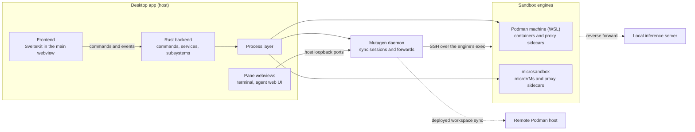

# System Overview

Sandbox-mio is a Windows-first Tauri 2 desktop app that gives each user project an isolated sandbox (a Podman container or a microsandbox microVM) holding the project's workspace, a mise-managed toolchain, a web terminal and optional AI coding agents. This document is the map: how the pieces fit, where state lives, and what the shared terms mean. Each subsystem has its own document in the [architecture index](index.md); code structure and conventions live in the `AGENTS.md` files.

## The Picture

## How the Pieces Fit

- **One host process, one window.** The Rust backend owns all state and every external call. The frontend reaches it only through Tauri commands and receives pushed state as Tauri events; there is no HTTP API.
- **Three backend layers.** Commands are thin; services sequence work across subsystems (create, teardown, routing); each subsystem wraps one concern behind a trait.
- **One process layer.** Every external binary (podman, msb, mutagen, ssh, wsl) is spawned through it. It keeps children off the app's console on Windows and is the seam the fast test tier replaces ([Testing](testing.md)).
- **No published ports.** The app reaches every in-sandbox service over SSH tunnelled through the engine's own `exec`, with Mutagen carrying workspace sync and port forwards ([Transport](transport.md)).
- **One activity center.** Long-running work (image pulls, downloads, installs, recreates) reports progress through a single task registry.

## Where State Lives

- **The workspace** is a host folder, by default one per sandbox under `Documents/sandbox-mio/`, or an existing folder chosen at create. It is visible inside the sandbox. Per-project configuration lives in it (`mise.toml` for installed tools, `.mio/` for network policy, injection rules, ports and pane configuration), so the configuration travels with the project.
- **App-global state** lives under one app-data root: settings, credential bundles, SSH keys, logs, proxy sidecar state and secret values. Every path derives from that root, which the e2e harness relocates per worktree.
- **Derivable state is never persisted.** Which engine runs a sandbox, whether it has a proxy, and whether it is deployed are recomputed from the engines and Mutagen.

## Vocabulary

| Term | Meaning |
|---|---|
| Sandbox | One project's isolated environment: a container or microVM plus its workspace |
| Provider | The engine running a sandbox, Podman or microsandbox ([Providers](providers.md)) |
| Machine | The WSL-backed Podman VM that hosts Podman sandboxes |
| Base image | The versioned image every sandbox starts from: Debian, mise, zellij and an SSH server |
| Workspace | The project folder shared between the host and the sandbox |
| Alias | An app-managed SSH host entry that reaches one sandbox through its engine's `exec` |
| Forward | A Mutagen port forward from a host loopback port into a sandbox, or the reverse |
| Sync session | A Mutagen session mirroring a workspace; one named after a sandbox means the sandbox is deployed ([Remote](remote.md)) |
| Sidecar | A sandbox's own mitmproxy instance for traffic inspection ([Network](network.md)) |
| Pane | An embedded webview showing a sandbox's terminal or agent web UI ([Workspace UI](workspace-ui.md)) |
| Activity | A long-running task shown in the activity center |

## Invariants

- Every external binary is spawned through the process layer.
- Every app-global path derives from the app-data root.
- No secret value is written into a workspace, because the workspace is visible inside the sandbox.
- A change to the base image's recipe ships with a new base-image version; an unchanged version keeps the old image.
- A control a provider cannot honour is hidden in the UI and refused by the backend.
