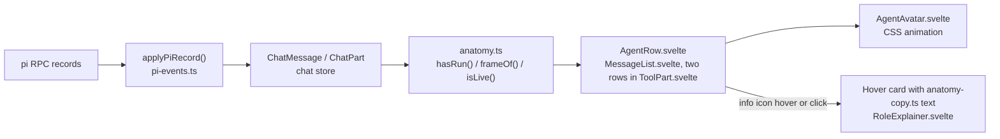

# Agent Anatomy in the Native Chat: Build Plan

This document is the build plan for `chat-agent-anatomy`, continuing [01_ideas.md](01_ideas.md): a learning mode for the native chat that shows each assistant part as a participant of a group chat, a small animated Brain or Arms avatar in a left margin with a name line and an info icon, and splits each tool call into a Brain row and an Arms row. Status: Phases A to D, H, I and J are implemented; Phases E and F were superseded by the margin-scene redesign of Phases H and I, whose scenes and outline Phase J replaced with avatars; Phase G (translations) waits for the user to approve the working feature. The tool-call record order, timings and concurrency in this plan come from the spike in [spike/01_tool-call-stream.md](spike/01_tool-call-stream.md), which recorded five local-model tool-call runs with pi 1.5.0 on 2026-11-22.

## The Concrete Model

- **One source of truth:** the chat store's `ChatState` (`src/lib/agent-chat/chat.svelte.ts`, `src/lib/agent-chat/types.ts`) stays the only state pi's records feed. Every learning-mode view derives from that state through `src/lib/agent-chat/anatomy.ts`; no learning-mode code reads raw pi records.
- **Adapter fixes:** `applyPiRecord()` in `src/lib/agent-chat/pi-events.ts` learns two things the spike showed it needs (Resolved Decision 7). It opens a tool part on `toolcall_start`, in a new `ToolState` `composing`, so the Brain's request is visible while the model writes it. It also marks a message's earlier reasoning part as no longer streaming when a later block opens, because pi holds `thinking_end` until the message ends.
- **Roles:** a reasoning part is `brain-think`, a text part `brain-reply`, and a tool part is `brain-ask` for its request band plus `arms-act` for its execution band once `hasRun()` in `anatomy.ts` is true (state `running`, `output` or `error`). `toolKindOf()` maps a tool name to the icon family of its badge (`terminal`, `read`, `edit`, `find`, or null for the generic tool icon).
- **Frames:** `frameOf()` in `anatomy.ts` reduces one part and the run state to the frame its avatar shows: `think`, `reply`, `compose` (tool state `composing`: the Brain is still writing the call), `request` (state `input` while the run is running), `asked` (the Brain row of a call the Arms have taken, so a failed execution never marks the request; `askFrameOf()`), `act` (`running`), `done` (`output`), `failed` (`error`) or `unrun` (state `input` or `composing` once the run ended). `isLive()` says whether the part is in progress: the run is `running` and the part is streaming, or a tool part is `composing`, `input` or `running`. `MessageList.svelte` passes the run state only to the newest assistant message and `idle` to older ones, so a part left unfinished by an earlier run never goes live again.
- **Learning mode:** a per-sandbox flag on the chat store, defaulted from the sandbox name and overridden by a persisted per-sandbox setting (Resolved Decisions 1 and 2). When the flag is off, the chat renders exactly as before this feature.
- **Avatar rows (Resolved Decisions 14 to 17):** in learning mode `AgentRow.svelte` lays each assistant part out as a row of a fixed 28 px margin cell and the part's content. The margin holds an `AgentAvatar.svelte` (Brain or Arms, with a corner badge for the specific act) and a thin thread in the role colour; the content cell starts with a muted name line (for example "Brain · asking for write") and the info icon of `RoleExplainer.svelte`. A tool part renders two rows. Only the live part's avatar animates, with CSS; finished parts are static. The rows scroll with the message list because they are rows of it.
- **Explainer:** hovering or focusing the info icon shows a `HoverCard` (`src/lib/components/ui/hover-card/`) with the role's title and body from `anatomy-copy.ts`; a click pins it open, so touch and keyboard users reach it too.

## Resolved Decisions

1. **Learning-mode persistence:** the toggle persists across restarts as a per-sandbox override map in `settings.json`: a new `chat_learning_mode` field (sandbox name to bool) on `AppSettings` in `src-tauri/src/settings/types.rs`, read and written through the existing `get_settings` and `set_settings` commands (`src-tauri/src/commands/app.rs`). `settings.json` already resolves through `settings_path()` in `src-tauri/src/settings/mod.rs`, which honours `MIO_SETTINGS_DIR` and `MIO_APP_DATA_DIR`, so parallel worktree e2e runs stay isolated. Browser `localStorage` was rejected because the webview's storage directory is not proven to follow the per-worktree app-data override. No persistence was rejected because a user who turned the panel off in `hello-world` would see it return on every launch.
2. **Identifying the onboarding sandbox:** learning mode defaults on for the sandbox named `FIRST_SANDBOX` (`hello-world`, `src/lib/onboarding/setup.svelte.ts`), with no separate marker. A user who hand-creates a `hello-world` sandbox gets learning mode on and can turn it off; a marker would add persisted state for no user-visible gain, because the override from Resolved Decision 1 already covers the case.
3. **Concurrent tool calls on the stage (superseded by Resolved Decision 10, which gives every tool part its own scene, and later by Resolved Decision 14):** pi runs the tool calls of one assistant message in parallel by default (spike result 4: two `bash` calls started 2 ms apart and ended in the same millisecond). One `acting` beat therefore covers every tool part that has started, until the last one ends: the arms reach into the sandbox with one tool tile per hand for up to two calls, and a "+N" count beside the hands for any beyond two. Tool calls from different assistant messages are separate beats, played in order.
4. **Explainer copy source:** explainer sentences live in a new `src/lib/agent-chat/anatomy-copy.ts`, written in the book's vocabulary (Brain, Arms, tools, sandbox) but not imported from `src/lib/onboarding/chapters/agents-and-sandboxes/copy.ts`. The chapter copy is scene copy for one chapter, and importing it would make the chat depend on onboarding chapter internals. Strings start as English literals under `TODO(i18n)` and move to Paraglide in Phase G.
5. **Reply bubble on the stage (superseded by Resolved Decision 10; the reply scene draws its own packet):** a `brain-reply` beat stays inside the stage: a reply packet (`send()` in `src/lib/story-stage/effects.ts`, class `reply`) flies from the brain to the stage's right edge and fades. Crossing into the real chat column would need overlay positioning that tracks the message list's scroll position, which is fragile for a decorative cue.
6. **Minimum beat durations (superseded by Resolved Decision 10: scenes have no beats, and a finished tool part's scene keeps its end frame, so a 7 ms call stays visible):** the driver's per-beat minimums are constants in `anatomy-driver.ts`, starting at 600 ms for `asking`, 1200 ms for `acting` and 600 ms for `returning`, then tuned by eye in Phase F. The spike measured tool executions of 7 to 90 ms and about 1 ms between `toolcall_end` and `tool_execution_start`, so without minimums the Arms would never be visible. Each tool call adds at most about 2.4 s of stage lag, and the next turn's model work (0.4 to 1 s of silent reading, then thinking) absorbs most of it; the skip-ahead rule covers the rest.
7. **Adapter changes in `pi-events.ts`:** `01_ideas.md` planned to leave `pi-events.ts` unchanged; the spike showed two adapter gaps that affect every chat user, not only learning mode, so Phase C fixes them in the adapter. First, `toolcall_start` (fields `contentIndex`, `id`, `toolName`) opens a tool part in a new `ToolState` `composing`, and `toolcall_end` fills that part's `input` and moves it to `input` instead of skipping an existing part. Second, opening a `text` or `toolCall` block marks the same message's earlier reasoning parts `streaming: false`, so "Thinking…" stops when the model has moved on; `thinking_end` still replaces the text when it arrives. Both handle documented pi events, so the adapter stays a faithful protocol mapping and roles stay in `anatomy.ts`.
8. **Errors and retries inside a run (the `retrying` beat is superseded by Resolved Decision 10; the empty errored message and its notice render as before):** a run can end an assistant message with `stopReason: "error"` and empty content, then `agent_end`, `auto_retry_start`, a new `agent_start` and the successful message, with `agent_settled` only at the very end (spike trace 02). The stage shows a `retrying` beat for that span: the brain shakes (`jolt()` in `src/lib/story-stage/effects.ts`) and the beat line reads "The connection to the Brain dropped; pi is trying again". The empty errored message and its notice keep their current rendering and get no role frame.
9. **Where the scenes live (the scenes were replaced by avatars in Resolved Decision 14; the margin placement stays):** in a left margin that is part of the scrolling message list, one scene per assistant part, aligned with that part's row, replacing the companion panel (user decision after trying Phases E and F). Each part is a grid row of a fixed-width margin cell and the part's content, so the scene scrolls with its part and needs no scroll tracking. The scenes were small compositions on a 120 x 96 board; the 28 px avatars need no widening, so the column is `max-w-3xl` again.
10. **Live and rest behaviour (still holds with avatars in place of scenes; its scene and end-frame wording is superseded by Resolved Decision 17):** the scene of the part in progress (`isLive()`) animates as its state changes; once the part finishes, its scene redraws once on the end frame and stays there. Every other scene, including all history after an attach, is drawn on its end frame without tweens, entrance animations or looping effects. No queue, beat or minimum duration exists: a scene draws its part's real state, and the persistent end frame is what makes a 7 to 90 ms tool call visible. A tool part has one scene covering both bands. A reduced-motion preference draws every scene on its end frame. Removed with the panel: the big stage, the beat line, the panel explainer, `currentBeat()`, the beat queue and the `retrying` beat.
11. **Explainer in a popover (superseded by Resolved Decision 15; the `popover` component was removed again):** the explainer copy shows in a `Popover` anchored to the clicked badge or scene, replacing the panel's explainer and `store.selected`. `popover` is listed in the root `AGENTS.md` but was absent from `src/lib/components/ui/` (as `sheet` still is), so Phase H adds it from the retro-ui-svelte registry. Each trigger owns its open state, so no selection lives on the chat store. The scene opens the popover of the part's last role, so a tool part's scene explains the Arms once they have run and the Brain's request before.
12. **The narrow-width drawer and its header button are removed.** Margin scenes need no extra width, so the `Dialog` drawer and the "Brain and Arms" header button have no purpose. The learning-mode switch stays in the header.
13. **A `composing` tool part reads differently from `input`:** the Brain's avatar shows typing dots and its name line reads "Brain · writing a request…" with the running indicator on the tool line, while `input` reads "Brain · asking for <tool>" with "· waiting to run" beside the tool name. Once the run ended, a `composing` part reads as asked but not run. A local model can take a long time to write a call, and a wait that looks identical to a finished request looks stuck.
14. **Avatars replace the margin scenes:** each assistant part gets a 28 px circular avatar in the margin, like a participant in a group chat where every participant is the same agent with a different responsibility. Brain roles use the `--brain` token with the lucide `Brain` icon, Arms uses `--arms` with `Hand`. A small corner badge names the act: three dots for thinking and for composing a request, `MessageCircle` for a reply, and the tool's icon for asking and acting (`SquareTerminal` for terminal, `FilePen` for edit, `FileText` for read, `Search` for find, `Wrench` for any other tool). A muted name line sits beside it ("Brain · thinking", "Brain · asking for write", "Brain · writing a request…", "Arms · running write", "Arms · ran write", "Brain · reply"). The scenes were rejected as too heavy: a boxed image per part cluttered a chat that is mostly text. The chat no longer mounts the stage engine, and the onboarding book is its only consumer. The generalisations added for the chat stay in `src/lib/story-stage/` for reuse: the board size option, `retract()`, `carry()` and `carryCount()`, the `.story-stage.live` rules and the `--s-brain` and `--s-arms` tokens. Only the `.story-stage.mini` rules and the instant `reach()` planned for the scenes were never built.
15. **Info icon with a hover card:** the name line ends with a small lucide `Info` icon button. Hover or keyboard focus shows the explainer in the existing `hover-card`; a click pins it open until a second click, Escape or an outside click (the click sets `open` itself, because the primitive ignores touch hover), so touch works too. The button also carries the body as a screen-reader description, since the portalled card is out of reach of assistive tech. `RoleExplainer.svelte` owns the icon, the open and pinned state, and the card content. The `popover` component added in Phase H became unused and was deleted.
16. **A thin thread replaces the outline and badge:** `RoleFrame.svelte` (dashed outline plus corner badge) is deleted. A 2 px line in the role colour at low opacity runs down the margin under each avatar, so consecutive rows of a tool part read as one thread, and row alignment between margin and content is structural (one grid row).
17. **Animation is CSS only, for the live part only:** a thinking avatar's three-dot badge bounces; a composing one shows typing dots (a fade chase); a running tool shows a pulsing ring around the Arms avatar; a streaming reply pulses its bubble badge gently. A part at rest is static, so history never replays. Everything sits inside `prefers-reduced-motion: no-preference`; this is the one place a component carries its own reduced-motion query, because the central tokens only drop movement from transitions and these are infinite keyframes. A tool part has the Brain row from `toolcall_start` and gets the Arms row from `running`; a call still in `input` or `composing` after the run ended shows "Asked, but not run" in place of the Arms row.

## Implemented: Phase A — Move the stage engine and parameterise the board

Pure refactor; the onboarding book must look and behave exactly as before.

- Move `src/lib/onboarding/stage/` (every file, including `stage.css`) to `src/lib/story-stage/` with `git mv`.
- Update the importers to `$lib/story-stage`: `src/lib/onboarding/book/context.svelte.ts`, `book/index.ts`, `book/Page.svelte`, `book/Stage.svelte`, and `chapters/agents-and-sandboxes/act1.scenes.ts` to `act5.scenes.ts` and `copy.ts`.
- `createStage()` in `src/lib/story-stage/index.ts` and `StageOptions` in `src/lib/story-stage/core.ts` gain an optional board size (width and height, default 1000 x 440). `createBoard()` in `src/lib/story-stage/board.ts` parks hidden actors at the centre of the given board instead of the fixed `translate(500px,220px)`.
- `src/lib/onboarding/book/Stage.svelte` keeps its `viewBox="0 0 1000 440"` and passes no size.
- `src/lib/story-stage/AGENTS.md` now holds with the "Writing a scene" section and the stage-specific rows of the Common Gotchas table moved from `src/lib/onboarding/AGENTS.md`; leave the book, chapter and setup material in `src/lib/onboarding/AGENTS.md` and point its layout table at `src/lib/story-stage/`.
- Update the root `AGENTS.md` repo-map row for `onboarding-story/` if it names the old stage path.
- Verify: `pnpm check`; open `/intro` and step through every page; `./build e2e light` for `e2e/test/specs/light/onboarding-story-ui.spec.ts`.

## Implemented: Phase B — A tool-call trace in the mock agent host

Gives the `light` tier and day-to-day development under `MIO_MOCK_BACKEND=1` tool calls to render, from the spike's recordings.

- Add `src-tauri/src/agent_host/fixtures/06-toolcall.jsonl` and `07-parallel-tools.jsonl`, converted from `docs/features/chat-agent-anatomy/spike/traces/01-list-files.jsonl` and `03-parallel.jsonl`: keep each line's `record` and drop the spike's `ms` wrapper, matching the bare-record format of the existing fixtures. The traces already hold the redacted model id in `responseModel`.
- In `src-tauri/src/agent_host/mock.rs`: `TOOL_TRIGGER` and `PARALLEL_TOOLS_TRIGGER` constants next to `DIALOG_TRIGGER`, matched in the `"prompt"` arm of `handle()`; `include_str!` both fixtures; drop each fixture's `response` record and answer the prompt with `disposition: "started"`, as the round-trip branch does; push the user message, then every assistant and `toolResult` message the fixture's `message_end` records carry, onto `sb.history`, so a re-attach through `get_messages` rebuilds the same parts through `messagesFromHistory()`.
- Replay the tool-call records with a longer delay than `RECORD_DELAY` before `tool_execution_end`, so the running state is visible long enough for a spec to observe.
- Verify: `cargo check`; open a mock chat, send a prompt containing each trigger, and confirm one and then two `bash` tool parts render and settle.

## Implemented: Phase C — Adapter fixes, anatomy classifier and learning mode state

- `src/lib/agent-chat/types.ts`: add `composing` to `ToolState`.
- `src/lib/agent-chat/pi-events.ts`, `applyUpdate()` (Resolved Decision 7): a `toolcall_start` case opens a tool part at the event's `contentIndex` with `toolCallId` from `id`, `toolName`, empty `input` and state `composing`; the `toolcall_end` case updates the part already open at that `contentIndex` (or found by `findTool()`) with the complete `arguments` and state `input`, and opens one only when none exists. The `text_start` and `toolcall_start` cases mark every earlier `reasoning` part of the streaming message `streaming: false`. `assistantParts()` keeps shown tool parts by id, so `message_end` does not reset a `composing` or `running` part.
- `src/lib/agent-chat/ToolPart.svelte`: map state `composing` to the `pending` trace status, as `input` is today.
- New `src/lib/agent-chat/anatomy.ts`: the `Role`, `Beat` and `BeatKind` types (the beat pieces were removed again in Phase H); `rolesOf()` (a part's roles: a tool part gives `brain-ask` plus `arms-act` once it runs; replaced by `hasRun()` in Phase J), `toolKindOf()` (`bash` → `terminal`, `read` → `read`, `edit` and `write` → `edit`, `grep`, `find` and `ls` → `find`, otherwise null for a generic tile) and `currentBeat()`, which reads the newest opened part of the newest assistant message and never the `streaming` flags. Pure, no Svelte runes, no IO.
- `src-tauri/src/settings/types.rs`: add `chat_learning_mode: BTreeMap<String, bool>` to `AppSettings` with a doc comment; `#[serde(default)]` on the struct already covers settings files written before the field.
- New `src/lib/agent-chat/learning.svelte.ts`: a module-scoped store that loads the override map once through `get_settings`, answers `learningMode(sandbox)` (override, else `sandbox === FIRST_SANDBOX`), and writes a change by round-tripping the whole settings object through `set_settings`, as `writeCompleted()` in `src/lib/settings/onboarding.svelte.ts` does.
- `src/lib/agent-chat/chat.svelte.ts`: the `ChatStore` gains a `learning` getter backed by `learning.svelte.ts`, plus a `selected` field and `epoch` counter that Phase H removed.
- `src/lib/agent-chat/ChatHeader.svelte`: a learning-mode toggle (`switch` from `src/lib/components/ui/switch/`, labelled "Show the Brain and Arms"), with a `data-chat-learning` attribute carrying the current value.
- `src/lib/agent-chat/ChatView.svelte`: expose `data-learning` on the root element.
- Verify: `cargo check`; `pnpm check`; `./build e2e light` for `e2e/test/specs/light/agent-chat-ui.spec.ts`, since the adapter changed; with learning mode off, the Phase B traces show a tool part from `toolcall_start` on and "Thought" (not "Thinking…") once the tool request or reply starts; the toggle survives an app restart under the e2e app-data directory.

## Implemented: Phase D — Annotated messages

- `src/app.css`: add Brain and Arms colour tokens (and their foregrounds) for light and dark mode, registered as Tailwind theme colours like the existing tokens. `src/lib/story-stage/stage.css` mirrors the light values as `--s-brain` and `--s-arms`, with a comment at both ends naming the other file.
- New `src/lib/agent-chat/RoleFrame.svelte`: wraps children in a role-coloured outline with a corner badge button ("Brain · thinking", "Brain · reply", "Brain · asks", "Arms · terminal"). Clicking the badge toggled the store's `selected` (Phase H moves this to a popover); a selected frame shows a stronger outline. Attributes: `data-role-frame` (the role) and `data-selected`.
- `src/lib/agent-chat/MessageList.svelte`: in learning mode, wrap reasoning and text parts in `RoleFrame`; tool parts render their own bands. `MessageList` receives the store (or `learning`, `selected` and a select callback) instead of only `messages`.
- `src/lib/agent-chat/ReasoningPart.svelte`: accept an `open` prop bound to the collapsible, so selecting a `brain-think` badge expands the reasoning (removed in Phase H).
- `src/lib/agent-chat/ToolPart.svelte`: in learning mode, render the Brain band (`data-tool-band="ask"`: "Brain is asking for: <tool>" while `composing`, then "Brain asked: <tool>" plus the existing summary) and, once the state is `running`, `output` or `error`, the Arms band (`data-tool-band="act"`: running indicator, then the existing per-tool output body). A part still in state `input` after the run settles shows "Asked, but not run". Outside learning mode the existing single `Trace` markup is untouched. Leave room in the band header for the MCP badge planned by `chat-mcp-learning` ([01_ideas.md](../chat-mcp-learning/01_ideas.md)).
- Verify: `pnpm check`; mock chat with `TOOL_TRIGGER` shows both bands; dark mode legible; learning mode off renders as before.

## Superseded: Phase E — Companion panel and explainer

Built as a left companion panel (`AnatomyPanel.svelte`: live stage, beat line, explainer for the selected part) that collapsed into a left-anchored `Dialog` drawer opened from a "Brain and Arms" header button below 896 px. The user tried it and replaced it with the margin scenes of Phase H. `anatomy-copy.ts` survives, trimmed to the role copy the popover shows. `AnatomyPanel.svelte`, the drawer and the header button are deleted; do not reintroduce a panel or a second mounting point for the scene.

## Superseded: Phase F — Live stage and driver

Built as one large portrait stage (`LiveStage.svelte`) fed by a beat queue (`anatomy-driver.ts`, `currentBeat()` in `anatomy.ts`) with per-beat minimum durations, the `carry()` and `carryCount()` helpers in `src/lib/story-stage/arms.ts`, and a `.story-stage.live` rule set in `stage.css`. Replaced by Phase H: a single shared stage had to queue and delay beats to make 7 to 90 ms tool calls visible, while per-part scenes keep their end frame. The chat code is deleted; the engine additions (`carry()`, `carryCount()`, the `.story-stage.live` rules and the Phase A board size option) stay in `src/lib/story-stage/` unused.

## Superseded in part: Phase H — Margin scenes and popover explainer

Phase J replaced the scenes, `RoleFrame.svelte` and the popover described below with avatars, a thread line and a hover card. What survives: the `frameOf()` and `isLive()` classifier, the deletion of the panel pieces, the row-per-part layout and the removal of `selected` and `epoch`. `mini-scene.ts`, `MiniScene.svelte`, `RoleFrame.svelte`, the `popover` component and the `.story-stage.mini` rules no longer exist.

- `src/lib/components/ui/popover/`: added from the retro-ui-svelte registry (`pnpm dlx shadcn-svelte@latest add https://retroui-svelte.netlify.app/r/popover.json`; its dependency-install step fails in this workspace root and is not needed, `bits-ui` is already present); Resolved Decision 11.
- `src/lib/agent-chat/anatomy.ts`: delete `Beat`, `BeatKind`, `currentBeat()` and `sameBeat()`; add `Frame`, `frameOf(part, run)` and `isLive(part, run)` (the concrete model lists the frames). Pure, no Svelte runes.
- New `src/lib/agent-chat/mini-scene.ts`: `createMiniScene(svg, toolKind)` builds a stage on a 120 x 96 board with only `brain` placed, plus one tool tile in `layers.fxBack` for a tool part, and returns `show(frame, animate)` and `dispose()`. `show()` calls `cancelAll()`, then draws the frame: `think` draws a thought bubble, plus a pulsing Brain when animated; `reply` sends a reply packet repeatedly when animated and otherwise shows a resting reply pill; `compose` pulses the Brain beside a faded tile; `request` shows the tile lit; `act` reaches the hands onto the tile and taps (`reach()`, `typing()`); `done` marks the tile used with the arms home; `failed` gives the tile a red outline; `unrun` dims the tile. A non-animated draw uses `reach(..., 0)` and no entrance classes.
- New `src/lib/agent-chat/RoleExplainer.svelte`: the popover content (title and body from `ROLE_COPY`) shared by `RoleFrame.svelte` and `MiniScene.svelte`.
- New `src/lib/agent-chat/MiniScene.svelte`: imports `src/lib/story-stage/stage.css`; renders a `<button>` (the `Popover` trigger) holding a `` around the `<svg>`; mounts `createMiniScene()` once, redraws from a `$effect` on `frameOf()`, animating only while `isLive()` and `prefers-reduced-motion` is off, and disposes on unmount. Attributes: `data-mini-scene` (part type), `data-scene-frame`, `data-scene-live`. Its popover content shows `ROLE_COPY` for `rolesOf(part).at(-1)`.
- `src/lib/story-stage/stage.css`: replace the `.story-stage.live` rules with a `.story-stage.mini` rule set (border, no actor transitions, labels hidden, animations off when the section carries `rest`, a `.tile.bad` outline). `src/lib/story-stage/arms.ts`: `carry()` and `carryCount()` were planned for deletion, but stay in the engine for reuse.
- `src/lib/agent-chat/RoleFrame.svelte`: the badge becomes a `Popover.Trigger` whose content is the role's `ROLE_COPY` entry; the frame keeps its own open state for the stronger outline and takes no `onselect`.
- `src/lib/agent-chat/MessageList.svelte`: in learning mode wrap each assistant part (reasoning, text, tool) in a two-column row with `MiniScene` in the margin cell and widen the column to `max-w-4xl`; stop passing `selected` and `onselect`. `ReasoningPart.svelte` loses its `open` prop. `ToolPart.svelte` loses `selectedRole` and `onselect`.
- `src/lib/agent-chat/chat.svelte.ts`: delete `PartSelection`, `selected` and `epoch`. `src/lib/agent-chat/ChatView.svelte`: delete the grid, `AnatomyPanel` column, the drawer, `paneWidth` and the `Dialog` import. `src/lib/agent-chat/ChatHeader.svelte`: delete `onOpenAnatomy` and its button; keep the switch.
- `src/lib/agent-chat/anatomy-copy.ts`: keep `ROLE_COPY` and `ARMS_WORDS`; delete `INTRO`, `roleForBeat()` and `beatLine()`. Delete `AnatomyPanel.svelte`, `LiveStage.svelte` and `anatomy-driver.ts`.
- Docs: `docs/architecture/workspace-ui.md`, `src/lib/story-stage/AGENTS.md`, `src/AGENTS.md`, `04_improvements.md` (drop the entries the redesign makes moot).
- Verify: `pnpm check`; `./build e2e light`; a mock chat with `/spiketool` and `/spikeparallel` shows one scene per part, aligned with its row, the running part animating and finished parts resting. Checked with a throwaway light spec that took screenshots (the dark theme at 1200 x 900): scenes sit beside their rows, the running tool scene has the hands on the tile, finished scenes show the used tile and the reply pill, and a click opens the popover.

## Implemented: Phase I — A composing tool part reads differently

Part of the same redesign, listed apart because it is a wording change in the tool band. In `src/lib/agent-chat/ToolPart.svelte` the learning-mode Brain band reads "Brain is still writing the request for: <tool>" with the running indicator while `composing`, and "Brain asked: <tool> · waiting to run" while `input` (wording superseded by Resolved Decision 13). Outside learning mode the trace line is unchanged.

- Verify: the mock agent's `composing` state lasts a few milliseconds, so the wording is verified by reading the component against the state table, not by eye.

## Implemented: Phase J — Avatar rows

Refines the margin of Phase H (Resolved Decisions 14 to 17) to cut clutter while keeping the aligned margin the user liked.

- New `src/lib/agent-chat/AgentAvatar.svelte`: the 28 px disc, icon, badge and the CSS animations; attributes `data-agent-avatar` (role), `data-avatar-frame`, `data-avatar-live`.
- New `src/lib/agent-chat/AgentRow.svelte`: the grid row (avatar and thread in the margin, name line with the info icon above the content), or without a `role` an empty margin cell that aligns notices and the "Asked, but not run" line; attributes `data-part-row`, `data-row-role`, `data-row-frame`, `data-row-live`, `data-agent-label`.
- `src/lib/agent-chat/RoleExplainer.svelte`: now the info icon button plus its hover card, pinned by click (`data-anatomy-info`, `data-anatomy-explainer`, `data-explainer-role`).
- `src/lib/agent-chat/anatomy-copy.ts`: `ROLE_COPY` stays; `avatarLabel()` builds the name line; `ARMS_WORDS` is deleted. `src/lib/agent-chat/anatomy.ts` owns `ToolKind` now, so the chat no longer imports from `src/lib/story-stage/`.
- `src/lib/agent-chat/ToolPart.svelte` renders the Brain row and the Arms row with `AgentRow` and takes the run state (`run`) instead of `settled`; `MessageList.svelte` wraps reasoning and text parts in `AgentRow`.
- Deleted: `MiniScene.svelte`, `mini-scene.ts`, `RoleFrame.svelte`, `src/lib/components/ui/popover/`, and `rolesOf()`. The stage engine additions listed in Resolved Decision 14 stay in the engine.
- Verify: `pnpm check`; `./build e2e light`; `./build docs`; a throwaway light spec with `/spiketool`, `/spikeparallel` and `/spiketool` took screenshots in dark and light themes and at a narrow width: avatars align with their rows, only the live part animates, and the info icon shows the card on hover and pins it on click.

## Remaining: Phase G — Translations

Runs only after the user approves the working feature, per the `feature-implement` skill.

- Move every `TODO(i18n)` literal added by Phases C to J (`ChatHeader.svelte`, `RoleExplainer.svelte`, `ToolPart.svelte`, `anatomy-copy.ts`) into `messages/en.json` under `agent_chat_anatomy_*` keys, then mirror the keys in `messages/de.json` and `messages/ru.json`. These are chat strings, so they go in the main message files, not `messages/onboarding/`.
- Stage labels drawn by `src/lib/story-stage/` stay under the onboarding translation pass (Phase F of `docs/features/onboarding-story/02_dev.md`).

## Cross-Cutting Concerns

- **State derivation:** frames, roles, labels and explainer copy are always derived from `ChatState`; an avatar holds no state of its own. A reconnect that replays journal records therefore rebuilds the same view.
- **Cost:** every assistant part mounts one avatar, a handful of elements. Animation is CSS on the live part alone, so no timer or script runs.
- **Parallel worktrees:** the feature adds no host port, host-global resource, bundled binary, harness environment variable or teardown. The only new persisted state is the `chat_learning_mode` field inside `settings.json`, whose path already follows `MIO_SETTINGS_DIR` and `MIO_APP_DATA_DIR`.
- **Stale overrides:** a destroyed sandbox's entry in `chat_learning_mode` is kept, so a new sandbox reusing the name inherits the old toggle. The entry is a single bool and is not pruned.
- **Testability:** every learning-mode element carries a `data-*` attribute named in its phase, for the specs `03_e2e.md` will define against the Phase B trace.

## Common Gotchas

| Gotcha | Cause | Fix |
|---|---|---|
| Onboarding scenes fail to compile after Phase A with "Cannot find module '../../stage'" | The stage engine moved from `src/lib/onboarding/stage/` to `src/lib/story-stage/` and a relative import was missed | Import from `$lib/story-stage` in every book component and every `act*.scenes.ts` file |
| Turning learning mode off in one sandbox resets other app settings | `set_settings` in `src-tauri/src/commands/app.rs` replaces the whole `settings.json`, and a partial object was written | Round-trip the full settings object through `get_settings` before `set_settings`, as `writeCompleted()` in `src/lib/settings/onboarding.svelte.ts` does |
| Role colours are unreadable in dark mode | The `--s-*` tokens in `src/lib/story-stage/stage.css` are light-only because the board is a whiteboard | Use the Brain and Arms tokens from `src/app.css`, defined for both themes, for chat avatars and threads |
| A tool box shows "Asked, but not run" for a call that did run | The tool part opened at `toolcall_start` and the part `tool_execution_start` updated were different parts, because `toolcall_end` opened a second part instead of updating the first | In `applyUpdate()` (`src/lib/agent-chat/pi-events.ts`), update the part already open at the event's `contentIndex` on `toolcall_end`; pi uses one id for `toolcall_start`'s `id`, `toolCall.id` and `toolCallId` |
| "Thinking…" stays on while the reply is already streaming | pi 1.5.0 sends `thinking_end` only at the end of the message, together with the final `text_end` or `toolcall_end` (`docs/features/chat-agent-anatomy/spike/01_tool-call-stream.md`) | Mark earlier reasoning parts `streaming: false` when `text_start` or `toolcall_start` opens a later block, in `applyUpdate()` (`src/lib/agent-chat/pi-events.ts`) |
| Opening a long chat replays every past tool call, or a finished avatar keeps pulsing | An animation was attached to the avatar regardless of the part's state | Animate only under the `live` class of `AgentAvatar.svelte`, which comes from `isLive()`; a part at rest has no animation rule |
| A tool call that took 7 ms never shows its Arms | The Arms row was drawn only while the tool ran | Derive the rows from the part's state: the Arms row stays once the state is `running`, `output` or `error` |
| A pinned info card closes when the pointer leaves it | The primitive writes `open = false` on pointer leave, and a parent-owned `open` prop that did not change never overrides that local write | Bind `open` and re-open it from `onOpenChange` while pinned, as `RoleExplainer.svelte` does; Escape and an outside click (not the trigger's own click) clear the pin |
| The run looks finished while pi is still retrying | A retry ends with `agent_end`, then starts again with `agent_start`; only `agent_settled` marks the true end | Keep run state on `agent_settled` as `src/lib/agent-chat/pi-events.ts` does, so `isLive()` stays true through the retry |
