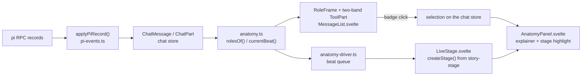

# Agent Anatomy in the Native Chat: Build Plan

This document is the build plan for `chat-agent-anatomy`, continuing [01_ideas.md](01_ideas.md): a learning mode for the native chat that outlines each assistant part as Brain or Arms, splits each tool call into a Brain band and an Arms band, and plays a live brain-and-arms stage in a companion panel left of the messages. Status: Phases A to F are implemented; Phase G (translations) waits for the user to approve the working feature. The tool-call record order, timings and concurrency in this plan come from the spike in [spike/01_tool-call-stream.md](spike/01_tool-call-stream.md), which recorded five local-model tool-call runs with pi 1.5.0 on 2026-11-22.

## The Concrete Model

- **One source of truth:** the chat store's `ChatState` (`src/lib/agent-chat/chat.svelte.ts`, `src/lib/agent-chat/types.ts`) stays the only state pi's records feed. Every learning-mode view derives from that state through `src/lib/agent-chat/anatomy.ts`; no learning-mode code reads raw pi records.
- **Adapter fixes:** `applyPiRecord()` in `src/lib/agent-chat/pi-events.ts` learns two things the spike showed it needs (Resolved Decision 7). It opens a tool part on `toolcall_start`, in a new `ToolState` `composing`, so the Brain's request is visible while the model writes it. It also marks a message's earlier reasoning part as no longer streaming when a later block opens, because pi holds `thinking_end` until the message ends.
- **Roles:** `rolesOf()` in `anatomy.ts` maps a reasoning part to `brain-think`, a text part to `brain-reply`, and a tool part to `brain-ask` for its request band plus `arms-act` for its execution band once its state is `running`, `output` or `error`. `toolKindOf()` maps a tool name to a stage `ToolKind`.
- **Beats:** `currentBeat()` in `anatomy.ts` reduces the newest assistant message and the run state to one beat, read from the newest opened part rather than from `streaming` flags: `idle`; `thinking` (from the assistant `message_start` on, which covers the silent prompt-reading gap, and while a reasoning part is newest); `asking` (a tool part in state `composing` or `input`); `acting` (one or more tool parts `running`); `returning` (tool parts that just reached `output` or `error`); `replying` (a text part is newest); or `retrying` (the newest assistant message ended in error and the run is still running). A beat carries the tool kinds and tool call ids of every tool part involved.
- **Learning mode:** a per-sandbox flag on the chat store, defaulted from the sandbox name and overridden by a persisted per-sandbox setting (Resolved Decisions 1 and 2). When the flag is off, the chat renders exactly as before this feature.
- **Annotated messages:** `MessageList.svelte` wraps each assistant part in `RoleFrame.svelte` (outline plus clickable badge). `ToolPart.svelte` renders the Brain band and, from `tool_execution_start` on, the Arms band.
- **Companion panel:** `ChatView.svelte` becomes a two-column grid in learning mode, with `AnatomyPanel.svelte` on the left. The panel holds `LiveStage.svelte`, a beat line, and the explainer for the selected part. Below a container width the panel collapses into a `sheet` opened from the chat header.
- **Live stage:** `LiveStage.svelte` mounts `createStage()` from the relocated engine in `src/lib/story-stage/` on a portrait board. `src/lib/agent-chat/anatomy-driver.ts` queues beats and plays each with a minimum duration through stage helpers, cancelling with `cancelAll()` when it skips ahead.

## Resolved Decisions

1. **Learning-mode persistence:** the toggle persists across restarts as a per-sandbox override map in `settings.json`: a new `chat_learning_mode` field (sandbox name to bool) on `AppSettings` in `src-tauri/src/settings/types.rs`, read and written through the existing `get_settings` and `set_settings` commands (`src-tauri/src/commands/app.rs`). `settings.json` already resolves through `settings_path()` in `src-tauri/src/settings/mod.rs`, which honours `MIO_SETTINGS_DIR` and `MIO_APP_DATA_DIR`, so parallel worktree e2e runs stay isolated. Browser `localStorage` was rejected because the webview's storage directory is not proven to follow the per-worktree app-data override. No persistence was rejected because a user who turned the panel off in `hello-world` would see it return on every launch.
2. **Identifying the onboarding sandbox:** learning mode defaults on for the sandbox named `FIRST_SANDBOX` (`hello-world`, `src/lib/onboarding/setup.svelte.ts`), with no separate marker. A user who hand-creates a `hello-world` sandbox gets learning mode on and can turn it off; a marker would add persisted state for no user-visible gain, because the override from Resolved Decision 1 already covers the case.
3. **Concurrent tool calls on the stage:** pi runs the tool calls of one assistant message in parallel by default (spike result 4: two `bash` calls started 2 ms apart and ended in the same millisecond). One `acting` beat therefore covers every tool part that has started, until the last one ends: the arms reach into the sandbox with one tool tile per hand for up to two calls, and a "+N" count beside the hands for any beyond two. Tool calls from different assistant messages are separate beats, played in order.
4. **Explainer copy source:** explainer sentences live in a new `src/lib/agent-chat/anatomy-copy.ts`, written in the book's vocabulary (Brain, Arms, tools, sandbox) but not imported from `src/lib/onboarding/chapters/agents-and-sandboxes/copy.ts`. The chapter copy is scene copy for one chapter, and importing it would make the chat depend on onboarding chapter internals. Strings start as English literals under `TODO(i18n)` and move to Paraglide in Phase G.
5. **Reply bubble on the stage:** a `brain-reply` beat stays inside the stage: a reply packet (`send()` in `src/lib/story-stage/effects.ts`, class `reply`) flies from the brain to the stage's right edge and fades. Crossing into the real chat column would need overlay positioning that tracks the message list's scroll position, which is fragile for a decorative cue.
6. **Minimum beat durations:** the driver's per-beat minimums are constants in `anatomy-driver.ts`, starting at 600 ms for `asking`, 1200 ms for `acting` and 600 ms for `returning`, then tuned by eye in Phase F. The spike measured tool executions of 7 to 90 ms and about 1 ms between `toolcall_end` and `tool_execution_start`, so without minimums the Arms would never be visible. Each tool call adds at most about 2.4 s of stage lag, and the next turn's model work (0.4 to 1 s of silent reading, then thinking) absorbs most of it; the skip-ahead rule covers the rest.
7. **Adapter changes in `pi-events.ts`:** `01_ideas.md` planned to leave `pi-events.ts` unchanged; the spike showed two adapter gaps that affect every chat user, not only learning mode, so Phase C fixes them in the adapter. First, `toolcall_start` (fields `contentIndex`, `id`, `toolName`) opens a tool part in a new `ToolState` `composing`, and `toolcall_end` fills that part's `input` and moves it to `input` instead of skipping an existing part. Second, opening a `text` or `toolCall` block marks the same message's earlier reasoning parts `streaming: false`, so "Thinking…" stops when the model has moved on; `thinking_end` still replaces the text when it arrives. Both handle documented pi events, so the adapter stays a faithful protocol mapping and roles stay in `anatomy.ts`.
8. **Errors and retries inside a run:** a run can end an assistant message with `stopReason: "error"` and empty content, then `agent_end`, `auto_retry_start`, a new `agent_start` and the successful message, with `agent_settled` only at the very end (spike trace 02). The stage shows a `retrying` beat for that span: the brain shakes (`jolt()` in `src/lib/story-stage/effects.ts`) and the beat line reads "The connection to the Brain dropped; pi is trying again". The empty errored message and its notice keep their current rendering and get no role frame.

## Implemented: Phase A — Move the stage engine and parameterise the board

Pure refactor; the onboarding book must look and behave exactly as before.

- Move `src/lib/onboarding/stage/` (every file, including `stage.css`) to `src/lib/story-stage/` with `git mv`.
- Update the importers to `$lib/story-stage`: `src/lib/onboarding/book/context.svelte.ts`, `book/index.ts`, `book/Page.svelte`, `book/Stage.svelte`, and `chapters/agents-and-sandboxes/act1.scenes.ts` to `act5.scenes.ts` and `copy.ts`.
- `createStage()` in `src/lib/story-stage/index.ts` and `StageOptions` in `src/lib/story-stage/core.ts` gain an optional board size (width and height, default 1000 x 440). `createBoard()` in `src/lib/story-stage/board.ts` parks hidden actors at the centre of the given board instead of the fixed `translate(500px,220px)`.
- `src/lib/onboarding/book/Stage.svelte` keeps its `viewBox="0 0 1000 440"` and passes no size.
- `src/lib/story-stage/AGENTS.md` now holds with the "Writing a scene" section and the stage-specific rows of the Common Gotchas table moved from `src/lib/onboarding/AGENTS.md`; leave the book, chapter and setup material in `src/lib/onboarding/AGENTS.md` and point its layout table at `src/lib/story-stage/`.
- Update the root `AGENTS.md` repo-map row for `onboarding-story/` if it names the old stage path.
- Verify: `pnpm check`; open `/intro` and step through every page; `./build e2e light` for `e2e/test/specs/light/onboarding-story-ui.spec.ts`.

## Implemented: Phase B — A tool-call trace in the mock agent host

Gives the `light` tier and day-to-day development under `MIO_MOCK_BACKEND=1` tool calls to render, from the spike's recordings.

- Add `src-tauri/src/agent_host/fixtures/06-toolcall.jsonl` and `07-parallel-tools.jsonl`, converted from `docs/features/chat-agent-anatomy/spike/traces/01-list-files.jsonl` and `03-parallel.jsonl`: keep each line's `record` and drop the spike's `ms` wrapper, matching the bare-record format of the existing fixtures. The traces already hold the redacted model id in `responseModel`.
- In `src-tauri/src/agent_host/mock.rs`: `TOOL_TRIGGER` and `PARALLEL_TOOLS_TRIGGER` constants next to `DIALOG_TRIGGER`, matched in the `"prompt"` arm of `handle()`; `include_str!` both fixtures; drop each fixture's `response` record and answer the prompt with `disposition: "started"`, as the round-trip branch does; push the user message, then every assistant and `toolResult` message the fixture's `message_end` records carry, onto `sb.history`, so a re-attach through `get_messages` rebuilds the same parts through `messagesFromHistory()`.
- Replay the tool-call records with a longer delay than `RECORD_DELAY` before `tool_execution_end`, so the running state is visible long enough for a spec to observe.
- Verify: `cargo check`; open a mock chat, send a prompt containing each trigger, and confirm one and then two `bash` tool parts render and settle.

## Implemented: Phase C — Adapter fixes, anatomy classifier and learning mode state

- `src/lib/agent-chat/types.ts`: add `composing` to `ToolState`.
- `src/lib/agent-chat/pi-events.ts`, `applyUpdate()` (Resolved Decision 7): a `toolcall_start` case opens a tool part at the event's `contentIndex` with `toolCallId` from `id`, `toolName`, empty `input` and state `composing`; the `toolcall_end` case updates the part already open at that `contentIndex` (or found by `findTool()`) with the complete `arguments` and state `input`, and opens one only when none exists. The `text_start` and `toolcall_start` cases mark every earlier `reasoning` part of the streaming message `streaming: false`. `assistantParts()` keeps shown tool parts by id, so `message_end` does not reset a `composing` or `running` part.
- `src/lib/agent-chat/ToolPart.svelte`: map state `composing` to the `pending` trace status, as `input` is today.
- New `src/lib/agent-chat/anatomy.ts`: the `Role`, `Beat` and `BeatKind` types; `rolesOf()` (a part's roles: a tool part gives `brain-ask` plus `arms-act` once it runs), `toolKindOf()` (`bash` → `terminal`, `read` → `read`, `edit` and `write` → `edit`, `grep`, `find` and `ls` → `find`, otherwise null for a generic tile) and `currentBeat()`, which reads the newest opened part of the newest assistant message and never the `streaming` flags. Pure, no Svelte runes, no IO.
- `src-tauri/src/settings/types.rs`: add `chat_learning_mode: BTreeMap<String, bool>` to `AppSettings` with a doc comment; `#[serde(default)]` on the struct already covers settings files written before the field.
- New `src/lib/agent-chat/learning.svelte.ts`: a module-scoped store that loads the override map once through `get_settings`, answers `learningMode(sandbox)` (override, else `sandbox === FIRST_SANDBOX`), and writes a change by round-tripping the whole settings object through `set_settings`, as `writeCompleted()` in `src/lib/settings/onboarding.svelte.ts` does.
- `src/lib/agent-chat/chat.svelte.ts`: the `ChatStore` gains a `selected` field (the selected part's message id, part index and role, or null; a tool part has one badge per band) and a `learning` getter backed by `learning.svelte.ts`. Selection is cleared when the message list is rebuilt on attach.
- `src/lib/agent-chat/ChatHeader.svelte`: a learning-mode toggle (`switch` from `src/lib/components/ui/switch/`, labelled "Show the Brain and Arms"), with a `data-chat-learning` attribute carrying the current value.
- `src/lib/agent-chat/ChatView.svelte`: expose `data-learning` on the root element.
- Verify: `cargo check`; `pnpm check`; `./build e2e light` for `e2e/test/specs/light/agent-chat-ui.spec.ts`, since the adapter changed; with learning mode off, the Phase B traces show a tool part from `toolcall_start` on and "Thought" (not "Thinking…") once the tool request or reply starts; the toggle survives an app restart under the e2e app-data directory.

## Implemented: Phase D — Annotated messages

- `src/app.css`: add Brain and Arms colour tokens (and their foregrounds) for light and dark mode, registered as Tailwind theme colours like the existing tokens. `src/lib/story-stage/stage.css` mirrors the light values as `--s-brain` and `--s-arms`, with a comment at both ends naming the other file.
- New `src/lib/agent-chat/RoleFrame.svelte`: wraps children in a role-coloured outline with a corner badge button ("Brain · thinking", "Brain · reply", "Brain · asks", "Arms · terminal"). Clicking the badge toggles the store's `selected`; a selected frame shows a stronger outline. Attributes: `data-role-frame` (the role) and `data-selected`.
- `src/lib/agent-chat/MessageList.svelte`: in learning mode, wrap reasoning and text parts in `RoleFrame`; tool parts render their own bands. `MessageList` receives the store (or `learning`, `selected` and a select callback) instead of only `messages`.
- `src/lib/agent-chat/ReasoningPart.svelte`: accept an `open` prop bound to the collapsible, so selecting a `brain-think` badge expands the reasoning.
- `src/lib/agent-chat/ToolPart.svelte`: in learning mode, render the Brain band (`data-tool-band="ask"`: "Brain is asking for: <tool>" while `composing`, then "Brain asked: <tool>" plus the existing summary) and, once the state is `running`, `output` or `error`, the Arms band (`data-tool-band="act"`: running indicator, then the existing per-tool output body). A part still in state `input` after the run settles shows "Asked, but not run". Outside learning mode the existing single `Trace` markup is untouched. Leave room in the band header for the MCP badge planned by `chat-mcp-learning` ([01_ideas.md](../chat-mcp-learning/01_ideas.md)).
- Verify: `pnpm check`; mock chat with `TOOL_TRIGGER` shows both bands; dark mode legible; learning mode off renders as before.

## Implemented: Phase E — Companion panel and explainer

- New `src/lib/agent-chat/anatomy-copy.ts`: for each role, a short title and a two-to-three-sentence explanation in the book's voice; for each beat, the one-line beat sentence ("The Brain is thinking…", "The Arms are running a command in your sandbox"). English literals under `TODO(i18n)`.
- New `src/lib/agent-chat/AnatomyPanel.svelte`: `LiveStage.svelte` (Phase F), the beat line from `currentBeat()`, and the explainer for `store.selected`, defaulting to the role of the current beat when nothing is selected. Attributes: `data-anatomy-panel`, `data-beat`, `data-explainer-role`.
- `src/lib/agent-chat/ChatView.svelte`: when learning mode is on, lay the connected branch out as a grid with the panel column on the left and the existing header, banners, message list and composer on the right. The chat pane root measures its own width with `bind:clientWidth` and mounts the column only at 896 px or wider, so the inline column and the sheet never mount together.
- Below the breakpoint, `ChatHeader.svelte` shows a "Brain and Arms" button that opens `AnatomyPanel` in a left-anchored `dialog` (`src/lib/components/ui/dialog/`): `ui/sheet` is listed in the root `AGENTS.md` but absent from `src/lib/components/ui/`, so the dialog content is restyled as a left drawer instead. Only one `AnatomyPanel` is mounted at a time, so only one live stage runs.
- Verify: `pnpm check`; resize the window across the breakpoint; selection from a badge updates the explainer.

## Implemented: Phase F — Live stage and driver

- `src/lib/story-stage/arms.ts`: a `retract()` helper that draws the hands home and hides the arms, `reach()` taking `ms` 0 to jump, a `carry(kinds)` helper that draws one tool tile (`tool()` from `src/lib/story-stage/tools.ts`) per hand for up to two kinds in `layers.fxBack`, moves the tiles with the hands on every `drawArms()` call, and is cleared by a `resets` entry; a `carryCount(n)` helper for the "+N" badge from Resolved Decision 3.
- `src/lib/story-stage/stage.css`: a `.story-stage.live` modifier that lifts the `max-height: 34vh` cap and sizes the SVG to the panel width; any new keyframes prefixed `story-`.
- New `src/lib/agent-chat/LiveStage.svelte`: imports `src/lib/story-stage/stage.css`, renders `<section class="story-stage live">` with a portrait `<svg>` viewBox, calls `createStage()` with the matching board size, applies the portrait layout (`brain` top, `box` bottom; `you`, `chat`, `pc` and `host` hidden) with `resetStage()`, and hands the stage to the driver. Highlights the actor for `store.selected` (`brain` for Brain roles, the arms for `arms-act`). Attribute: `data-live-stage` plus `data-stage-beat` for the beat currently drawn.
- New `src/lib/agent-chat/anatomy-driver.ts`: `createDriver(stage)` returns `push(beat)`, `settle(beat)` and `dispose()`. `push` enqueues, except that a growing `acting` beat (parallel calls start milliseconds apart) replaces a queued `acting` beat or redraws the tiles of the one now drawn instead of replaying it; the loop plays each beat with its minimum duration (Resolved Decision 6): `thinking` → `think(true)`; `asking` → the requested tool tiles pop beside the brain; `acting` → `reach(keys("box"))`, `carry(kinds)`, `carryCount()` for calls beyond two, `typing(true)`; `returning` → a `cmd` packet from the box to the brain, arms withdraw; `replying` → a `reply` packet to the stage's right edge; `retrying` → `jolt("brain", "shake")`; `idle` → everything at rest. When more than three beats wait, the loop calls `cancelAll()`, drops the intermediate beats and plays the newest. `settle` draws a beat's end state with no tweens.
- `LiveStage.svelte` feeds the driver from a `$effect` on `currentBeat()`, but calls `settle()` instead of `push()` for the first beat after mount and after every attach that rebuilt history, so opening an old chat never replays it.
- Reduced motion: when `prefers-reduced-motion: reduce` matches, the driver uses `settle()` for every beat.
- Verify: `pnpm check`; the mock `TOOL_TRIGGER` run plays think, ask, act, return, think, reply in order; the `PARALLEL_TOOLS_TRIGGER` run shows two tiles, one per hand; a real local-model run in `hello-world` against a Podman sandbox, tuning the minimum durations; re-opening the chat does not replay.

## Remaining: Phase G — Translations

Runs only after the user approves the working feature, per the `feature-implement` skill.

- Move every `TODO(i18n)` literal added by Phases C to F (`ChatHeader.svelte`, `RoleFrame.svelte`, `ToolPart.svelte`, `AnatomyPanel.svelte`, `anatomy-copy.ts`, `LiveStage.svelte`) into `messages/en.json` under `agent_chat_anatomy_*` keys, then mirror the keys in `messages/de.json` and `messages/ru.json`. These are chat strings, so they go in the main message files, not `messages/onboarding/`.
- Stage labels drawn by `src/lib/story-stage/` stay under the onboarding translation pass (Phase F of `docs/features/onboarding-story/02_dev.md`).

## Cross-Cutting Concerns

- **State derivation:** the beat, roles and explainer are always derived from `ChatState`; the driver holds only its queue and what it last drew. A reconnect that replays journal records therefore rebuilds the same view.
- **Lifecycle:** `LiveStage.svelte` calls `dispose()` (which calls `cancelAll()`) on unmount, so closing the chat pane, switching sandbox, collapsing the panel into the sheet or turning learning mode off stops every pending `sleep` and `tween`.
- **One stage per chat:** the inline column and the sheet never mount `AnatomyPanel` together.
- **Parallel worktrees:** the feature adds no host port, host-global resource, bundled binary, harness environment variable or teardown. The only new persisted state is the `chat_learning_mode` field inside `settings.json`, whose path already follows `MIO_SETTINGS_DIR` and `MIO_APP_DATA_DIR`.
- **Stale overrides:** a destroyed sandbox's entry in `chat_learning_mode` is kept, so a new sandbox reusing the name inherits the old toggle. The entry is a single bool and is not pruned.
- **Testability:** every learning-mode element carries a `data-*` attribute named in its phase, for the specs `03_e2e.md` will define against the Phase B trace.

## Common Gotchas

| Gotcha | Cause | Fix |
|---|---|---|
| Onboarding scenes fail to compile after Phase A with "Cannot find module '../../stage'" | The stage engine moved from `src/lib/onboarding/stage/` to `src/lib/story-stage/` and a relative import was missed | Import from `$lib/story-stage` in every book component and every `act*.scenes.ts` file |
| Hidden actors fly in from the wrong point of the portrait stage | `createBoard()` in `src/lib/story-stage/board.ts` still parks hidden actors at the centre of a 1000 x 440 board | Pass the board size from `LiveStage.svelte` into `createStage()` and park hidden actors at the given centre |
| The live stage renders tiny in the panel | `.story-stage svg` in `src/lib/story-stage/stage.css` caps the SVG at `max-height: 34vh` for the book | Put the `live` modifier class on the live stage's section and lift the cap under `.story-stage.live` |
| Stage drawings appear unstyled in the chat panel | The stage SVG is built imperatively, and its rules are scoped under `.story-stage` in `src/lib/story-stage/stage.css` | Import `stage.css` in `LiveStage.svelte` and give the wrapper the `story-stage` class |
| Opening a long chat replays every past tool call on the stage | The driver received history beats from `messagesFromHistory()` in `src/lib/agent-chat/pi-events.ts` through `push()` | Feed the first beat after mount or attach through `settle()` in `src/lib/agent-chat/anatomy-driver.ts` |
| The arms flash for one frame and the reach never reads | A tool call moved from `running` to `output` faster than one beat, and the beat played without a minimum duration | Play every beat through the queue in `src/lib/agent-chat/anatomy-driver.ts` with its minimum duration constant |
| The stage keeps animating an old beat after skipping ahead | A pending `sleep` or `tween` from the skipped beat was not cancelled | Call `cancelAll()` from `src/lib/story-stage/core.ts` before playing the newest beat |
| A held tool tile hides behind the hands or floats above the arms | The tile was drawn in `layers.fx`, which paints above the arms | Draw carried tiles in `layers.fxBack` from `carry()` in `src/lib/story-stage/arms.ts` |
| Turning learning mode off in one sandbox resets other app settings | `set_settings` in `src-tauri/src/commands/app.rs` replaces the whole `settings.json`, and a partial object was written | Round-trip the full settings object through `get_settings` before `set_settings`, as `writeCompleted()` in `src/lib/settings/onboarding.svelte.ts` does |
| Role outlines are unreadable in dark mode | The `--s-*` tokens in `src/lib/story-stage/stage.css` are light-only because the board is a whiteboard | Use the Brain and Arms tokens from `src/app.css`, defined for both themes, for chat outlines and badges |
| A tool box shows "Asked, but not run" for a call that did run | The tool part opened at `toolcall_start` and the part `tool_execution_start` updated were different parts, because `toolcall_end` opened a second part instead of updating the first | In `applyUpdate()` (`src/lib/agent-chat/pi-events.ts`), update the part already open at the event's `contentIndex` on `toolcall_end`; pi uses one id for `toolcall_start`'s `id`, `toolCall.id` and `toolCallId` |
| "Thinking…" stays on while the reply is already streaming | pi 1.5.0 sends `thinking_end` only at the end of the message, together with the final `text_end` or `toolcall_end` (`docs/features/chat-agent-anatomy/spike/01_tool-call-stream.md`) | Mark earlier reasoning parts `streaming: false` when `text_start` or `toolcall_start` opens a later block, in `applyUpdate()` (`src/lib/agent-chat/pi-events.ts`) |
| The stage shows `thinking` during the reply, or never shows `asking` | `currentBeat()` in `src/lib/agent-chat/anatomy.ts` read the `streaming` flags, and pi keeps the reasoning block open until the message ends | Derive the beat from the newest opened part of the newest assistant message, never from `streaming` |
| The brain looks idle for several seconds after the user sends a prompt | The model reads the prompt silently for 0.4 to 3.7 s before the first `thinking_delta`, and the beat waited for a reasoning part | Start the `thinking` beat when the assistant `message_start` creates an empty assistant message |
| Only one of two parallel tool calls appears in the Arms' hands | pi runs one message's tool calls concurrently, and the driver took only the first running tool part | Build the `acting` beat from every `running` tool part and pass all kinds to `carry()` in `src/lib/story-stage/arms.ts` |
| The run looks finished while pi is still retrying | A retry ends with `agent_end`, then starts again with `agent_start`; only `agent_settled` marks the true end | Keep run state on `agent_settled` as `src/lib/agent-chat/pi-events.ts` does, and show the `retrying` beat while the newest assistant message ended in error |
| Two stages animate at once after resizing the window | The inline panel column and the sheet both mounted `AnatomyPanel.svelte` | Mount the sheet's panel only below the container breakpoint, where the inline column is not rendered |
