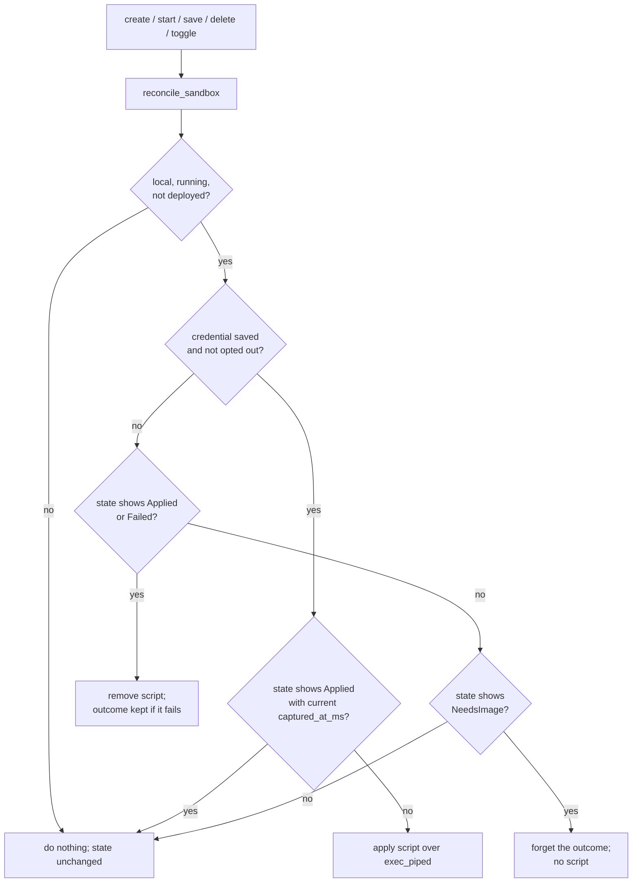

# GitHub CLI Login, Shared With Every Sandbox: Build Plan

This document is the build plan for `github-cli-auth`. It continues and supersedes [01_ideas.md](01_ideas.md), whose spike ([spike/gh-device-flow.md](spike/gh-device-flow.md)) cleared the device-flow login and the stdin token hand-off. Status: Phases A to E are implemented. The classic-PAT probe of Phase B and the `standard` image build remain manual checks.

## The Concrete Model

The single-value credential `github` (`GITHUB_SERVICE` in `src-tauri/src/credentials/mod.rs`) stays the only GitHub secret on the host. Two paths fill it, and both end in one host function, `save_github_token()` (new, `src-tauri/src/credentials/github.rs`):

- **Paste:** the Credentials page's existing token field calls `set_github_token` (`src-tauri/src/commands/credentials.rs`).
- **Login:** a "Log in with GitHub" button runs `gh auth login --hostname github.com --git-protocol https --web` in the auth container `mio-auth-github` through the existing `start_auth()` (`src-tauri/src/agents/mod.rs`). On exit 0 the new command `capture_github_login`, which takes no container argument, reads `gh auth token` from the fixed auth container and calls `save_github_token()`.

`save_github_token()` rejects an empty trimmed value first, then checks the token against GitHub from the host with one `GET https://api.github.com/user` (reqwest, already a dependency in `src-tauri/Cargo.toml`). A `401` rejects the save. A success records the GitHub login and any missing gh scopes in the manifest. A network failure saves the token unverified. Only the manifest crosses IPC.

A sandbox receives the token through one reconcile function, `reconcile_sandbox()` (new, `src-tauri/src/services/github_access.rs`), which compares the desired state with the per-sandbox state file and runs at most one in-sandbox script:

- **Apply script** (`apply()` in `src-tauri/src/credentials/github.rs`): one `sh -c` through `MachineProvider::exec_piped` with the token on stdin. The script exits 64 when `/usr/local/bin/gh` is missing, deletes `/root/.config/gh/hosts.yml`, runs `gh auth login --with-token --hostname github.com --git-protocol https`, then `gh auth setup-git`. Outcome: `Applied`, `NeedsImage` (exit 64) or `Failed` with gh's first stderr line.
- **Remove script** (`remove()` in the same file): `rm -f /root/.config/gh/hosts.yml` through `MachineProvider::exec`. The git helper section `gh auth setup-git` wrote stays in `/root/.gitconfig` and fails closed (spike, Risk 5).
- **Per-sandbox state** lives in `<app_data_root>/github/<sandbox>.json` (new `sandbox_github_state_path()` in `src-tauri/src/paths.rs`): `opted_out` and the last `outcome`. `cleanup_host_state()` (`src-tauri/src/services/sandbox.rs`) deletes the file on destroy through `forget()`, which takes the reconcile lock.
- **Manage tab:** a new card `GithubAccess.svelte` (`src/lib/workspace/`) under `AgentManager` in `src/lib/workspace/DashboardOverview.svelte` shows the derived status and a switch. Every reconcile ends with the Tauri event `github-access://changed`, carrying the sandbox name, and the card reloads its status when the name is its own.

gh 2.105.0 is baked into the base image at `/usr/local/bin/gh` (`src-tauri/resources/Containerfile`), so the auth container and every new sandbox have it.

## Resolved Decisions

1. **Existing pasted token on upgrade** (resolved in `01_ideas.md`). No migration; a pasted token is applied exactly like a login token, and the manifest carries no `source` field.

2. **Pasted-token scope check.** The save validates host-side and warns, and the apply is the authority. `save_github_token()` sends `GET /user` with the token. A `401` fails the save with `CredentialError::InvalidValue`. On `200`, the `login` field becomes `account_login`, and for a classic token (the `X-OAuth-Scopes` response header is present) any of `repo` and `read:org` missing from the header goes into `missing_scopes`. The Credentials card shows `missing_scopes` as a warning: mise can use the token, but sandboxes may reject it. Apply still runs, and gh's own refusal is recorded per sandbox as a `Failed` outcome. Fine-grained tokens send no scopes header and get no warning. The scope list gh enforces was not probed in the spike; Phase B confirms it with a classic token that lacks `read:org`. This also supersedes the `gh api user` call `01_ideas.md` planned inside the auth container: one host-side check labels both paths.

3. **Fallback for sandboxes without gh.** No fallback. A sandbox on an image older than the gh bump gets the `NeedsImage` outcome, and the Manage card says GitHub access needs the sandbox recreated over its workspace. Rejected: `git credential-store`, which adds a second plaintext copy and a second removal path that matters only until the sandbox is recreated. Also rejected: installing gh through mise, whose version-specific install path breaks the absolute helper path `gh auth setup-git` writes (spike, Risk 4). The apply script detects the missing binary itself (exit 64), so no image-version bookkeeping is needed host-side.

4. **Deployed sandboxes** (resolved in `01_ideas.md`). Out of scope. `reconcile_sandbox()` skips a sandbox with a Mutagen deploy session named after it (`SyncEngine::sessions()`, the same check `services::sandbox::destroy` makes), through one `is_deployed()` helper. A Mutagen error skips the reconcile with a warning instead of treating the sandbox as local, so a deployed sandbox never receives the token on a failed probe. The Manage card's read-only status falls back to local on the same error, since it triggers no action. `04_improvements.md` records the extension.

5. **Proxy sandboxes with an allowlist** (resolved in `01_ideas.md`; host list settled here). Already satisfied: `STARTER_BASE_HOSTS` (`src-tauri/src/net_policy.rs`) seeds `github.com`, `api.github.com`, `codeload.github.com` and `*.githubusercontent.com` into every new allowlist. Phase D adds `uploads.github.com` (release uploads) and `gist.github.com` (gist clones). The frontend's `starterHosts` (`CreateSandboxItem.svelte`) does not change. A Podman sandbox behind iron-proxy inherits `HTTPS_PROXY` and `SSL_CERT_FILE` from its container environment (`proxy_env()` in `src-tauri/src/proxy/mod.rs`), which gh honours.

6. **Re-login while sandboxes are stopped.** A stale token in a stopped sandbox is accepted. gh tokens do not expire. A sandbox started outside `start_sandbox` keeps the previous token, or keeps a removed one, until its next app start, toggle or save. A revoked token fails closed with `401`. The Manage card shows "out of date" whenever the state's `captured_at_ms` differs from the manifest's, and flipping the switch off and on re-applies. A startup sweep over running sandboxes is deferred (`04_improvements.md`).

7. **Cancel ends the exec, not just stdin.** `cancel_auth()` signals the session's wait task, which kills the `podman exec` client. The wait task then emits `Exit`, and `handleExit()` (`src/lib/agents/authSession.svelte.ts`) destroys the auth container, which ends gh inside it. Closing stdin alone leaves gh polling for about 15 minutes (spike, Risk 2). The change is generic and also lets a Claude login be cancelled after its code was submitted.

8. **Apply clears gh's hosts file before login, and removal deletes the file.** Without the clear, a re-login as a different GitHub account would make gh keep both accounts, so the replaced token would stay in `hosts.yml`. A non-TTY `gh auth logout` also refuses to pick between several accounts. Deleting the file couples the app to gh's documented config path only, not to the file's schema, which `01_ideas.md` rejected writing directly. Consequence: an app-applied sandbox loses any extra `gh auth login` the user ran inside it when the app re-applies or removes.

9. **Podman sandboxes are created stopped, so the first start applies.** `podman create` leaves a non-proxied Podman sandbox stopped, and the reconcile never starts a sandbox to apply. The create hook therefore applies immediately only to a sandbox that is already running: a microsandbox sandbox, or a proxied Podman sandbox started by the CA injection. Every other sandbox applies on its first `start_sandbox`.

10. **The opt-out lives in app data, default opted in** (from `01_ideas.md`). It is never in `.mio/`, which code inside the sandbox can write.

11. **Reconciles are serialised.** One process-wide `tokio::sync::Mutex<()>` in `src-tauri/src/services/github_access.rs` wraps every `reconcile_sandbox()`, so an apply-all after a save cannot race a start hook on the same sandbox. Each script takes about a second, so a single lock is enough. `forget()`, which deletes the state file of a destroyed sandbox, takes the same lock, so a reconcile in flight cannot recreate the file for a sandbox later created under the same name. `cleanup_host_state()` is synchronous, so it spawns `forget()`; a reconcile that starts after the destroy finds the sandbox gone before it saves anything.

12. **Failures never fail the triggering action.** Create, start, save and delete spawn the reconcile in the background and only warn-log its errors. Only the Manage switch awaits its reconcile, to show the result. The behaviour matches `github_secret_env()`'s rule that a missing token never fails an install.

## Implemented: Phase A — gh in the base image

- `src-tauri/resources/Containerfile`: add `ARG GH_VERSION=2.105.0` and `ARG GH_SHA256`. The value comes from `gh_2.105.0_checksums.txt` on the `cli/cli` release. Download `gh_${GH_VERSION}_linux_amd64.tar.gz`, verify it with `sha256sum -c`, and extract `bin/gh` to `/usr/local/bin/gh`, beside the Herdr block. Add `GH_NO_UPDATE_NOTIFIER=1` to the existing `ENV` block, so gh never checks for releases.
- `src-tauri/src/backends/mod.rs`: bump `BASE_IMAGE_VERSION` to a number never built on any developer machine. The working tree at the time of writing reverts `host-tool-ssh-access`, taking the constant from 9 back to 8, while `localhost/sandbox-mio/base:9` already exists locally from that feature. The bump therefore goes to 10 (see Common Gotchas).
- The gh tarball checksum was read from `gh_2.105.0_checksums.txt` on the `cli/cli` v2.105.0 release. The tarball nests the binary at `gh_2.105.0_linux_amd64/bin/gh`, so the extract uses `--strip-components=2`.
- Not yet run: `./build e2e` (`standard`) once, where `base-image-recipe.spec.ts` (`e2e/test/specs/standard/`) builds the image.

## Implemented: Phase B — the host store and `save_github_token()`

- `src-tauri/src/credentials/types.rs`: `GITHUB_AUTH_CONTAINER` (`mio-auth-github`) sits beside `AUTH_CONTAINER_PREFIX`, mirrored by `src/lib/github.ts`. `CredentialManifest` gains `account_login: Option<String>` and `missing_scopes: Vec<String>`, both `#[serde(default)]`, so existing manifests still parse. `capture()` and `write_secret()` in `src-tauri/src/credentials/mod.rs` set them to empty.
- New `src-tauri/src/credentials/github.rs`, declared with `pub mod github;` in `src-tauri/src/credentials/mod.rs`:
  - `save_github_token(app, token) -> Result<CredentialManifest, CredentialError>`. It rejects an empty trimmed value before any request, calls `verify_token()`, then `save_secret(app, GITHUB_SERVICE, token)`, and rewrites the manifest `save_secret()` returned with `account_login` and `missing_scopes` through `save_manifest()`.
  - `verify_token(token) -> Result<TokenCheck, CredentialError>`. It sends `GET https://api.github.com/user` with `Authorization: Bearer`, `User-Agent: sandbox-mio`, `Accept: application/vnd.github+json` and a 10-second timeout. `401` returns `InvalidValue("GitHub rejected the token")`, `200` returns the login and missing scopes, and any other status or network error returns an unverified `TokenCheck`. When `mock_backend_enabled()` (`src-tauri/src/backends/mod.rs`) is true, it returns unverified without a request: the `light` tier must not call GitHub, and `e2e/test/specs/light/github-token.spec.ts` saves a sentinel token.
  - `missing_gh_scopes(header: Option<&str>) -> Vec<String>`, a pure function with unit tests: no header gives none, and `"repo, gist"` gives `["read:org"]`.
- `src-tauri/src/commands/credentials.rs`:
  - `set_github_token` becomes `async`, calls `save_github_token()`, then `services::github_access::spawn_reconcile_all(&app)`.
  - New `capture_github_login(app, registry)`. It execs `gh auth token` in the fixed `GITHUB_AUTH_CONTAINER` through `provider.exec` (one-shot, through the runner seam, stdout never logged) and passes the trimmed stdout to `save_github_token()`. It then calls `spawn_reconcile_all`. The container name is a constant rather than an argument, so the command cannot read a token out of a user sandbox.
  - `delete_credential_bundle`: when `service_id == GITHUB_SERVICE`, it calls `spawn_reconcile_all` after the delete, which removes the token from every running sandbox it was applied to.
- Register `credentials::capture_github_login` in `generate_handler![]` (`src-tauri/src/commands/mod.rs`).
- Manual check, not yet done: `gh auth login --with-token` in a sandbox with a classic personal access token that lacks `read:org`. Record the exact refusal text in the Common Gotchas table below, and correct `missing_gh_scopes()` if gh's minimum differs. `missing_gh_scopes()` treats `write:org` and `admin:org` as satisfying `read:org`.

## Implemented: Phase C — the login flow and cancel

- `src-tauri/src/agents/types.rs`: `AuthSession` became `{ stdin: Option<ChildStdin>, cancel: tokio::sync::oneshot::Sender<()> }`. The sender is never absent while the entry is in the map, because `cancel_auth()` removes the entry to fire it.
- `src-tauri/src/agents/mod.rs`:
  - `start_auth()` creates the oneshot pair, and its wait task runs `tokio::select!` over `child.wait()` and the cancel receiver. On cancel it calls `child.kill()`, waits, and emits `Exit { code: -1 }`.
  - `send_auth_input()` takes `stdin` out of the entry instead of removing the entry.
  - `cancel_auth()` removes the entry and fires `cancel`.
  - The wait task still removes the entry on every exit.
- New `src/lib/github.ts`: `GITHUB_SERVICE = "github"`, `GITHUB_AUTH_CONTAINER = "mio-auth-github"`, and `GITHUB_LOGIN_COMMAND`, the argv `["gh", "auth", "login", "--hostname", "github.com", "--git-protocol", "https", "--web"]`. `start_auth()` prefixes `mise exec --`, which finds gh on `PATH`.
- `src/lib/agents/authSession.svelte.ts`:
  - New state `deviceCode` and accessor `authDeviceCode()`. `start()` matches each output line against `/one-time code: ([A-Z0-9]{4}-[A-Z0-9]{4})/`.
  - `handleExit()` branches on `serviceId === GITHUB_SERVICE` before the `AGENTS` lookup and invokes `capture_github_login` without arguments on exit 0. The `destroy_sandbox` cleanup and `capturedCount++` stay shared.
- `src/lib/agents/AuthSessionCard.svelte`: when `authDeviceCode()` is set and the phase is not `exited`, it shows the code in a prominent monospace block with a copy button (`navigator.clipboard.writeText`), above the existing "Open in browser" row.
- `src/routes/credentials/+page.svelte`, GitHub card:
  - New `logInGithub()`: `beginSigningIn(GITHUB_SERVICE)`, `ensure_auth_container`, `start_agent_auth` with `GITHUB_LOGIN_COMMAND`, `startAuthSession`. It keeps the existing dismissed-before-session guard from `logIn()`. It runs no `install_agent` step.
  - The card shows `AuthSessionCard` while `authActiveServiceId() === GITHUB_SERVICE`.
  - The status line reads `accountLogin` ("Logged in as `<login>`", else the saved date) and a `missingScopes` warning.
  - The page's `CredentialManifest` interface gains `accountLogin` and `missingScopes`. The paste form stays.
- `src/routes/credentials/+page.svelte`, `cancelOrDismiss()`: unchanged; the backend cancel now ends the exec.

## Implemented: Phase D — apply, remove, and the reconcile service

- `src-tauri/src/paths.rs`: `sandbox_github_state_path(app, name)` returns `app_data_root(app)?/github/<name>.json`.
- `src-tauri/src/credentials/github.rs`:
  - `GithubSandboxState { opted_out: bool, outcome: Option<ApplyOutcome> }`.
  - `ApplyOutcome` is an enum: `Applied { captured_at_ms }`, `NeedsImage`, `Failed { reason, captured_at_ms }`.
  - `load_state(path)` returns the default (opted in, no outcome) for a missing file. `save_state(path, state)` creates the parent directory.
  - `apply(provider, name, token, captured_at_ms) -> ApplyOutcome` and `remove(provider, name) -> Result<(), CredentialError>`, as in the Concrete Model. The extra `captured_at_ms` argument is the manifest stamp the `Applied` and `Failed` outcomes record. The script text is a `const` with no interpolated values, and the token reaches gh only on stdin. `Failed.reason` is gh's first stderr line, capped at 200 characters.
- New `src-tauri/src/services/github_access.rs`, declared in `src-tauri/src/services/mod.rs`:
  - `reconcile_sandbox(app, name) -> Result<GithubSandboxState, AppError>`. It holds the module lock and implements the flowchart through a pure `plan()` function, which also drops a stale non-applied outcome once the credential is gone or the sandbox is opted out. `set_access(app, name, enabled)` shares the same locked path and also records the opt-out while the sandbox is stopped. It decides local and running from `services::sandbox::list_user()` (`status == "running"`), and deployed through `is_deployed()`. It resolves the engine with `ProviderRegistry::engine_of()` and never calls `SandboxRouter::resolve()`, which writes `~/.ssh`. `plan()` returns `Apply` with the credential stamp, `Remove` for an `Applied` or a `Failed` outcome once the credential is gone or the sandbox is opted out, and `Forget` only for `NeedsImage`. A `Failed` outcome can sit over a token gh already wrote (login succeeded, `setup-git` failed, or the exec timed out), and the remove script is idempotent. On `Remove` the outcome is cleared only when the script succeeds; on failure it stays, so the next reconcile retries. Every reconcile, successful or not, then emits `github-access://changed`.
  - `forget(app, name)` deletes the state file under the reconcile lock.
  - `spawn_reconcile(app, name)` and `spawn_reconcile_all(app)` run the reconcile off the caller's path and warn-log failures, modelled on `spawn_ensure_for_sandbox()` in `src-tauri/src/services/inference_reach.rs`.
  - `status(app, name) -> GithubSandboxStatus` is host-only, with no exec. It returns `{ optedOut, outcome, credentialCapturedAtMs, accountLogin, deployed }`.
- Hooks:
  - In `create()` (`src-tauri/src/services/sandbox.rs`), after the microsandbox sync block and beside `spawn_ensure_for_sandbox`: `spawn_reconcile(app, name)`.
  - In `start_sandbox` (`src-tauri/src/commands/sandbox.rs`), after `store.start`: `spawn_reconcile(&app, &name)`.
  - `cleanup_host_state()` in `src-tauri/src/services/sandbox.rs` spawns `forget()`, best-effort like the pane directory.
- New commands in `src-tauri/src/commands/credentials.rs`, registered in `src-tauri/src/commands/mod.rs`:
  - `github_sandbox_status(name)`.
  - `set_github_sandbox_access(name, enabled)`. It writes `opted_out = !enabled`, awaits `reconcile_sandbox()` and returns the status. Calling it with the current value re-runs the reconcile, which is the retry for `Failed`.
- `src-tauri/src/net_policy.rs`: append `uploads.github.com` and `gist.github.com` to `STARTER_BASE_HOSTS`. The `starter_is_allowlist_with_deduplicated_hosts` test counts from the constant and needs no edit.

## Implemented: Phase E — the Manage card

- New `src/lib/workspace/GithubAccess.svelte`, rendered after `<AgentManager>` in `src/lib/workspace/DashboardOverview.svelte`. It loads `github_sandbox_status` on mount and after every toggle, refreshes on `authCapturedCount()` changes, and listens for `github-access://changed` filtered to its own sandbox, so a background reconcile updates it; the listener is released on destroy. The switch is remounted after every call, so its thumb always shows the status even when a call failed or changed nothing. It uses the `switch` component from `src/lib/components/ui/switch/`, a `data-github-access` root attribute and a `data-state` attribute for specs. States, in priority order:

| Condition | Text | Switch |
|---|---|---|
| `deployed` | Not available for deployed sandboxes | hidden |
| no credential | No GitHub login; link to `/credentials` | hidden |
| `optedOut` | Off for this sandbox | off |
| `outcome = NeedsImage` | Needs the sandbox recreated over its workspace for gh | on |
| `outcome = Failed` | Failed: `<reason>` | on (toggling retries) |
| `Applied` with matching `captured_at_ms` | GitHub: `<accountLogin>` (or "token applied") | on |
| `Applied` with an older `captured_at_ms` | Out of date; applies on next start | on |
| no outcome | Applies when the sandbox runs | on |

- Paraglide keys for the Credentials and Manage strings go into `messages/en.json`, `messages/de.json` and `messages/ru.json` only after the user approves the working feature (the `feature-implement` skill). Until then, the strings stay inline English.

## Lifecycle and Cross-Cutting Concerns

- **Where the token exists:** the host store (`<store_dir>/github/secret`), each applied sandbox's `/root/.config/gh/hosts.yml`, and the auth container until `handleExit()` destroys it. The Podman process runner feeds stdin through a pipe (an apply sends only the placeholder on stdin anyway), but it still captures stdout to temporary files, so the token briefly lands on host disk during the `gh auth token` capture. The stdout capture predates the feature (Claude credential capture uses the same path), and `04_improvements.md` records the fix. The token never appears in an argv, `mio.log`, the workspace or IPC (`docs/architecture/agents.md` and `docs/architecture/providers.md`, Invariants).
- **Cleanup:** destroying a sandbox deletes its state file. Deleting the credential removes the token from running sandboxes now and from stopped ones on their next start. Revoking the token on GitHub stays the user's job (Common Gotchas).
- **State derivation:** the Manage card derives everything from the manifest and the state file, both host-side, so it renders for stopped sandboxes without an exec.
- **Parallel worktrees:**
  - The only new path is `<app_data_root>/github/`, routed through `app_data_root()`, which honours `MIO_APP_DATA_DIR`. The credential store already honours `MIO_CREDENTIALS_DIR`.
  - No host port is added.
  - No env var is added.
  - No bundled binary is added: gh lives in the image, not under `src-tauri/binaries/`.
  - The auth container name `mio-auth-github` is fixed on the Podman machine like `mio-auth-claude`. `light` never creates it (mocked), and `standard`/`heavy` runs are already host-locked.
  - The host-side `GET /user` is skipped under `MIO_MOCK_BACKEND=1`.
  - A real device-flow login needs a human, so no tier runs it end to end; `03_e2e.md` scripts `podman.exec` for `capture_github_login` and the apply script instead.

## Common Gotchas

| Gotcha | Cause | Fix |
|---|---|---|
| The GitHub login card stays on "Signing in…" for about 15 minutes after Cancel | `cancel_auth()` (`src-tauri/src/agents/mod.rs`) only dropped stdin, and `gh auth login` keeps polling with stdin closed (spike, Risk 2) | Kill the `podman exec` child through the session's cancel channel (Phase C) so `Exit` fires and `handleExit()` destroys `mio-auth-github` |
| New sandboxes still have no gh after the Phase A Containerfile change | `ensure_base_image` short-circuits on an existing tag, and `localhost/sandbox-mio/base:9` already exists from the reverted `host-tool-ssh-access` feature | Bump `BASE_IMAGE_VERSION` in `src-tauri/src/backends/mod.rs` to 10 or higher, a number never built, or remove the stale tag with `podman rmi localhost/sandbox-mio/base:9` |
| `git push` fails with "could not read Username" after a gh upgrade | `gh auth setup-git` writes gh's absolute path into `/root/.gitconfig`, and gh was installed somewhere other than `/usr/local/bin/gh` | Install gh only through `src-tauri/resources/Containerfile` at `/usr/local/bin/gh`, never through mise |
| A sandbox shows "Failed: error connecting to api.github.com" | `gh auth login --with-token` validates online, and the sandbox's allowlist (`.mio/net-policy.json`) no longer allows `api.github.com`, or the sidecar CA is not trusted | Allow `api.github.com` and `github.com` in the sandbox's network policy, then toggle the Manage switch off and on to retry |
| A sandbox still pushes after the GitHub credential was removed | The sandbox was stopped at delete time, and the remove script runs only on running sandboxes and on the next `start_sandbox` | Start the sandbox through the app so `reconcile_sandbox()` removes `hosts.yml`; revoke the token at github.com under Settings → Applications if a copy may have leaked |
| Removing the login in the app leaves the token valid on GitHub | Deleting the `github` credential and `hosts.yml` deletes local copies only; an OAuth token stays valid until revoked | Revoke the GitHub CLI authorisation at github.com under Settings → Applications → Authorized OAuth Apps |
| A re-login as a different account leaves the old token in a sandbox | `gh auth login --with-token` adds a second account to `hosts.yml` instead of replacing the first | Keep the `rm -f /root/.config/gh/hosts.yml` step at the start of the apply script in `src-tauri/src/credentials/github.rs` (Resolved Decision 8) |
| `github-token.spec.ts` fails with "GitHub rejected the token" | `verify_token()` ran a real `GET /user` with the spec's sentinel token | Keep the `mock_backend_enabled()` short-circuit at the top of `verify_token()` in `src-tauri/src/credentials/github.rs` |
| A Podman sandbox shows "Applies when the sandbox runs" right after create | `podman create` leaves a non-proxied Podman sandbox stopped, and the reconcile never starts a sandbox (Resolved Decision 9) | Expected; the first `start_sandbox` applies the token |
| `capture_github_login` fails with "the value is empty" | `gh auth token` ran in the auth container without a completed login, or under `MIO_MOCK_BACKEND=1` with `podman.exec` unscripted; `save_github_token()` rejects the empty value before contacting GitHub | Call `capture_github_login` only after an exit-0 login; in a `light` spec, script `podman.exec` with a `ReturnValue` token through `mock_configure` |
| The GitHub token is briefly readable on host disk | The Podman process runner (`src-tauri/src/process/mod.rs`) feeds stdin through a pipe but captures stdout to temporary files named for the process and call id; `gh auth token`'s stdout passes through them | Known and shared with Claude credential capture; the process-layer fix is deferred (`04_improvements.md`, "Capture secret stdout without a temp file") |
| A removed GitHub login stays in a sandbox though the credential is gone | The remove script failed (sandbox unreachable), and the state keeps the previous outcome so the removal is retried | Reconcile again through `start_sandbox`, a save, or the Manage switch; the retry runs the idempotent remove script |
| A gh login token appears in `mio.log` | A new log line printed the stdout of `gh auth token` or the stdin of the apply script | Log variable names and outcomes only; the process layer logs argv, never stdout, so keep the token out of argv (`src-tauri/src/process/mod.rs`) |
