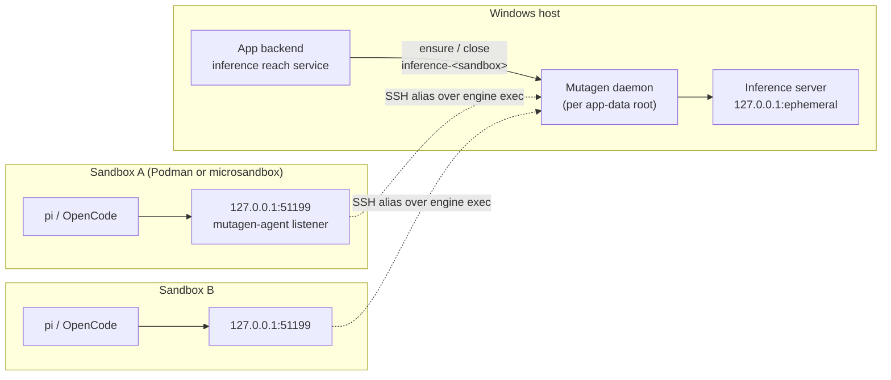

# Local LLM Reachability Build Plan

This is the build plan for making the host inference server reachable from every local sandbox, Podman or microsandbox, and for keeping every local-model agent's provisioned config current. It continues `docs/features/local-llm-reachability/01_ideas.md`, whose technology choices it adopts, and resolves that document's open questions. The approach was proven end to end with pi in a proxied microsandbox sandbox (`docs/features/local-llm-reachability/spike/01_mutagen-reverse-msb.md`). Status: Phases A to E are implemented and verified.

## The Concrete Model

- **One URL everywhere.** Every agent config written into a workspace uses `http://127.0.0.1:51199/v1`, which is the sandbox's own loopback. The guest port is `INFERENCE_GUEST_PORT`, declared in `src-tauri/src/inference/mod.rs` and mirrored in `src/lib/agents/local-llm.ts`.
- **One forward per local running sandbox.** The Mutagen session `inference-<sandbox>` has source `<sandbox alias>:tcp:127.0.0.1:51199` and destination `tcp:127.0.0.1:<server port>`. `NetworkManager` (`src-tauri/src/network/`) tracks the session as `ServiceKind::Inference`.
- **One owner of the forward set.** The inference reach service (`src-tauri/src/services/inference_reach.rs`) creates and removes the forwards. It reacts to server start and stop, sandbox start and stop, workspace views and app exit.
- **One provisioning path.** `provisionAgent` (`src/lib/agents/provision.ts`) writes an agent's local-model config. The install flow and `reprovisionInstalledAgents` (`src/lib/agents/reprovision.ts`) both call it. Re-provisioning covers every catalogue agent with a `provision` entry, and it runs at app startup and after each server start.
- **Nothing to open in network control.** Guest loopback traffic never meets the microsandbox egress policy, TLS interception, the chained SOCKS proxy, or the Podman sidecar's `http_proxy`.

### Superseded Approach

The previous design had one Mutagen session, `inference-reverse` (`INFERENCE_FORWARD` in `src-tauri/src/inference/mod.rs`). That session listened on `0.0.0.0:51199` inside the Podman machine named by `backends::connection_name()`. Agents dialled it at `host.containers.internal:51199`, and Podman sidecar-proxied sandboxes excluded that hostname through `NO_PROXY`. The design was replaced for three reasons:

- `host.containers.internal` does not resolve inside a microsandbox guest.
- The Podman machine's address is in microsandbox's denied `private` group.
- The listener is host-global state on the shared Podman machine, reachable by every container.

Do not reintroduce a machine-level listener or a host alias in agent configs.

## Resolved Decisions

1. **Stopped-sandbox forwards** (`01_ideas.md`, Open Question 1). `stop_sandbox` closes the sandbox's inference forward before stopping the sandbox, and every start path ensures the forward again. Closing first matters: the spike showed that a live Mutagen session keeps trying to boot a stopped microsandbox VM. `mutagen forward pause` was rejected because a paused session still holds a fixed destination port, which goes stale when the server restarts. The reach service would then need both a resume path and a recreate path instead of a single ensure path.
2. **Sandbox-start hook** (Open Question 2). Ensure runs in four places:
   - `start_sandbox` (`src-tauri/src/commands/sandbox.rs`);
   - `watch_workspace_ports` (`src-tauri/src/commands/panes.rs`), which the frontend calls on every workspace view and which already resolves the route;
   - the end of `services::sandbox::create` and `services::sandbox::reapply_network` (`src-tauri/src/services/sandbox.rs`);
   - server start, for every running sandbox.

   No periodic reconciler runs. A sandbox started outside the app gets its forward the next time its workspace is viewed.
3. **Deployed sandboxes** (Open Question 3). They are excluded. Ensure skips a sandbox whose `SandboxRoute.machine` (`src-tauri/src/services/routing.rs`) differs from `ProviderRegistry::local_ref` for its provider. Deployed local-model access stays in `04_improvements.md`.
4. **Default model** (Open Question 4). Provisioning writes the running model as each agent's default, falling back to `FALLBACK_MODEL_ID` when no server runs. It does so only when the current default is absent or already names the `local-llm` provider, so a user who chose another provider keeps that choice.
   - OpenCode: `provision_opencode` (`src-tauri/src/agents/config.rs`) replaces `model` under that rule instead of inserting only when absent.
   - pi: `provision_pi` writes `defaultProvider` and `defaultModel` into `settings.json` beside `models.json` in `.mio/pi-agent/`, under the same rule. Verify both key names against pi 1.5.0 before writing them (Phase D).
5. **Guest port collision** (Open Question 5). The guest port stays fixed for every sandbox; per-sandbox URLs were rejected because they would make workspace files engine-state dependent. A collision with a user process on port 51199 is not handled; it surfaces as the session's `Last error` in `mutagen forward list` and as a connection error in the agent (Common Gotchas).
6. **Both providers move to the per-sandbox forward** (`01_ideas.md`, Technology Choices, "Scope: both providers, one URL"). Adopted as recommended there; the user had not overridden it when this plan was written, so revisit this decision before Phase B if that changes. Podman sandboxes lose the machine-level listener in the same change that microsandbox sandboxes gain their forward.
7. **Forward ownership.** The forward is a `NetworkManager` service kind, not a raw `sync` call (`01_ideas.md`, Technology Choices). Teardown through `close_sandbox`, the port-poller exclude set and the frontend forwards snapshot then cover it without extra code.
8. **Host-port changes.** Server start recreates every inference forward, because Mutagen fixes a session's destination at create. The ensure check compares the tracked `ForwardInfo.host_port` with the running server's port and recreates on mismatch.
9. **Exit and startup.** `on_run_event` (`src-tauri/src/bootstrap.rs`) closes every tracked inference forward after stopping the server and before the sync engine's `daemon stop`. That way no session resumes against a stopped sandbox when the daemon next starts. The startup sweep terminates every `inference-` session, including the legacy `inference-reverse`, because no server runs at startup by construction.
10. **Ensure failures are logged, never raised.** An ensure failure is logged under target `inference` and never fails the command that triggered it. Starting a sandbox or a server must not fail because a forward could not be created. The behaviour matches the old machine forward.
11. **Re-provisioning migrates existing workspaces.** The startup pass rewrites every provisioned agent's `local-llm` provider entry, which moves workspaces written with `host.containers.internal` to the loopback URL without any version marker. `provision_pi` and `provision_opencode` already replace the provider entry by id.

## Implemented: Phase A — Inference Forward Primitive

- `src-tauri/src/network/types.rs`:
  - add `ServiceKind::Inference`, which serialises as `inference`;
  - add `NetworkManager::open_reverse_forward(sandbox, kind, alias, guest_port, host_port) -> Result<(), NetworkError>`. Its doc comment states that the guest listener binds guest loopback and that `ForwardInfo.host_port` holds the destination port, not a listener.
- `src-tauri/src/network/mod.rs`:
  - `forward_name` maps `Inference` to `inference-<sandbox>`;
  - `MutagenNetworkManager::open_reverse_forward` calls `crate::sync::forward_create_reverse`, inserts a `ForwardInfo` (`remote_port` = guest port, `auto_detected` false) and emits `EVENT_NAME`;
  - the port poller's exclude match in `poll_ports_file` adds `ServiceKind::Inference => f.remote_port`, so the forward's own listener is never auto-exposed.
- `src-tauri/src/network/mock.rs`: `MockNetworkManager::open_reverse_forward` records the `ForwardInfo` without spawning anything.
- `src-tauri/src/sync/mod.rs`:
  - `forward_create_reverse` gains a `listen_host` parameter, so that the machine-level caller keeps `0.0.0.0` until Phase B removes it;
  - `sweep_stale_forwards` treats every `inference-` session as orphaned (Resolved Decision 9).
- `INFERENCE_VM_PORT` moves from `src-tauri/src/sync/mod.rs` to `src-tauri/src/inference/mod.rs` as `INFERENCE_GUEST_PORT`. Both ends keep the paired-path comment; the frontend name follows in Phase C.
- Frontend type: the `ServiceKind` union in `src/lib/network/state.svelte.ts` gains `inference`. `PortsManager.svelte` (`src/routes/projects/`) already lists only `exposed` forwards, so the inference forward gets no row and no close button; its label switch gains an `inference` arm for exhaustiveness.

## Implemented: Phase B — Inference Reach Service and Machine-Listener Removal

- New `src-tauri/src/services/inference_reach.rs`, declared in `src-tauri/src/services/mod.rs`:
  - `ensure_for_sandbox(app, name)`:
    - read the server port from `ActiveServer` (`src-tauri/src/inference/types.rs`), then release the lock;
    - return if no server runs;
    - return unless the backend lists the sandbox as `running`, because `watch_workspace_ports` also runs for stopped sandboxes and dialling a stopped microsandbox alias tries to boot its VM;
    - resolve the route with `SandboxRouter::resolve`;
    - skip deployed sandboxes (Resolved Decision 3);
    - skip when a tracked `Inference` forward already has the same `host_port`;
    - otherwise call `open_reverse_forward` with `INFERENCE_GUEST_PORT`.
  - `ensure_all(app)` lists sandboxes through the backend, keeps the running ones that are neither auth containers nor sidecars, and ensures each sequentially; the forward-create lock serialises the creates anyway. The filter that `list_sandboxes` (`src-tauri/src/commands/sandbox.rs`) used is now the shared helper `services::sandbox::list_user`.
  - `spawn_ensure_for_sandbox` and `spawn_ensure_all` run the two ensures off the caller's path; every hook below uses them.
  - `close_all(network)` closes every tracked `Inference` forward.
  - `close_for_sandbox(network, name)` closes one.
- `src-tauri/src/commands/inference.rs`:
  - `start_inference` drops the `ensure_connection_alias`/`forward_create_reverse` block and its false microsandbox comment, and spawns `ensure_all` once the server is ready, so the command returns without waiting on forward creation;
  - `stop_inference` spawns `close_all` in place of terminating `INFERENCE_FORWARD`.
- `src-tauri/src/inference/mod.rs`: delete `INFERENCE_FORWARD`.
- `src-tauri/src/sync/mod.rs`:
  - `forward_create_reverse` loses `listen_host` and always binds `127.0.0.1`;
  - replace its doc comment, whose `0.0.0.0` rationale applied only to the machine-level listener.
- `src-tauri/src/commands/sandbox.rs`:
  - `start_sandbox` spawns `ensure_for_sandbox` after a successful start;
  - `stop_sandbox` awaits `close_for_sandbox` before `store.stop` (Resolved Decision 1).

  `start_sandbox` gains the `AppHandle`; `stop_sandbox` gains the `NetworkManager` state.
- `src-tauri/src/commands/panes.rs`: `watch_workspace_ports` spawns `ensure_for_sandbox` after `router.resolve`.
- `src-tauri/src/services/sandbox.rs`: `create` and `reapply_network` spawn `ensure_for_sandbox` as their last step.
- `src-tauri/src/bootstrap.rs`: `on_run_event` calls `close_all` inside its existing `block_on`, after the server stops and before `engine.shutdown()` (Resolved Decision 9).
- `src-tauri/src/proxy/mod.rs`: `proxy_env` drops `host.containers.internal` from `NO_PROXY`, and the doc comment loses its load-bearing note. `127.0.0.1` stays and now carries the inference traffic.
- `ensure_connection_alias` (`src-tauri/src/backends/mod.rs`) is deleted. This plan assumed deploy used it, but `start_inference` was its only caller. The global podman runner that existed only for it goes too: `PODMAN_RUNNER`, `set_podman_runner` and `podman_global_runner` in `src-tauri/src/backends/mod.rs`, the `set_podman_runner` call in `bootstrap::build`, and the matching Common Gotchas row in `src-tauri/AGENTS.md`.

## Implemented: Phase C — One URL and Unified Provisioning

- `src/lib/agents/local-llm.ts`:
  - `INFERENCE_VM_PORT` becomes `INFERENCE_GUEST_PORT`;
  - `LOCAL_LLM_BASE_URL` becomes the guest-loopback URL;
  - `FALLBACK_MODEL_ID` moves here from `src/lib/agents/opencode.ts`.
- New `src/lib/agents/provision.ts`: `provisionAgent(descriptor, workspacePath, runningModelId)` is the only code that switches on `provision.kind`. It invokes `provision_opencode` or `provision_pi` with the builder output from `src/lib/agents/opencode.ts` or `src/lib/agents/pi.ts`.
- `src/routes/projects/AgentManager.svelte`: install-time provisioning calls `provisionAgent` with the model from `inference_status`, replacing its inline branch.
- `src/lib/agents/reprovision.ts`: `reprovisionInstalledAgents(runningModelId | null)` loops over every `AGENTS` entry with `provision`. For each sandbox from `list_sandboxes` whose `list_packages` includes the agent's mise packages, it calls `provisionAgent`. Failures stay per-sandbox best-effort.
- `src/routes/models/+page.svelte`: the existing post-start call stays.
- `src/routes/+layout.svelte`: `onMount` fires `reprovisionInstalledAgents` once with the running model (or `null`), without awaiting it (Resolved Decision 11). It runs from the `main-navigation-panel` webview only, as `checkForUpdate` does, because every webview mounts the root layout.
- `src/lib/agents/pi.ts`: `buildPiLocalLlmProvider` takes the default model id and returns it beside the provider JSON; delete the unused `PI_DEFAULT_MODEL`. `provisionAgent` passes pi's default model on to `provision_pi` only from Phase D.

## Implemented: Phase D — Default Model Follows the Server

- First, verify pi 1.5.0's `settings.json` keys for the default provider and model (expected `defaultProvider`, `defaultModel`). Recorded in `docs/features/local-llm-reachability/spike/02_pi-settings-keys.md`: both keys confirmed, with `defaultModel` a bare model id. No sandbox with pi was running, so the check read the published 1.5.0 package source instead of a live sandbox.
- `src-tauri/src/agents/config.rs`:
  - `provision_opencode` replaces `model` when it is absent or starts with `local-llm/`;
  - `provision_pi` gains optional `default_provider` and `default_model` parameters, and merges them into `settings.json` (same directory as `relative_path`) under the same rule, keyed on `defaultProvider` equalling the provider being written (`local-llm`);
  - both rules live in pure merge functions over the parsed JSON object, so the `cargo test` unit tests cover absent, app-written and user-chosen values without touching the filesystem.
- `src-tauri/src/commands/agents.rs`: `provision_pi` forwards the new parameters.
- `src/lib/agents/provision.ts` passes them.

## Implemented: Phase E — Specs, Docs and Verification

- Existing specs that encode the old URL must change in the same branch:
  - `e2e/test/specs/standard/opencode-agent.spec.ts`: `EXPECTED_BASE_URL`;
  - `e2e/test/specs/heavy/opencode-forward.spec.ts`: probe `127.0.0.1:51199` inside the sandbox, and stop asserting that `host.containers.internal` is in `/etc/hosts`.

  The full regression plan is `03_e2e.md`.
- Architecture updates once Phases A to D ship:
  - `docs/architecture/inference.md`: the "Reaching the Server from Sandboxes" section and the all-interfaces invariant;
  - `docs/architecture/transport.md`: the reverse-forwards bullet;
  - `docs/architecture/agents.md`: re-provisioning covers every agent, runs at startup, and the default model follows the server;
  - `docs/architecture/network.md`: the `host.containers.internal` invariant becomes "local-model traffic never leaves the sandbox".
- Verification: `cargo check` and `cargo test` in `src-tauri/`, `pnpm check`, `./build docs`, `./build e2e light`, then one `./build e2e` standard run.

Outcome: both specs updated (the `e2e/` project typechecks), the four architecture documents updated, and `cargo check`, `cargo test`, `pnpm check` and `./build docs` pass. On 2026-11-10 `./build e2e light` passed 14 of 14 spec files and `./build e2e` passed 16 of 16, including `opencode-agent.spec.ts`; each tier's first run lost specs to the app shell not rendering, and those specs passed on rerun. `03_e2e.md` has not been written yet.

## Lifecycle

| Event | Inference forward effect | Seam |
|---|---|---|
| Server start (or restart on a new port) | Ensure for every running local sandbox; recreate on port mismatch | `start_inference` → `inference_reach::ensure_all` |
| Server stop | Close all | `stop_inference` → `inference_reach::close_all` |
| Sandbox create, start, network re-apply | Ensure for that sandbox | `services::sandbox::create`, `start_sandbox`, `services::sandbox::reapply_network` |
| Workspace view | Ensure for that sandbox | `watch_workspace_ports` |
| Sandbox stop | Close before stopping | `stop_sandbox` |
| Destroy, undeploy | Closed with every other forward | `close_panes_and_forwards` → `NetworkManager::close_sandbox` |
| Deploy | Closed by the deploy's own teardown; never re-ensured while deployed | Resolved Decision 3 |
| App exit | Close all before `daemon stop` | `on_run_event` |
| App startup | Sweep every `inference-` session | `sweep_stale_forwards` |

- **State derivation.** Whether a sandbox has an inference forward is tracked only in `NetworkManager`'s in-memory map, rebuilt from events in the current run. Nothing is persisted. Mutagen sessions left over from an earlier run are swept, never adopted.
- **Lock discipline.** `ensure_for_sandbox` reads the server port under the `ActiveServer` lock and releases the lock before any Mutagen call. A server stop that races an ensure can leave one forward pointing at a dead port. That forward is harmless (connection refused), and the next server start recreates it.
- **Sandboxes stopped outside the app** keep a live inference forward until the next server stop, sandbox stop or app exit. The forward then repeats the boot attempt recorded in the spike, which the existing terminal forwards and the port poller already do (`04_improvements.md`).

## Parallel-Worktree Constraints

- **Paths:** none new. pi's `settings.json` lives in the workspace, under `.mio/pi-agent/`.
- **Host ports:** none new. The server port stays ephemeral, and the guest port is fixed inside each sandbox, where no worktree collision exists.
- **Host-global resources:** one fewer. The `0.0.0.0:51199` listener on `podman-machine-default` goes away. `inference-<sandbox>` sessions live in the Mutagen daemon under the run's app-data root, so they are per worktree. The per-sandbox SSH alias is already in use by terminal forwards.
- **Binaries, environment variables, teardown:** none new.

## Common Gotchas

| Gotcha | Cause | Fix |
|---|---|---|
| An `inference` port appears in a sandbox's auto-detected ports list | The port poller's exclude set in `poll_ports_file` (`src-tauri/src/network/mod.rs`) lacks a `ServiceKind::Inference` arm, or a forward was created outside `NetworkManager` | Add the `Inference` arm and create inference forwards only through `NetworkManager::open_reverse_forward` |
| A stopped microsandbox sandbox flips between `stopped` and `starting` | A live `inference-<sandbox>` Mutagen session keeps dialling the alias, whose `msb exec` `ProxyCommand` tries to boot the VM | Close the inference forward before stopping the sandbox in `stop_sandbox` (`src-tauri/src/commands/sandbox.rs`) |
| Agents report a connection error after the model is restarted on the Models page | The server came back on a new host port and an inference forward still targets the old one | `ensure_all` must recreate forwards whose tracked `host_port` differs from the running server's port |
| `mutagen forward list` shows `inference-<sandbox>` with `Last error: ... bind: address already in use` | A user process inside the sandbox already listens on guest port 51199 (Resolved Decision 5) | Stop the user process holding port 51199 inside the sandbox, then view the workspace again to re-ensure the forward |
| pi ignores an exported `PI_CODING_AGENT_DIR` when run inside the workspace | `provision_pi` writes `PI_CODING_AGENT_DIR` into the workspace `mise.toml` env, which mise re-applies | Edit `.mio/pi-agent/models.json` or `.mio/pi-agent/settings.json` in the workspace; test alternative configs from outside `/root/work` |
| An existing workspace still has `host.containers.internal` in `opencode.json` or `.mio/pi-agent/models.json` | The startup re-provision pass in `src/routes/+layout.svelte` did not run, or `list_packages` failed for that sandbox | Re-provision from the Models page by starting a model, or check that the agent's mise package is recorded in the workspace `mise.toml` |
| `inference-reverse` reappears in `mutagen forward list` | Code from before this plan, or a stale branch, still calls `forward_create_reverse` on the Podman connection alias | Remove the call; inference forwards are per sandbox only (Superseded Approach) |
| A user who switched OpenCode or pi to a cloud model finds it switched back to `local-llm` | A provisioning merge overwrote a default that did not name the `local-llm` provider | Keep the Resolved Decision 4 rule in `src-tauri/src/agents/config.rs`: overwrite only absent or `local-llm` defaults |
