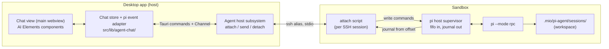

# Native Agent UI Ideas

This document covers the ideation for a built-in chat UI, rendered by the app's own SvelteKit frontend, that drives the **pi** coding agent running inside a sandbox. The goal is a desktop-native agent experience tuned for local models, offered alongside (not instead of) the existing Paseo agent web UI (`docs/features/agent-web-ui/`). The chosen approach has three parts: pi runs inside the sandbox in its JSON-lines RPC mode (`pi --mode rpc`) under a small supervisor that keeps it alive while the app is closed; the Rust backend attaches to that supervisor over the sandbox's existing SSH alias and streams pi's events to the frontend; the frontend renders those events with the official shadcn-svelte AI Elements components, copied into `src/lib/components/` and restyled to the retro theme. Nothing described here is built yet. The relevant code lives in `src/lib/workspace/` (launchable apps and pane state), `src-tauri/src/workspace/` (the pane registry), `src-tauri/src/services/` (routing and pane preparation), `src-tauri/src/process/mod.rs` (process spawning) and `src/lib/agents/` (the pi catalogue entry and provisioning).

## Current State

- **pi is installed and provisioned per sandbox.** The pi descriptor in `src/lib/agents/catalogue.ts` installs the mise tool `pi`, a self-contained binary with no Node.js dependency (`docs/features/pi-agent/02_dev.md`). The descriptor pins no version, so a new install resolves the latest release (1.5.0 on 2026-11-11) while `mise.lock` freezes the version of an existing workspace. The provisioned model entries carry only `id` and `name`, so pi assumes a 128,000-token context window and `reasoning: false` for every local model. Provisioning writes `.mio/pi-agent/models.json` into the workspace and sets `PI_CODING_AGENT_DIR` to `/root/work/.mio/pi-agent` in the workspace `mise.toml [env]` (`PI_CONFIG_DIR_CONTAINER` in `src/lib/agents/pi.ts`). The provider entry points pi at the host inference server through the per-sandbox reverse forward (`docs/features/local-llm-reachability/02_dev.md`).
- **pi's session files already land in the workspace.** pi stores sessions under `<config dir>/sessions/<encoded cwd>/` as JSON-lines files whose entries form a tree through `id` and `parentId`. Because `PI_CODING_AGENT_DIR` points into the workspace, sessions of a sandbox whose working directory is `/root/work` sit under `.mio/pi-agent/sessions/` in the host workspace folder: bind-mounted for Podman, mirrored by Mutagen for microsandbox.
- **Paseo is the only non-terminal agent UI.** `prepare_agent_web` in `src-tauri/src/runtime/mod.rs` starts the Paseo daemon with `mise exec --` (which applies `mise.toml [env]`), and `prepare_agent_web_pane` in `src-tauri/src/services/panes.rs` forwards Paseo's port and mounts a child webview. Paseo spawns the same `pi` binary with the same `PI_CODING_AGENT_DIR`.
- **Every pane today is a child webview backed by a Mutagen forward.** `AppKind` in `src-tauri/src/workspace/types.rs` has `Terminal` and `AgentWeb`. `AppPane` requires a `forward_name` and a `url`. The frontend's mirror type in `src/lib/workspace/state.svelte.ts` adds `dashboard`, the Manage tab, which renders in the main webview and is not a pane. `LAUNCHABLE_APPS` in `src/lib/workspace/apps.ts` declares the apps Manage can launch.
- **The SSH alias already reaches every sandbox engine-neutrally.** `SandboxRouter::resolve` in `src-tauri/src/services/routing.rs` resolves a sandbox to its provider and rewrites its alias (`write_alias` in `src-tauri/src/ssh/mod.rs`). An `ssh <alias>` session lands inside the sandbox through the engine's own `exec` (`docs/architecture/transport.md`).
- **Streaming child processes have a precedent.** `CliBackend::listen_events` in `src-tauri/src/backends/mod.rs` spawns a long-lived child, streams JSON values to the frontend over a Tauri `Channel`, and gates itself on `mock_backend_enabled()` because the `ProcessRunner` seam (`src-tauri/src/process/types.rs`) models one-shot calls only.
- **The base image has the tools a supervisor needs.** `src-tauri/resources/Containerfile` installs `procps`, `socat`, `tini` and `openssh-server` on Debian 12; coreutils supplies `mkfifo` and `tail`, and util-linux supplies `setsid`.

## Proposed Model

### The pi host supervisor inside the sandbox

A per-sandbox supervisor keeps one `pi --mode rpc` process alive independent of any SSH connection, so a turn keeps running after the chat closes or the app quits.

- The supervisor is started detached (`setsid`) through `mise exec --` in the workspace directory, so pi inherits `mise.toml [env]` and therefore `PI_CODING_AGENT_DIR`. `mise exec` replaces itself with pi, so the recorded pid is pi's own.
- pi's stdin reads from a named pipe that a keeper process holds open for writing, so pi never sees end-of-file when a client disconnects. Ending the keeper is the orderly stop: pi treats end-of-file on stdin as a shutdown request.
- pi's stdout is appended to a journal file. Each supervisor start writes a new journal and a new generation id, so a cursor is a generation plus a byte offset: a client that reattaches asks for the journal from its last offset and loses no event, and a cursor from an older generation restarts at offset 0.
- The attach script appends every line a client sends to an input log beside the journal, because pi never echoes an `extension_ui_response`; the input log is what makes pending dialogs derivable after reattach.
- The supervisor's state (pipe, journal, input log, generation, pid file, stderr log) lives in a sandbox-local directory under `/run`, outside the workspace, so Mutagen never mirrors a fast-growing journal and nothing in the workspace changes except pi's own session files. `/run` is not a tmpfs in either engine, so the state survives a sandbox restart and the liveness check must confirm that the recorded pid is still `pi --mode rpc`.
- One supervisor, and therefore one live pi process, runs per sandbox in v1. pi's `switch_session` and `new_session` commands change which session that process works on.
- The supervisor and attach scripts ship as app resources and are copied in with `MachineProvider::copy_in` (`src-tauri/src/provider/types.rs`) before each start, the pattern `seed_paseo_projects` in `src-tauri/src/runtime/mod.rs` uses for Paseo's project file.

### Attaching from the host

A new Rust subsystem, the agent host, owns the host side of the connection; its trait and real implementation live in a new `src-tauri/src/agent_host/` module.

- **Attach** resolves the sandbox through `SandboxRouter::resolve`, ensures the supervisor is running, then spawns `ssh <alias>` running the attach script with the client's journal offset. The spawn goes through `detached_command` in `src-tauri/src/process/mod.rs`.
- The attach script streams the journal from the requested offset to SSH stdout and copies SSH stdin into the supervisor's pipe. One SSH connection therefore carries both directions.
- The Rust side splits stdout on line feeds only, parses each line as JSON, tags it with its journal offset, and forwards it to the frontend over a Tauri `Channel`, mirroring `CliBackend::listen_events`.
- Commands from the frontend (prompt, steer, follow-up, abort, model and thinking-level changes, session operations, extension-dialog answers) are written to SSH stdin as single JSON lines carrying an `id`. Responses are correlated by `id`, never by order.
- **Detach** ends the SSH process only; pi keeps running, and the attach script's reader and writer exit with the SSH session. **Stop** ends the keeper so pi shuts down in order, and kills pi only if it outlives a timeout.
- Under `MIO_MOCK_BACKEND=1` the subsystem swaps in a mock that replays recorded pi RPC traces, because a streamed child cannot go through the scripted `ProcessRunner`.

### Reattach and history

- A fresh attach (no stored offset) starts from the journal's current end, rebuilds the conversation with pi's `get_state` and `get_messages` commands, and recovers unanswered dialogs from the journal and the input log, because `get_state` reports no pending dialog.
- A short reconnect (stored offset still inside the journal) replays the journal from that offset, so streaming text and tool output resume without a gap.
- The session list is read host-side from the JSON-lines files under the workspace's `.mio/pi-agent/sessions/`, because pi's RPC mode has no list command. Reading host-side also works while the sandbox is stopped.

### The chat view

The chat is a new launchable app rendered by the main webview, the way Manage is, rather than a child webview.

- `LAUNCHABLE_APPS` in `src/lib/workspace/apps.ts` gains a chat entry, available once pi is installed.
- The pane registry in `src-tauri/src/workspace/` gains a pane kind with no webview and no forward. When that pane is active, Rust hides the overlay webviews and the frontend shows the chat view, the same way Manage is shown today.
- A module-scoped store per sandbox (`src/lib/agent-chat/chat.svelte.ts`) owns the attach state, the message list, the queue, pending extension dialogs and usage, so the conversation survives route changes.

### The pi event adapter

A pure TypeScript module (`src/lib/agent-chat/pi-events.ts`) turns pi RPC events into the message-and-parts shape AI Elements reads.

- Assistant `text_delta` and `thinking_delta` events accumulate into text and reasoning parts; the `*_end` events and `message_end` replace the accumulated content with the authoritative final content.
- `tool_execution_start`, `tool_execution_update` and `tool_execution_end` drive one tool part per tool call, moving through input, running, output and error states.
- `queue_update` drives the queue, `compaction_*` and `auto_retry_*` events become timeline notices, and `agent_settled` is the only idle signal.
- `extension_ui_request` dialogs (`select`, `confirm`, `input`, `editor`) become pending dialogs answered with `extension_ui_response`. `notify` becomes a toast; `setStatus` and `setWidget` feed a status line.
- The adapter is the unit-test surface: recorded traces in, message lists out.

### Components

The official shadcn-svelte AI Elements are copied into `src/lib/components/` with the shadcn-svelte CLI and restyled to the retro theme by hand, as `field` and `input-group` were. The v1 set is the chat building blocks (message scroller, message, bubble, trace, code block, prompt input) plus the Tool, Reasoning, Queue, Context, Confirmation and Model Selector patterns. Tool rendering is keyed by tool name, so `bash` can render with the Terminal pattern and file edits with a code or diff view.

### Local-model affordances

- A context meter fed by pi's usage data, because local models have small context windows and compaction happens often. The meter is only as accurate as the `contextWindow` provisioned in `models.json`, which today is absent.
- Visible compaction and retry notices instead of a silent spinner, because local servers are slow to first token and sometimes drop requests.
- A model and thinking-level picker fed by pi's `get_available_models` and `get_available_thinking_levels`, which reflect the provisioned local provider.
- A clear "inference server not running" state with a link to the Models page when pi's requests to the local provider fail.

## Technology Choices with Tradeoffs

### Agent protocol: pi RPC mode (chosen)

- **Chosen: pi's native JSON-lines RPC.** It exposes pi's full feature set: steering versus follow-up queueing, session fork and tree, compaction, retries, thinking levels and extension dialogs. It needs no extra package in the sandbox.
- **Rejected: Agent Client Protocol through a `pi-acp` adapter.** ACP would let one client drive pi, OpenCode and Claude Code, and would make the same in-sandbox setup usable from Zed. The adapters are third-party forks, do not forward permission requests, and drop pi-specific features ACP does not model. Revisit in `04_improvements.md` when a second agent needs a native UI.
- **Rejected: the Paseo daemon's WebSocket protocol through `@getpaseo/client`.** Paseo already supervises agents and exposes a timeline. Its protocol carries no version or stability guarantee, the client package depends on the Node-only `ws` module, and Paseo's provider-neutral timeline drops pi's steering and session tree.
- **Rejected: a host-side agent loop built with a Rust LLM framework such as Rig.** Rig builds agents; it does not speak to one. Replacing pi would mean rebuilding sessions, compaction, retries and the extension ecosystem.

### Keeping pi alive while detached: named pipe plus journal supervisor (chosen, validated by spike)

- **Chosen: a shell supervisor using a named pipe for stdin and an append-only journal for stdout.** It adds no package to the base image, gives every client a byte-offset cursor for gap-free reattach, and keeps the supervisor's state out of the workspace. Spike 01 ran it unchanged on Podman and microsandbox (`docs/features/native-agent-ui/spike/01_pi-rpc-supervisor.md`).
- **Rejected for v1: a purpose-built relay binary (Rust) compiled into the base image.** A relay could offer multiple clients, a pending-dialog query and journal rotation. It needs a Linux build of a new crate and a base-image version bump. Spike 01 found the shell supervisor sound, so the relay stays the fallback for multi-writer safety only.
- **Rejected: pi holding its own pipe open read-write instead of a keeper process.** It saves a process, but pi would then never see end-of-file, leaving a signal as the only way to stop it instead of pi's documented orderly shutdown.
- **Rejected: a Node.js relay.** pi ships as a self-contained binary, so a Node relay would add a Node.js install to every sandbox for the supervisor alone.
- **Rejected: a terminal multiplexer (zellij, `dtach`, `abduco`).** These hold a pseudo-terminal, which echoes input and rewrites line endings, corrupting the JSON-lines stream.
- **Rejected: `socat` as the supervisor.** Without `fork`, `socat` ends pi when its single client disconnects; with `fork`, `socat` starts a new pi per connection.
- **Rejected: `jmfederico/pi-web`'s session daemon.** The daemon speaks pi-web's own protocol and needs a C/C++ toolchain to build its `node-pty` dependency (`docs/features/agent-web-ui/01_ideas.md`, Validation).

### Host-to-sandbox transport: SSH alias stdio (chosen)

- **Chosen: one `ssh <alias>` process per attach.** The alias is engine-neutral, already maintained by `SandboxRouter`, and needs no port, forward or password.
- **Rejected: a Mutagen forward to a TCP listener inside the sandbox.** A listener needs an in-sandbox server and authentication, and adds a forward the network manager must track, for no gain over SSH stdio.
- **Rejected: the engine's interactive exec (`podman exec -i`, `msb exec`).** It works, but each engine needs its own path, whereas the alias already hides the engine difference.
- **Host-global cost:** the alias lives in the app-managed SSH config that `~/.ssh/config` includes, so a real-infra test of attach is pinned to the `standard` tier. The `light` tier runs against the replay mock and stays per-worktree.

### Where the chat renders: main webview (chosen)

- **Chosen: the main webview, as a pane kind with no webview.** The chat shares the app's stores, theme, toasts and translations directly.
- **Rejected: a child webview loading an app route.** A child webview keeps the pane model uniform, but runs a second JavaScript context with its own stores, and every shared concern (theme, locale, toasts) would need wiring twice.

### Component library: shadcn-svelte AI Elements (chosen)

- **Chosen: the official shadcn-svelte AI Elements.** They are Svelte 5 source owned by the project, built on the shadcn-svelte primitives the app already uses, and read only message parts, so any event source can feed them.
- **Rejected: the unofficial Svelte AI Elements port (`sikandarjodd/ai-elements`).** It is being superseded by the official set; individual pieces such as its streaming-markdown renderer can still be borrowed.
- **Rejected: pi's own `pi-web-ui` (mini-lit web components).** `ChatPanel` and `AgentInterface` require an in-browser pi agent, and the library brings its own theme and IndexedDB storage. Its renderer-registry design is the model for keying tool rendering by tool name.
- **Rejected: React libraries (assistant-ui, Vercel AI Elements, CopilotKit).** They are the most mature but would embed React in a Svelte app.

## Validation

Spike 01 (2026-11-11, `docs/features/native-agent-ui/spike/01_pi-rpc-supervisor.md`) ran the supervisor and attach scripts against pi 1.5.0 in one Podman sandbox and one microsandbox sandbox built from `sandbox-mio/base:7`, with the app's own `llama-server` serving `qwen3.5-2b`. It cleared all four risks:

1. **Round trip.** A prompt over `ssh <alias>` through the attach script reached `agent_settled` in 6.5 s. The trace is the first replay fixture (`docs/features/native-agent-ui/spike/traces/01-roundtrip.jsonl`).
2. **Survive and reattach.** pi kept generating after the SSH client was killed mid-stream; a reattach from the stored offset was byte-contiguous with the first trace, and the joined text deltas equalled the final message. No attach process outlived the dropped session on either engine.
3. **Session files.** pi's session file under `.mio/pi-agent/sessions/--root-work--/` was complete and readable host-side with the Podman sandbox stopped. The microsandbox path, where Mutagen carries the file to the host, was not exercised.
4. **Detached dialogs.** pi blocked on a `confirm` raised while detached, kept serving other commands, and resumed when the reattached client answered by id. Finding the request after losing the cursor needed the attach script's input log.

The spike also showed that `/run` survives a sandbox restart, that killing the keeper stops pi in order in under a second, that pi 1.5.0 keeps `message_update` records small, and that microsandbox attaches in 150–250 ms against about 1.4 s for Podman.

## Open Questions

- **Pending extension dialogs across reattach.** pi blocks on an unanswered `select`, `confirm`, `input` or `editor` and has no command to list pending requests; `get_state` does not report one. Options: the attach script's input log, from which pending requests are the journal's dialog requests with no matching response (Spike 01 proved this, including from a client with no cursor), or the client replaying the journal from the current run's last `agent_start`, which misses dialogs raised by extension commands outside a run. Recommendation: the input log.
- **Journal growth and rotation.** In pi 1.5.0 the journal grows linearly: a `message_update` is at most a few hundred bytes, but each carries a repeated `usage` object, and each run journals the system message twice and its messages again in `agent_end` (about 57 KB for one short answer in Spike 01). Options: a new journal per supervisor start with no rotation, or rotation at `agent_settled` boundaries with a new generation per rotation. Recommendation: a new journal per start for v1, measured against a long real session.
- **Concurrent writers.** Two app instances attached to one sandbox can interleave writes into the pipe and into the input log, and writes larger than `PIPE_BUF` (4096 bytes; prompts with images) are not atomic. Spike 01 saw no interleaving with two 200 KB writers, but the writes likely never overlapped in time, so the risk stands. Options: a lock file that admits one attached writer while letting further clients read, or accept the risk for v1.
- **pi version drift.** The catalogue installs pi unpinned, and the RPC protocol changed between 0.79 and 1.5 (`agent_settled`, `disposition`, the dropped cumulative `partial`). Options: pin pi in the catalogue and bump it deliberately, require a minimum version and offer an upgrade when an older workspace lock is found, or keep the adapter tolerant of both shapes.
- **Local model metadata.** `buildPiLocalLlmProvider` in `src/lib/agents/pi.ts` writes no `contextWindow` or `reasoning`, so pi reports 128,000 tokens and no reasoning for every local model. Options: extend the provider entry from the model catalogue and the running server's context size as part of this feature, or ship the chat with an inaccurate context meter and fix provisioning separately.
- **Sharing sessions with Paseo.** Paseo spawns pi with the same `PI_CODING_AGENT_DIR`, so both UIs can open the same session file at once. Options: give the native chat its own session directory with `--session-dir`, or detect a session already open in the other UI and refuse.
- **Message types for the adapter.** AI Elements' demos type messages with the `ai` package's `UIMessage`. Options: depend on `ai` for types only, or declare a structurally compatible local type in `src/lib/agent-chat/`.
- **Streaming markdown renderer.** The official AI Elements chat uses a local markdown component; `streamdown-svelte` handles incomplete markdown during streaming. `02_dev.md` picks one.
- **Deployed sandboxes.** Whether the attach path should support a sandbox deployed to a remote host, whose alias reaches a remote engine, or be hidden there like other provider-limited controls.
- **Supervisor lifetime.** The supervisor's processes die with the sandbox but its state under `/run` does not, so the next attach starts a new generation. Undecided: whether an idle pi should be stopped after a timeout to free sandbox memory, and whether the app starts pi eagerly when the sandbox starts or lazily on the first attach.

## Common Gotchas

| Gotcha | Cause | Fix |
|---|---|---|
| pi exits as soon as the chat disconnects | pi shuts down when its stdin reaches end-of-file, and the last writer to the named pipe closed it | Keep a keeper process holding the supervisor's named pipe open for writing for pi's whole lifetime |
| pi in the chat ignores the local model and `models.json` | pi was started without `mise exec --`, so `mise.toml [env]` never set `PI_CODING_AGENT_DIR` | Start the supervisor through `mise exec --` in `/root/work`, as `prepare_agent_web` in `src-tauri/src/runtime/mod.rs` does for Paseo |
| The JSON parser rejects a line from pi, or the chat drops a message containing unusual Unicode | A line reader split pi's stdout on characters other than line feed (Node's `readline` also splits on U+2028 and U+2029) | Split pi's stdout on line feed only, in both the Rust attach reader and any test harness |
| The chat shows the agent as idle while pi is still retrying or running queued work | `agent_end` can be followed by an automatic retry or queued follow-ups | Treat only `agent_settled` as the idle signal in `src/lib/agent-chat/pi-events.ts` |
| A `prompt` sent while pi is streaming returns an error | pi requires `streamingBehavior` (`steer` or `followUp`) on a prompt sent during a run | Send `steer` or `follow_up`, or set `streamingBehavior` on the prompt, whenever the chat store's run state is not idle |
| The chat corrupts JSON or echoes commands back as events | pi was run under a pseudo-terminal (a multiplexer or `ssh -t`), which echoes input and rewrites line endings | Run pi and the attach script on plain pipes; never request a terminal for the attach SSH session |
| The supervisor reports pi as running after a sandbox restart, and attach writes into a dead pipe | `/run` is not a tmpfs in either engine, so a stale pid file survives, and post-restart pids are low enough to match an unrelated live process | Confirm the pid's `/proc/<pid>/cmdline` contains `--mode rpc`, as `docs/features/native-agent-ui/spike/pi-host.sh` does, not just `kill -0` |
| The chat waits forever for `agent_settled`, or the adapter misreads streaming updates | The workspace's `mise.lock` holds a pi older than 1.5.0, whose protocol lacks `agent_settled` and carries a cumulative `partial` in `message_update` | Check pi's version on attach and handle or reject older versions; pi's own docs ship in `$(mise where pi)/docs/` and match the installed version |
| A dialog stays listed as pending after it was answered | The answer reached pi before the input log existed, or through a path that bypassed the attach script | Create the input log with the journal at supervisor start and route every client write through the attach script |
| The context meter shows a 128,000-token window for a small local model | The provisioned `models.json` entry has no `contextWindow`, so pi falls back to its default | Write `contextWindow` (and `reasoning`) into the provider entry built by `src/lib/agents/pi.ts` |
| A `light` e2e run spawns real `ssh` processes or hangs on attach | A streamed child process bypasses the scripted `ProcessRunner`, so `MIO_MOCK_BACKEND=1` does not divert it | Gate the agent host's real attach on `mock_backend_enabled()` and use the replay mock, as `CliBackend::listen_events` in `src-tauri/src/backends/mod.rs` does |
