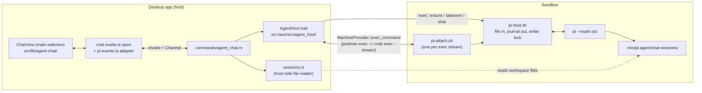

# Native Agent UI Build Plan

This document is the build plan for a chat view, rendered in the app's main webview, that drives the pi coding agent running inside a sandbox in pi's JSON-lines RPC mode. It continues `docs/features/native-agent-ui/01_ideas.md` and supersedes it wherever the two differ; the most important difference is the host-to-sandbox transport (Resolved Decision 1). Spike 01 (`docs/features/native-agent-ui/spike/01_pi-rpc-supervisor.md`) validated the in-sandbox supervisor this plan productionises. Status: Phases A to F are implemented; Phase G (translations and architecture documents) remains, and Phase B's hand verification on real sandboxes is outstanding.

## The Concrete Model

### In-sandbox supervisor

- Two POSIX shell scripts, `src-tauri/resources/agent-host/pi-host.sh` and `src-tauri/resources/agent-host/pi-attach.sh`, are embedded in the binary with `include_str!` and installed to `/usr/local/lib/mio/` inside the sandbox by `MachineProvider::exec_piped` (`src-tauri/src/provider/types.rs`) whenever the installed copy is missing or carries a different script version. The base image is not changed.
- `pi-host.sh ensure <script-version>` is the single entry point the app calls before every attach. It exits with code 10 when its own version differs from the argument; otherwise it starts the supervisor if it is not running and prints one `mio_host` JSON line (`generation`, `pi_version`, `started`) followed by every `extension_ui_request` line of the journal and every `extension_ui_response` line of the input log. The app derives pending dialogs from those lines (Resolved Decision 3).
- Starting the supervisor follows the spike shape: a named pipe and empty journal, input log and stderr log under `/run/mio/pi-host/`, a new generation id, a keeper (`sleep infinity`) holding the pipe open for writing, and `setsid mise exec -- pi --mode rpc --session-dir /root/work/.mio/pi-agent/chat-sessions` in `/root/work`. The start also records `pi --version` into the state directory.
- Liveness requires both `kill -0` on the recorded pid and `--mode rpc` in `/proc/<pid>/cmdline`, because `/run` survives a sandbox restart and post-restart pids are low.
- `pi-host.sh stop` kills the keeper, waits up to 10 seconds for pi's orderly end-of-file shutdown, then kills pi. `pi-host.sh takeover` kills the attach process recorded in `writer.pid`, after confirming its cmdline contains `pi-attach.sh`.

### Attach stream and the writer lock

- `pi-attach.sh <generation|-> <offset|end>` opens `/run/mio/pi-host/writer.lock` on a dedicated file descriptor and tries `flock -w 2`; the short wait covers the app replacing its own attach, whose old shell exits a moment after its client is killed, at the cost of a two-second delay for a genuine second reader. The holder is the writer: it records its pid in `writer.pid` and copies its stdin into the pipe through `tee -a input.jsonl`. A client that fails to take the lock is a reader: its stdin is discarded with `cat > /dev/null`, which keeps the session alive until end-of-file.
- The first stdout line is a synthetic `mio_attach` header carrying `generation`, `offset` and `writer`. The journal follows from the offset via `tail -c +<offset+1> -f --pid=$$`, with the lock descriptor closed for `tail` so only the attach shell holds the lock. A generation mismatch resets the offset to 0, as in the spike.
- The kernel releases a `flock` when the holding process dies, so a dropped connection never leaves a stale lock. Spike 01 showed that killing the host-side exec client delivers end-of-file to the in-sandbox process on both engines.

### Host side: the agent host subsystem

- A new subsystem module `src-tauri/src/agent_host/` declares the `AgentHost` trait in `types.rs`, the real `ExecAgentHost` in `mod.rs` and the replay mock `MockAgentHost` in `mock.rs`, constructed by `default_agent_host()` and chosen by `mock_backend_enabled()` (`src-tauri/src/backends/mod.rs`).
- `ExecAgentHost` holds an `Arc<ProviderRegistry>` and resolves a provider with `ProviderRegistry::provider_for` from the `MachineRef` the command passes in, as `PodmanMiseRuntime::provider_on` (`src-tauri/src/runtime/mod.rs`) does. One attach spawns `provider.exec_command(name, ["sh", "/usr/local/lib/mio/pi-attach.sh", generation, offset], ...)` with piped stdin and stdout, `kill_on_drop(true)`, the pattern `start_auth` in `src-tauri/src/agents/mod.rs` already uses for interactive auth.
- A reader task reads stdout with `read_until(b'\n')`, counts bytes to compute each record's journal offset, parses the line as JSON and sends `{ offset, end, record }` to the frontend's Tauri `Channel`. The header line is parsed separately and is not counted. When the stream ends, the task sends a synthetic `mio_detached` record with a reason.
- The live attach per sandbox (child, stdin, writer flag, cursor) lives in a map inside `ExecAgentHost`, keyed by sandbox name. A new attach for the same sandbox replaces and drops the old one.
- Frontend commands are serialised to one JSON line each and written to the attach's stdin. Responses are correlated by `id` in the frontend store, never by order.

### Frontend

- The chat is a pane kind with no webview: `AppKind::AgentChat` in `src-tauri/src/workspace/types.rs`, `"agentchat"` in `src/lib/workspace/state.svelte.ts`. Activating the pane hides the active overlay webview through the existing `activate_pane` path in `src-tauri/src/workspace/mod.rs`, and the main webview renders `ChatView` in the content area.
- `src/lib/agent-chat/chat.svelte.ts` is a module-scoped store per sandbox: attach state and cursor, messages, run state, queue, pending dialogs, usage, model and thinking level, session list.
- `src/lib/agent-chat/pi-events.ts` is a pure reducer from pi RPC records to the local message-and-parts types declared in `src/lib/agent-chat/types.ts`.
- `src/lib/components/ai-elements/` holds the building blocks of the shadcn-svelte AI Elements patterns (message scroller, message, bubble, trace, code block), copied in with the shadcn-svelte CLI and restyled to the retro theme by hand. The chat also uses the shadcn-svelte primitives `dropdown-menu`, `empty`, `hover-card`, `item`, `progress` and `spinner` from `src/lib/components/ui/`; components the CLI pulled in that the chat does not import were deleted rather than kept unused. The patterns themselves (Reasoning, Tool, Queue, Context, Confirmation, Model Selector) are composed in `src/lib/agent-chat/`.

## Resolved Decisions

1. **Host-to-sandbox transport: the engine's streamed exec through `MachineProvider::exec_command`, not the SSH alias.** `01_ideas.md` chose one `ssh <alias>` process per attach and rejected the engine's own exec because each engine would need its own path. `MachineProvider::exec_command` (`src-tauri/src/provider/types.rs`) already hides that difference for `podman exec -i` and `msb exec --stream`, and `start_auth` (`src-tauri/src/agents/mod.rs`) already streams through it. The SSH alias's `ProxyCommand` is itself that exec running `mio-sshd`, so dropping SSH removes a layer, the `~/.ssh` write in `SandboxRouter::resolve` (`src-tauri/src/services/routing.rs`) and the host-global alias that pinned real-infra attach tests to the `standard` tier. Commands therefore call `SandboxRouter::locate`, never `resolve`. Do not reintroduce an SSH spawn for the chat.
2. **Supervisor scripts are installed on demand, not baked into the base image.** `ensure` exits 10 on a version mismatch and the shell exits 127 when the script is missing; either triggers an install through `exec_piped` and one retry. Baking the scripts into `src-tauri/resources/Containerfile` would need a `BASE_IMAGE_VERSION` bump and would leave existing sandboxes without them.
3. **Pending dialogs (Open Question 1): derived from the attach script's input log.** `ensure` prints the journal's `extension_ui_request` lines and the input log's `extension_ui_response` lines; `pending_dialogs()` in `src-tauri/src/agent_host/dialogs.rs` parses both with serde and returns the `select`, `confirm`, `input` and `editor` requests with no matching response id. The input log is created with the journal at supervisor start, so no answered dialog predates it.
4. **Journal growth (Open Question 2): a new journal per supervisor start, no rotation in v1.** A cursor is `{generation, offset}`. Rotation at `agent_settled` boundaries is recorded in `04_improvements.md`.
5. **Concurrent writers (Open Question 3): a single-writer `flock` in `pi-attach.sh`.** The lock holder writes to the pipe and the input log; every other client attaches read-only and its `send` is refused by the agent host. The chat shows a read-only banner with a Take control action that runs `pi-host.sh takeover` and reattaches. The lock also serialises input-log appends, which `PIPE_BUF` atomicity alone did not guarantee for large prompts.
6. **pi version drift (Open Question 4): pin pi in the catalogue and gate the chat on the pinned version.** `PI_PINNED_VERSION` (`1.5.0`) in `src/lib/agents/pi.ts` feeds the catalogue spec `pi@1.5.0` in `src/lib/agents/catalogue.ts`. The `mio_host` line reports the running pi version; the chat store shows an Update pi state, which reruns the existing agent install, when that version is older than the pin. Bumping pi means bumping the constant and re-recording the replay fixtures.
7. **Local model metadata (Open Question 5): fixed in this feature, Phase A.** Each `ModelDescriptor` in `src/lib/models/catalogue.ts` gains `contextWindow` and `reasoning`. The llama engine always passes `--ctx-size`, using `llama_ctx_size` from settings or the new default `DEFAULT_LLAMA_CTX_SIZE` (32,768, the size Spike 01 ran). `buildPiLocalLlmProvider` writes each model's `contextWindow` as the smaller of the catalogue value and the effective llama context size, and the catalogue value alone for Foundry.
8. **Sharing sessions with Paseo (Open Question 6): the native chat uses its own session directory.** The supervisor passes `--session-dir /root/work/.mio/pi-agent/chat-sessions`, so the native chat and Paseo never write one session file from two pi processes. Paseo's sessions do not appear in the native chat's list.
9. **Message types (Open Question 7): a local, structurally compatible type.** `src/lib/agent-chat/types.ts` declares the message and part shapes the AI Elements components read; the `ai` package is not added.
10. **Streaming markdown (Open Question 8): `svelte-streamdown`, pinned.** The shadcn-svelte AI Elements are documented patterns composed from installable building blocks, and no markdown component ships with them; their documentation points to `svelte-streamdown`, which parses incomplete markdown while text streams in and renders through Svelte components rather than an HTML string. Raw HTML rendering stays off, links are limited to `https:` and `mailto:`, and images are not loaded. Only the code-highlighting component is enabled; Mermaid and KaTeX stay out of the bundle.
11. **Deployed sandboxes (Open Question 9): not supported in v1.** `agent_chat_attach` returns `AgentHostError::Deployed` when `SandboxRouter::locate` resolves a machine other than the provider's local machine, and the chat view shows an explanatory empty state. Support is recorded in `04_improvements.md`.
12. **Supervisor lifetime (Open Question 10): started lazily on the first attach, never stopped by idle time in v1.** The supervisor dies with the sandbox; the next attach starts a new generation. The chat menu offers Stop agent, which runs `pi-host.sh stop`. An idle timeout is recorded in `04_improvements.md`.
13. **Test surface: the replay mock under the `light` tier plus Rust unit tests for the pure parsers.** The frontend has no unit-test runner, so `pi-events.ts` is exercised through light specs that replay recorded traces. The pure Rust functions (journal framing, pending dialogs, session parsing) carry `cargo test` unit tests over the spike traces. A frontend unit harness for the adapter is recorded in `04_improvements.md`.
14. **`AppPane.forward_name` and `AppPane.url` become optional.** `AppPane` in `src-tauri/src/workspace/types.rs` carries `Option<String>` for both, mirrored as `string | null` in `src/lib/workspace/state.svelte.ts`, because a chat pane has no forward and no URL.

### Parallel-worktree constraints

- **New paths:** none on the host. Supervisor state stays under `/run/mio/pi-host/` inside the sandbox; session files are workspace files.
- **New host ports:** none.
- **New host-global resources:** none, because Resolved Decision 1 removed the SSH alias from the attach path.
- **New bundled binaries:** none.
- **New teardown of host-global state:** none.
- **New harness environment variables:** none.
- **Stray processes:** an attach child is a `podman` or `msb` process. `killStaleDevProcesses` in `e2e/wdio.conf.ts` matches `podman` by the worktree's `target\debug\` path prefix but not `msb`; Phase C adds `msb` to that name list with the same prefix filter.

## Implemented: Phase A — Provisioning: pin pi and accurate model metadata

- `src/lib/agents/pi.ts`: add `PI_PINNED_VERSION`; extend `buildPiLocalLlmProvider` with an effective server context argument (`null` for Foundry) and write `contextWindow` and `reasoning` per model entry.
- `src/lib/agents/catalogue.ts`: change the pi descriptor's `misePackages` to `pi@${PI_PINNED_VERSION}`. `miseKey()` already strips the version.
- `src/lib/models/types.ts`, `src/lib/models/catalogue.ts`: add `contextWindow` and `reasoning` to `ModelDescriptor` and fill them for every model from its model card.
- `src/lib/agents/provision.ts`: `provisionAgent` reads `get_settings` (`src-tauri/src/commands/app.rs`) for `inferenceEngine` and `llamaCtxSize` and passes the effective context to `buildPiLocalLlmProvider`.
- `src-tauri/src/inference/llama.rs`: pass `--ctx-size` always, from `cfg.llama_ctx_size` or `DEFAULT_LLAMA_CTX_SIZE`. Comment both ends of the pair `DEFAULT_LLAMA_CTX_SIZE` in `src-tauri/src/inference/llama.rs` and its mirror in `src/lib/agents/pi.ts`.
- `messages/en.json`: change `settings_llama_ctx_size`'s "blank = default" wording to name the 32,768 default.
- Existing workspaces pick up the new `models.json` on the next reprovision (`reprovisionInstalledAgents` in `src/lib/agents/reprovision.ts`, run at startup and on model start).

## Implemented: Phase B — Supervisor and attach scripts

Hand verification on real sandboxes is still outstanding: the bullet at the end of this section has not been run.

- `src-tauri/resources/agent-host/pi-host.sh`: productionise `docs/features/native-agent-ui/spike/pi-host.sh` with subcommands `ensure <version>`, `stop`, `takeover`; a `SCRIPT_VERSION` constant; `--session-dir`; the recorded pi version; the dialog-line output of `ensure`.
- `src-tauri/resources/agent-host/pi-attach.sh`: productionise `docs/features/native-agent-ui/spike/pi-attach.sh` with the `flock` writer lock, `writer.pid`, the `writer` header field and the reader path.
- Both scripts are POSIX `sh` using only coreutils, util-linux (`setsid`, `flock`) and procps, all present in `src-tauri/resources/Containerfile`. `.gitattributes` pins them to LF, and the install strips `
` as well, because a CRLF checkout would break `sh`.
- `ensure` serialises concurrent calls with `flock` on `start.lock`, so two attaches never start two pi processes. `stop` also ends every `pi-attach.sh`, so each client's stream closes. `takeover` kills the writer's attach shell and its children, then waits until the writer lock is free.
- `SCRIPT_VERSION` lives in `pi-host.sh` only; `ExecAgentHost` reads it from the embedded script, and `pi-attach.sh` carries it as a comment checked by a unit test.
- Verify by hand on one Podman and one microsandbox sandbox: two concurrent attaches yield one writer and one reader; killing the writer's host process frees the lock; `takeover` frees it from a live writer.

## Implemented: Phase C — Agent host subsystem and commands

- `src-tauri/src/agent_host/types.rs`: `AgentHost` trait with `ensure(name, machine) -> HostStatus`, `attach(name, machine, cursor, on_event) -> AttachInfo`, `send(name, line)`, `detach(name)`, `takeover(name, machine)`, `stop(name, machine)`; `Cursor { generation, offset }`; `HostStatus { generation, pi_version, pending_dialogs }`; `AttachInfo { generation, offset, writer }`; `AgentHostError` (`NotRunning`, `ReadOnly`, `Deployed`, `ScriptInstall`, `Stream`, `Provider`).
- `src-tauri/src/agent_host/mod.rs`: `ExecAgentHost`, `default_agent_host()`, script embedding and install, the attach reader task. `pi-host.sh` runs through a `sh -c` wrapper that exits 127 when the script is missing, because Debian's `sh` (dash) exits 2 for a missing script file. `detach_all` ends every attach on exit.
- `src-tauri/src/agent_host/framing.rs`: byte-exact line framing with offsets; unit tests over `docs/features/native-agent-ui/spike/traces/02a-drop.jsonl` and `02b-reattach.jsonl` proving contiguous offsets.
- `src-tauri/src/agent_host/dialogs.rs`: `pending_dialogs()`; unit tests over the spike's `04b`–`04f` traces.
- `src-tauri/src/agent_host/sessions.rs`: `list_sessions(workspace_path)` reads `*.jsonl` under `.mio/pi-agent/chat-sessions/` recursively, parsing the `session` header, the first user message, the message count and the file's modified time; returns each session's sandbox path (`/root/work/...`) for `switch_session`. Comment both ends of the pair `CHAT_SESSION_DIR` in `src-tauri/src/agent_host/sessions.rs` and `src-tauri/resources/agent-host/pi-host.sh`.
- `src-tauri/src/agent_host/mock.rs`: `MockAgentHost` replays fixtures from `src-tauri/src/agent_host/fixtures/` (the `record` field of the spike traces, copied in) with compressed timing. `get_state`, `get_messages`, `get_available_models` and `get_available_thinking_levels` get canned responses; a prompt containing `/spikeconfirm` replays the dialog traces; every other prompt replays `01-roundtrip`.
- `src-tauri/src/error.rs`: `AppError::AgentHost(AgentHostError)` with a `kind()` arm `"AgentHost"`, and `AppError::AgentChatDeployed` with kind `"AgentChatDeployed"`: a hand-written `From<AgentHostError>` maps `Deployed` to its own kind, as `From<BackendError>` does for `PodmanUnresponsive`, so the chat branches on `kind` rather than on message text. Both are mirrored in `AppErrorKind` in `src/lib/errors.ts`.
- `src-tauri/src/commands/agent_chat.rs`: `agent_chat_attach(name, cursor, on_event)` (`SandboxRouter::locate`, the deployed check through `SandboxRouter::is_local`, `ensure`, `attach`, returning `AttachInfo` plus `HostStatus`; a cursor whose generation differs from the running one is dropped, so the stream starts at the journal's end and the store rebuilds history with `get_messages` rather than replaying a new journal from 0), `agent_chat_send(name, line)`, `agent_chat_detach(name)`, `agent_chat_takeover(name)`, `agent_chat_stop(name)`, `agent_chat_sessions(workspace_path)`. Register all in `tauri::generate_handler![]` in `src-tauri/src/commands/mod.rs`.
- `src-tauri/src/bootstrap.rs`: `manage` the `Arc<dyn AgentHost>`; detach every attach in `on_run_event` on exit.
- `e2e/wdio.conf.ts`: add `msb` to `killStaleDevProcesses`.
- Update the module inventory and subsystem table in `src-tauri/AGENTS.md`.

## Implemented: Phase D — Chat pane in the workspace

- `src-tauri/src/workspace/types.rs`: `AppKind::AgentChat`; `AppPane.forward_name` and `AppPane.url` become `Option<String>` (Resolved Decision 14).
- `src-tauri/src/workspace/mod.rs`: `open_native_pane(app, name, workspace_path, kind)` pushes a webview-less pane through `activate_new_pane` and emits state. `hide_webview`, `show_webview` and `set_webview_bounds` already no-op for a label with no webview. `teardown_forwards` skips `AgentChat` and instead calls `AgentHost::detach`, so closing the tab, `close_app` on destroy and `close_all_apps` on exit all detach.
- `src-tauri/src/commands/panes.rs`: `open_agent_chat(name, workspace_path)` opens or switches to the chat pane, mirroring `open_agent_web`.
- `src/lib/workspace/state.svelte.ts`: `"agentchat"` in `AppKind`; nullable `forward_name` and `url`; an `activePane()` accessor returning the active `AppPane`.
- `src/lib/workspace/apps.ts`: a chat entry in `LAUNCHABLE_APPS` with `command: "open_agent_chat"`, available when the installed agents include pi; `LaunchContext.installedAgents` becomes `AgentDescriptor[]` so the rule can check the id.
- `src/routes/+layout.svelte` and `src/lib/workspace/WorkspaceContent.svelte`: derive `chatPane` (the active pane when its kind is `agentchat`, so `ChatView` also receives the workspace path) and render `ChatView` in the content area when it is set, alongside the existing `dashboardSandbox` derivation.
- `src/lib/workspace/SandboxSwitcherGroup.svelte` needed no change: it takes each tab's label and icon from the `LAUNCHABLE_APPS` entry.

## Implemented: Phase E — Chat core: adapter, store and basic rendering

- `src/lib/agent-chat/types.ts`: `ChatMessage`, `ChatPart` (text, reasoning, tool with input/running/output/error states, notice), `PendingDialog`, `RunState`, `Usage`.
- `src/lib/agent-chat/pi-events.ts`: `applyPiRecord(state, record)` handles `message_start`/`message_update`/`message_end` with `text_delta`, `thinking_delta` and their `*_end` replacements; `tool_execution_start`/`_update`/`_end`; `queue_update`; `compaction_*`; `auto_retry_*`; `extension_ui_request`; `agent_start`; `agent_settled` as the only idle signal; `response` records resolved by `id`.
- `src/lib/agent-chat/chat.svelte.ts`: `ensureChat(sandbox)`, `attach()`, `send(command)` with generated ids and a pending-response map, `detach()`. A fresh attach (no cursor) rebuilds history with `get_state` and `get_messages` and seeds pending dialogs from `HostStatus`; a reconnect passes the stored cursor. A `mio_detached` record moves the store to a disconnected state with a Reconnect action. While the run state is not idle, the prompt input sends `steer` or `follow_up` instead of `prompt`.
- `src/lib/components/ai-elements/`: the AI Elements building blocks, installed and restyled by hand (`border-2`, `shadow-md`, `rounded-md`). The prompt input is the existing `input-group`; Reasoning and Tool are composed from `trace` and `code-block` in `src/lib/agent-chat/`. Markdown renders through `svelte-streamdown` (Resolved Decision 10).
- `src/lib/agent-chat/pi-events.ts` mutates the store's state in place and returns effects (`notify`, `setEditorText`, `settled`) for the store to perform, so it stays IO-free while streaming deltas stay cheap. `response` records bypass the per-frame batch so request latency does not depend on rendering.
- `src/lib/agent-chat/ChatView.svelte`, `MessageList.svelte`, `ToolPart.svelte`, `ReasoningPart.svelte`, `Markdown.svelte`: render by part type; tool rendering is keyed by tool name, with `bash` using a terminal-style output block and file edits a removed/added code block. `Markdown.svelte` opens links with the system browser, because a followed link would navigate the main webview away.
- User-facing strings are English literals until the user approves the working feature (feature-implement skill); Phase G moves them into Paraglide.

## Implemented: Phase F — Chat features

- **Dialogs:** `ConfirmationDialog.svelte` renders `select`, `confirm`, `input` and `editor` requests and answers with `extension_ui_response`; `notify` becomes a `svelte-sonner` toast; `setStatus` and `setWidget` feed a status line.
- **Queue:** the AI Elements Queue pattern renders `queue_update`, with abort.
- **Model and thinking level:** a Model Selector fed by `get_available_models` and `get_available_thinking_levels`, sending `set_model` and `set_thinking_level`. Every command name and event field the chat uses was checked against the RPC command and JSON event documents bundled in the published `@earendil-works/pi-coding-agent@1.5.0` package. The thinking-level control shows only for a model with `reasoning`.
- **Context meter:** the AI Elements Context pattern fed by the usage on `message_end` and the model's `contextWindow` from `get_state`.
- **Notices:** compaction and retry records render as timeline notices.
- **Sessions:** a session list from `agent_chat_sessions`, New session (`new_session`) and switching (`switch_session` with the sandbox path).
- **Read-only and takeover:** a banner when `AttachInfo.writer` is false, with Take control (`agent_chat_takeover` then reattach).
- **Version gate:** an Update pi state when `HostStatus.pi_version` is older than `PI_PINNED_VERSION`.
- **Inference not running:** when a run settles with an error, the store calls `inference_status` (`src-tauri/src/commands/inference.rs`) and, if no server runs, shows a state linking to `/models`.
- **Deployed:** the empty state for `AgentHostError::Deployed`.
- **Stop agent:** a chat menu action calling `agent_chat_stop`. The store then enters a `stopped` state, which the view does not reattach from on its own, because attaching would start pi again; Start agent attaches explicitly.
- The view attaches once per mount, so a stream that ends while the chat is open leaves the Reconnect banner up instead of reattaching in a loop.
- **Update pi** reruns `install_agent` for the pinned spec and provisioning, then stops the supervisor and attaches fresh, so the new binary runs.
- The composer keeps a right gutter, because the activity bell is fixed in the window's bottom-right corner and covered the Send button.

## Remaining: Phase G — Translations and architecture

- Move every chat string into `messages/en.json`, `messages/de.json` and `messages/ru.json` after the user approves the working feature.
- `docs/architecture/agents.md`: the native chat, the in-sandbox supervisor and its own session directory.
- `docs/architecture/workspace-ui.md`: a pane kind with no webview and no forward; the invariant that every pane is backed by a Mutagen forward no longer holds.
- `docs/architecture/inference.md`: the llama server always runs with an explicit context size.

## Lifecycle and Cross-Cutting Concerns

- **Attach lifetime.** One attach per sandbox per app instance. Closing the chat tab, closing the sandbox's workspace, destroying the sandbox and app exit all detach; none stops pi. Only Stop agent and a sandbox stop end pi.
- **Sandbox stop.** The exec stream ends, the reader task sends `mio_detached`, and the store shows Reconnect. The next attach finds the stale pid rejected by the cmdline check and starts a new generation, so the stored cursor resets to offset 0 and the store rebuilds history with `get_messages`.
- **State derivation.** Conversation history comes from pi (`get_messages`), never from the journal on a fresh attach; the journal is replayed only from a stored cursor. Pending dialogs come from `HostStatus` on a fresh attach and from the replayed stream on a reconnect.
- **Webview reload.** The `Channel` from the previous page is dead; the reader task's send fails and the attach ends. The reloaded page attaches fresh.
- **Two app instances.** The second instance is a reader until Take control; the first instance's stream then ends and its store shows Reconnect, which attaches as a reader.

## Common Gotchas

| Gotcha | Cause | Fix |
|---|---|---|
| pi exits as soon as the chat disconnects | pi shuts down on end-of-file on stdin, and the last writer to the named pipe closed the pipe | Keep the keeper in `src-tauri/resources/agent-host/pi-host.sh` holding the pipe open for writing for pi's whole lifetime |
| The chat ignores the local model or reports a 128,000-token window | pi was started without `mise exec --`, or `models.json` predates Phase A and lacks `contextWindow` | Start pi through `mise exec --` in `/root/work`; trigger `reprovisionInstalledAgents` (`src/lib/agents/reprovision.ts`) to rewrite `models.json` |
| Journal offsets drift and a reconnect replays a partial or duplicated line | The reader counted bytes after stripping `\r\n`, or split on characters other than line feed | Frame with `read_until(b'\n')` in `src-tauri/src/agent_host/framing.rs` and count the raw bytes, terminator included |
| A second app window's prompts are silently dropped | The second attach is a reader because the first holds `writer.lock` | Check `AttachInfo.writer` and show the read-only banner; Take control runs `pi-host.sh takeover` |
| The lock stays held after the writer detached | `tail` inherited the lock descriptor and outlived the attach shell | Close the lock descriptor for `tail` in `src-tauri/resources/agent-host/pi-attach.sh` |
| A dialog stays listed as pending after it was answered | The answer bypassed `pi-attach.sh`, or reached pi before the input log existed | Route every write through the attach script and create the input log at supervisor start in `pi-host.sh` |
| The chat shows idle while pi is still retrying or running queued work | `agent_end` can be followed by an automatic retry or queued follow-ups | Treat only `agent_settled` as idle in `src/lib/agent-chat/pi-events.ts` |
| A `prompt` sent during a run returns an error | pi requires `streamingBehavior` for a prompt sent while streaming | Send `steer` or `follow_up` from `src/lib/agent-chat/chat.svelte.ts` whenever the run state is not idle |
| `switch_session` fails with a missing file | The host path of the session file was sent instead of the sandbox path | Send the `/root/work/...` path returned by `list_sessions` in `src-tauri/src/agent_host/sessions.rs` |
| The native chat's session list is empty although Paseo shows sessions | The native chat runs pi with `--session-dir .mio/pi-agent/chat-sessions` (Resolved Decision 8) | Expected; the two UIs keep separate session directories |
| Attach fails with exit code 127 or 10 | The supervisor scripts are missing from `/usr/local/lib/mio/` or carry an old `SCRIPT_VERSION` | `ExecAgentHost` reinstalls through `exec_piped` and retries once; bump `SCRIPT_VERSION` in both scripts with every script change |
| The supervisor reports running after a sandbox restart and attach writes into a dead pipe | `/run` is not a tmpfs, so a stale `pi.pid` survives and may match an unrelated low pid | Keep the `/proc/<pid>/cmdline` check for `--mode rpc` in `pi-host.sh` |
| The chat waits forever for `agent_settled` | The workspace runs a pi older than the pinned 1.5.0 | Show the Update pi state from `HostStatus.pi_version` and rerun the agent install |
| A `light` run spawns real `podman` or `msb` exec processes | `ExecAgentHost` was constructed under `MIO_MOCK_BACKEND=1`; a streamed child bypasses the scripted `ProcessRunner` | Construct `MockAgentHost` in `default_agent_host()` whenever `mock_backend_enabled()` (`src-tauri/src/backends/mod.rs`) is true |
| The chat pane opens but the content area still shows the Manage dashboard | `src/routes/+layout.svelte` derives only `dashboardSandbox` and ignores the active pane's kind | Derive `chatPane` from `activePane()` in `src/lib/workspace/state.svelte.ts` and render `ChatView` |
| Closing the chat tab leaves an exec stream running | `teardown_forwards` in `src-tauri/src/workspace/mod.rs` handled only forward-backed kinds | Call `AgentHost::detach` for `AppKind::AgentChat` in `teardown_forwards` |
| The context meter overstates the window on the Foundry engine | Foundry's served context is not probed; provisioning writes the catalogue value | Known approximation in v1; recorded in `docs/features/native-agent-ui/04_improvements.md` |
