# Native Terminal Build Plan

This document is the build plan for rendering a sandbox's Terminal tab inside the app's main webview, fed by an SSH session the Rust backend owns over the engine's exec, attached to the sandbox's zellij session, and for retiring the `zellij web` child webview. It continues [01_ideas.md](01_ideas.md) and supersedes it wherever the two differ; the most important additions are Resolved Decision 7 (zellij sessions are created through the engine exec, never through SSH) and Resolved Decision 2 (hidden terminals stay mounted in a layout-level layer). The gating spike ([spike record](spike/README.md)) measured the proposed path at a median 636 ms to the first zellij frame on a warm Podman sandbox against at least 2,428 ms for the current chain. The renderer is wterm with its Ghostty core, chosen by the user; no further spike precedes implementation, and the renderer-fitness items 01_ideas.md left unvalidated are acceptance checks in Phase D. Status: Phases A to E are implemented in code; Phase B's hand verification and Phase D's acceptance checks have not been run in full, and Phase F remains.

## The Concrete Model

```mermaid
flowchart LR
  subgraph host["Desktop app (host)"]
    layer["TerminalLayer (layout level)<br/>src/lib/terminal/"]
    view["TerminalView per terminal pane<br/>+ WtermRenderer (@wterm/svelte, GhosttyCore)"]
    cmds["commands/terminal.rs"]
    svc["services/panes.rs<br/>attach_terminal_session"]
    th["TerminalHost trait<br/>src-tauri/src/terminal/"]
  end
  subgraph sandbox["Sandbox"]
    sshd["mio-sshd (sshd -i)"]
    client["zellij attach &lt;name&gt; (client)"]
    server["zellij server, session &lt;name&gt;<br/>panes in /root/work"]
  end
  layer --> view
  view -- "invoke: attach, input, resize" --> cmds
  th -- "Channel: raw output bytes,<br/>Channel: exit events" --> view
  cmds --> svc --> th
  th -- "MachineProvider::exec_command<br/>(podman exec -i / msb exec --stream) mio-sshd<br/>russh over the child's stdio" --> sshd
  th -- "MachineProvider::exec:<br/>zellij attach --create-background &lt;name&gt;" --> server
  sshd --> client --> server
```

### Session host (Rust)

- A new subsystem module `src-tauri/src/terminal/` declares the `TerminalHost` trait in `types.rs`, implements `SshTerminalHost` in `mod.rs` and the SSH client handler in `ssh.rs`, and provides `MockTerminalHost` in `mock.rs`. `default_terminal_host(registry)` returns the mock whenever `mock_backend_enabled()` (`src-tauri/src/backends/mod.rs`) is true, as `default_agent_host()` in `src-tauri/src/agent_host/mod.rs` does.
- `SshTerminalHost` holds an `Arc<ProviderRegistry>` and a map of live sessions keyed by sandbox name. One app instance holds at most one session per sandbox; a new attach for the same sandbox supersedes the old entry, pending or live (see Implemented: Review fixes).
- **Attach** takes an `AttachRequest` (sandbox name, `MachineRef`, whether the sandbox must be started, identity path, known-hosts path, initial columns and rows) and two Tauri channels: one for raw output bytes, one for `TerminalEvent` JSON. It runs, in order:
  1. `MachineProvider::start` when the request says the sandbox is not running (Resolved Decision 11).
  2. Concurrently: (a) spawn `provider.exec_command(name, ["mio-sshd"], ExecOpts::default())` with piped stdin and stdout, `stderr` null and `kill_on_drop(true)`, join the child's stdout and stdin into one stream, and run `russh::client::connect_stream` over it, verify the host key (Resolved Decision 10), authenticate with `authenticate_publickey` as `root` using `load_secret_key` on the identity path, open a session channel and send `request_pty` with `xterm-256color` at the requested size; (b) run `provider.exec(name, ["zellij", "attach", "--create-background", name], ExecOpts { workdir: Some("/root/work"), .. })`, which creates or resurrects the zellij session with the container's environment (Resolved Decision 7).
  3. After both succeed, `exec` the remote command `zellij attach <name>` (name shell-quoted) on the channel, then wait for the channel's `Success` or `Failure` reply before attach resolves.
  4. Spawn one session task that owns the russh channel and an mpsc receiver of `SessionCommand::Input(bytes)` and `SessionCommand::Resize(cols, rows)`. The task selects between `Channel::wait()` and the receiver: `ChannelMsg::Data` goes to the output channel as `InvokeResponseBody::Raw`, input becomes `Channel::data`, resize becomes `Channel::window_change`. On `ChannelMsg::ExitStatus`, end-of-file, a closed transport or a failed channel send, the task sends `TerminalEvent::Exited { reason, exit_status }`, disconnects, and removes its map entry only if no newer session replaced it (the session-id check `read_stream` in `src-tauri/src/agent_host/mod.rs` uses).
- **Input, resize, detach** look up the live session and send on its mpsc sender; `detach` drops the map entry, which closes the sender, ends the task and kills the exec child. The zellij session keeps running inside the sandbox.
- The spike's probe (`docs/features/native-terminal/spike/ssh-probe/src/main.rs`) is the reference for every russh call above; it ran all of them on Podman and microsandbox.

### Session lifecycle in the workspace

- `AppKind::Terminal` (`src-tauri/src/workspace/types.rs`) becomes a native pane: `open_terminal_pane` registers it through `workspace::open_native_pane` (`src-tauri/src/workspace/mod.rs`) with no URL and no forward, exactly as `open_agent_chat` does, so the tab appears at once and the view attaches.
- Closing the pane, closing the sandbox's workspace, destroying the sandbox and app exit call `TerminalHost::detach` or `detach_all`; none ends the zellij session.

### Frontend

- `src/lib/terminal/TerminalLayer.svelte` is mounted once in `src/routes/+layout.svelte`, outside the `{#key viewSandbox}` block, and renders one `TerminalView` per registered terminal pane, keyed by pane label. The layer is `position: fixed` with its origin at the overlay rectangle Rust computes (`WorkspaceState.overlay`) and its right and bottom edges at the window's, because the pane area always reaches both. Rust emits no `workspace://state` event on a window resize (`relayout` in `src-tauri/src/workspace/mod.rs`), so taking the width and height from the overlay would leave the layer at its old size; the origin changes only on a sidebar collapse, which does emit.
- The active terminal pane is visible and focused. Every other terminal pane stays mounted with `visibility: hidden`, `pointer-events: none` and wterm's `renderingPaused`, so it keeps parsing output and keeps its size while a page, the Manage tab or another sandbox shows (Resolved Decision 2).
- `src/lib/terminal/TerminalView.svelte` owns one session: it creates the two channels, calls `terminal_attach` with the renderer's measured size, writes output bytes into the renderer, sends `onData` input through `terminal_input`, sends debounced `onResize` sizes through `terminal_resize`, and shows connecting, ended (with Reconnect) and failed (with the `parseError` message and Retry) states over the renderer.
- `src/lib/terminal/WtermRenderer.svelte` is the only file that imports `@wterm/*`. It loads one `GhosttyCore` per terminal in `onMount` with `GhosttyCore.load()`, renders `Terminal` from `@wterm/svelte` with `core`, `autoResize` and the DOM renderer once the core resolves, and calls `GhosttyCore.dispose()` on destroy. It exposes the renderer interface 01_ideas.md asked for: props `onInput`, `onResize`, `paused`, and methods `write`, `focus` and `readText`. Swapping to xterm.js means replacing this one file.

## Resolved Decisions

1. **Renderer library (Q1): wterm with the Ghostty core, DOM renderer, pinned.** The user chose wterm; `@wterm/svelte`, `@wterm/dom` and `@wterm/ghostty` are pinned exactly at `0.5.10`, the release current on 2026-11-16. DOM text gives native selection and browser find, and `WTerm.readText()` gives e2e specs the screen text whichever renderer is active. The renderer-fitness items from 01_ideas.md Validation (first frame, output flood, IME, paste, mouse mode) are Phase D acceptance checks, not a spike. A failed check is fixed inside `WtermRenderer.svelte`; when it cannot be, the fallback is xterm.js behind the same renderer interface, recorded as a decision change in this document before any code moves.
2. **Session lifetime while hidden (Q2): the SSH session and the terminal component both stay alive while the pane is registered.** The 01_ideas.md recommendation kept the session open but let the component unmount, which would lose every byte written while hidden and need a forced zellij redraw. Mounting terminals in a layout-level layer with rendering paused keeps the screen current at no transport cost; a webview reload is the only remount, and the reattach makes zellij draw a full frame for the new client.
3. **Retiring `zellij web` (Q3): removed in this feature, with no fallback setting.** Phase E deletes `RuntimeManager::prepare_terminal`, the terminal's token login, `ServiceKind::Terminal` and the terminal forward. Keeping both paths would double the terminal's e2e surface for a path the spike showed is about three times slower.
4. **Keyboard ownership (Q4): the focused terminal receives every key.** The app defines no app-wide shortcuts: the only window-level `keydown` listener is the onboarding book's (`src/lib/onboarding/book/Book.svelte`), which is not mounted beside a sandbox view. WebView2 browser accelerators (Ctrl+F, Ctrl+P, Ctrl+R, F5) must not fire while the terminal is focused, because zellij and bash bind several of them; Phase D verifies that wterm's handled keys suppress them and, for any that leaks, adds a capture-phase `keydown` handler in `WtermRenderer.svelte` that calls `preventDefault` for that key.
5. **Pre-warming (Q5): no.** The terminal attaches only when its pane is opened, which keeps the lazy-terminal behaviour `e2e/test/specs/standard/embedded-workspace.spec.ts` asserts. Pre-warming is recorded in [04_improvements.md](04_improvements.md).
6. **`russh` crypto backend (Q6): `ring`.** `src-tauri/Cargo.toml` adds `russh = { version = "0.65.1", default-features = false, features = ["ring", "flate2", "rsa"] }`, the feature set the spike probe built and measured. `ring` is already in the dependency tree through `rcgen` in `src-tauri/Cargo.toml`, and the default `aws-lc-rs` backend needs NASM on Windows.
7. **zellij sessions are created through the engine exec, never through SSH.** `sshd` gives each session a fresh environment, so a zellij server started by `zellij attach --create` over SSH would lack the container's environment: the proxy variables and CA-trust overrides `proxy_env` in `src-tauri/src/proxy/mod.rs` injects, and `MISE_LOCKFILE` and `MISE_YES` from `src-tauri/resources/Containerfile`. The spike did not exercise this, because it timed attach only. `zellij attach --create-background <name>` through `MachineProvider::exec` starts the server with exactly the environment the `zellij web --daemonize` exec gives it today, and with `/root/work` as its working directory; the SSH channel then only runs the `zellij attach <name>` client. The exec runs concurrently with the SSH handshake, so it adds little to the warm path.
8. **Transport: `SandboxRouter::locate`, not `resolve`.** The session spawns the engine exec itself, so it needs neither the `~/.ssh` alias nor the alias rewrite under the cross-process lock in `src-tauri/src/ssh/mod.rs`, the same reasoning as `docs/features/native-agent-ui/02_dev.md`, Resolved Decision 1. The SSH protocol is kept, unlike the agent chat, because the pseudo-terminal and `window-change` are what the terminal needs (01_ideas.md, SSH client).
9. **Bytes cross the IPC boundary raw.** Output goes over a `tauri::ipc::Channel` sending `InvokeResponseBody::Raw`, which arrives in JavaScript as an `ArrayBuffer`; a `Vec<u8>` serialised as JSON would be a number array about four times larger, and zellij paints about 23 KB per full frame. Input is small and goes as a JSON string through `terminal_input`, because wterm's `onData` yields strings. Exit events go over a second, JSON-typed channel, so the raw channel carries nothing but terminal bytes.
10. **Host-key handling: the per-sandbox known-hosts file, accept-new.** `ssh.rs` checks the server key against `sandbox_known_hosts_path` (`src-tauri/src/backends/mod.rs`, made `pub(crate)`) under the host name `<sandbox-name>` and port 22, the entry OpenSSH writes for the alias, using the known-hosts helpers in `russh::keys`. An absent entry is learned into the file, matching `StrictHostKeyChecking accept-new`; a mismatching entry fails the attach with `TerminalError::HostKeyChanged`. The user's own known hosts are never read or written. `forget_sandbox_host_key` already deletes the file whenever a fresh container is created, so a base-image rebuild does not trip the check.
11. **No `podman start` on the warm path.** `SandboxRoute` (`src-tauri/src/services/routing.rs`) gains `running: bool`, true when the `Sandbox` entry `sandbox_provider` already lists has status `running` and the machine is the provider's local machine. The attach calls `MachineProvider::start` only when `running` is false, saving the median 291 ms `podman start` costs on a running container (spike Task 1). A deployed sandbox is never `running` by this rule, so it is always started, as `prepare_terminal` does today.
12. **Deployed sandboxes: supported through the same path.** `ProviderRegistry::provider_for` resolves a deploy target's provider, whose `exec_command` runs `podman --connection <target> exec -i <name> mio-sshd`, and deploy installs the same sandbox identity (`src-tauri/src/backends/mod.rs`). The spike did not run it, so Phase B verifies it by hand on the remote test machine; that check has not been run, and Phase E went ahead without it at the user's decision.
13. **Legacy state from the web terminal is swept.** The Mutagen daemon outlives the app, so a `terminal-<sandbox>` forward from an earlier app version survives the upgrade; `sweep_stale_forwards` in `src-tauri/src/sync/mod.rs` terminates every `terminal-` session at startup, as it does for `expose-` and `inference-`. A `zellij web` server already running in a sandbox keeps listening on its port until the sandbox stops; with no terminal forward to exclude it, the port poller in `src-tauri/src/network/mod.rs` auto-exposes that port meanwhile. The auto-exposure is accepted: it ends with the sandbox's next stop and serves only a token-protected login page.
14. **The base image does not change.** `zellij`, its dumped config and `mio-sshd` are already baked into `src-tauri/resources/Containerfile`; only the comments naming `zellij web` change, so `BASE_IMAGE_VERSION` is not bumped and existing sandboxes need nothing.
15. **Error surface: one `AppError::Terminal` kind.** `TerminalError` (`src-tauri/src/terminal/types.rs`: `Spawn`, `Handshake`, `HostKeyChanged`, `Auth`, `SessionCreate`, `NotAttached`, `Provider`) converts into `AppError::Terminal` with kind `"Terminal"` in `src-tauri/src/error.rs`, mirrored in `AppErrorKind` in `src/lib/errors.ts`. The view shows the message; no variant needs its own kind, because every failure offers the same Retry.

### Parallel-worktree constraints

- **New paths:** none. The session reads the identity and known-hosts files under `crate::paths::sandbox_key_dir` (`src-tauri/src/paths.rs`), which honours `MIO_APP_DATA_DIR`; the known-hosts write lands in the same per-worktree directory.
- **New host ports:** none. The terminal no longer allocates a loopback port, because the forward is gone.
- **New host-global resources:** none. Resolved Decision 8 keeps the terminal off the `~/.ssh` alias, so a real-infra terminal spec no longer depends on the host-global alias file.
- **New bundled binaries:** none.
- **New teardown of host-global state:** none. The `terminal-` sweep in Resolved Decision 13 runs against the app-private Mutagen data directory each worktree's run already isolates.
- **New harness environment variables:** none.
- **Stray processes:** a session child is a `podman` or `msb` process, which `killStaleDevProcesses` in `e2e/wdio.conf.ts` already matches by the worktree's `target\debug\` path prefix.

## Implemented: Phase A — Dependencies

- `src-tauri/Cargo.toml`: add `russh` per Resolved Decision 6. `russh` re-exports its key handling as `russh::keys`; no separate `russh-keys` crate is added.
- `package.json`: add `@wterm/svelte`, `@wterm/dom` and `@wterm/ghostty`, each pinned exactly at `0.5.10`. Bump `svelte` from the exact `5.55.0` pin to the exact `5.57.3` pin, because `@wterm/svelte@0.5.10` declares the peer dependency `svelte ^5.57.0`.
- Verify with `cargo check` in `src-tauri/` and `pnpm check` at the repository root; a Svelte bump can surface new svelte-check diagnostics, which are fixed in this phase. Both passed with no new diagnostics; `russh` resolved to `0.65.2`.

## Implemented: Phase B — Terminal session host subsystem

- `src-tauri/src/terminal/types.rs`: `TerminalHost` trait with `attach(req: AttachRequest, on_output: Channel<InvokeResponseBody>, on_event: Channel<TerminalEvent>) -> Result<(), TerminalError>`, `input(name, bytes)`, `resize(name, cols, rows)`, `detach(name)`, `detach_all()`; `AttachRequest`; `TerminalEvent::Exited { reason, exit_status }`; `TerminalError`.
- `src-tauri/src/terminal/mod.rs`: `SshTerminalHost`, `default_terminal_host(registry)`, the attach sequence and the session task from The Concrete Model. A pure function renders the two in-sandbox argv lists (the `--create-background` exec and the `zellij attach <name>` remote command) so a unit test pins both.
- `src-tauri/src/terminal/ssh.rs`: the `russh::client::Handler` whose `check_server_key` applies Resolved Decision 10, and the stdio stream adapter the probe defines as its `Pipe` type.
- `src-tauri/src/terminal/mock.rs`: `MockTerminalHost`. On attach it writes the banner `mio mock terminal <name>` and a `$ ` prompt to the output channel, echoes every input byte back (carriage return as carriage return plus line feed), writes `[resize <cols>x<rows>]` on every resize so a `light` spec can assert resizes, and sends `Exited` on detach.
- `src-tauri/src/backends/mod.rs`: make `sandbox_known_hosts_path` `pub(crate)`.
- `src-tauri/src/services/routing.rs`: `SandboxRoute.running` per Resolved Decision 11; `sandbox_provider` returns the listed status alongside the provider.
- `src-tauri/src/error.rs` and `src/lib/errors.ts`: `AppError::Terminal` per Resolved Decision 15.
- `src-tauri/src/bootstrap.rs`: `manage` the `Arc<dyn TerminalHost>` next to the agent host, and call `detach_all` in `on_run_event` on `RunEvent::Exit`, as the agent host does.
- `src-tauri/AGENTS.md`: add `TerminalHost` to the subsystem table and `terminal/` to the module inventory.
- The session task treats end-of-file as non-terminal, because `sshd` sends it before the exit status; a close, an exit status, a refused exec or a dead transport ends the session. The russh client sets no inactivity timeout and sends its own keepalive every 30 seconds, giving up after three unanswered.
- An attach is bounded by a 60-second timeout over the start, exec spawn, handshake and session creation, and fails with `TerminalError::Handshake` when it expires.
- **Not yet run:** the hand verification below. No Podman machine was running when Phase B was built, so it remains open and is still to be run through the app's `terminal_attach` command. The user waived it as a precondition of Phase E after testing the terminal by hand (it opens, renders, reopens after closing the tab, and reattaches after a sandbox stop and start); every item below not marked as verified by hand stays not yet run. Hand verification on one Podman sandbox, one microsandbox sandbox and one sandbox deployed to the remote test machine:
  - the first output byte arrives, and zellij draws at the requested size;
  - a resize redraws zellij at the new size;
  - a pane created by a new session starts in `/root/work`, and `env` inside it shows the proxy variables when the sandbox has an egress proxy (Resolved Decision 7);
  - `zellij attach --create-background <name>` exits non-zero with "Session already exists" when the session is running (seen by hand: reopening a closed terminal tab failed), so the attach treats that message as success; after the sandbox is stopped and started, the terminal reattaches (verified by hand), so the `zellij delete-session` retry fallback is not needed;
  - an idle session survives two minutes, which proves the client answers the `keepalive@openssh.com` probes `ClientAliveInterval 15` in `src-tauri/resources/Containerfile` sends;
  - killing the app process ends the in-sandbox `sshd -i` within about 45 seconds, and the zellij session survives.

## Implemented: Phase C — Commands, service and the native pane

- `src-tauri/src/services/panes.rs`: `attach_terminal_session(name, cols, rows, on_output, on_event, router, terminal, app)` runs `SandboxRouter::locate`, derives the identity path with `ensure_sandbox_identity` and the known-hosts path with `sandbox_known_hosts_path` (`src-tauri/src/backends/mod.rs`), and calls `TerminalHost::attach`.
- `src-tauri/src/commands/terminal.rs`: `terminal_attach(name, cols, rows, on_output, on_event)`, `terminal_input(name, data: String)`, `terminal_resize(name, cols, rows)`, `terminal_detach(name)`. Register all four in `tauri::generate_handler![]` in `src-tauri/src/commands/mod.rs`.
- `src-tauri/src/commands/panes.rs`: `open_terminal_pane(name, workspace_path)` becomes a synchronous switch-or-open through `workspace::open_native_pane(&app, &name, &workspace_path, AppKind::Terminal)`, mirroring `open_agent_chat`.
- `src-tauri/src/workspace/mod.rs`: `teardown_forwards` calls `TerminalHost::detach` for `AppKind::Terminal` instead of closing a forward. Update the doc comments on `AppKind` and `AppPane` in `src-tauri/src/workspace/types.rs`: Terminal is a native pane.

## Implemented: Phase D — Terminal view in the main webview

- `src/lib/workspace/state.svelte.ts`: mirror `WorkspaceState.overlay` and add an `overlayRect()` accessor; update the `AppPane` comment (terminal panes are native too).
- `src/lib/terminal/WtermRenderer.svelte`, `src/lib/terminal/TerminalView.svelte`, `src/lib/terminal/TerminalLayer.svelte`: as described in The Concrete Model. `TerminalView` writes each output `ArrayBuffer` as a `Uint8Array`; if `write` accepts only strings, it decodes through one `TextDecoder` with `{ stream: true }` per session. `onResize` sends are debounced to one per animation frame and skipped while the pane is hidden. OSC 52 clipboard writes from zellij go through wterm's `onClipboardWrite` to `navigator.clipboard.writeText`.
- `src/routes/+layout.svelte`: mount `TerminalLayer` beside the sidebar when `isNavigationPanel` and not `chromeless`.
- `src/lib/workspace/SandboxView.svelte`: keep rendering nothing for an active terminal pane; update the comment, since the layer, not a webview, now draws over the empty region.
- `src/lib/workspace/apps.ts` needs no change: the terminal entry already invokes `open_terminal_pane`.
- User-facing strings stay English literals until the user approves the working feature (`feature-implement` skill); Phase F moves them into Paraglide.
- `src/lib/terminal/wterm.d.ts` declares the `@wterm/svelte/css` module, because the package exports its stylesheet without a `types` condition and svelte-check rejects the side-effect import otherwise. The Ghostty core loads its WebAssembly through the package's default URL; `vite build` emits it as a hashed asset, so no `wasmPath` is needed.
- `TerminalView` exposes its state as `data-status` (`loading`, `connecting`, `attached`, `ended`, `failed`) on the element carrying `data-terminal="<sandbox>"`, with `data-terminal-reconnect`, `data-terminal-retry` and `data-terminal-error` on the controls, for `03_e2e.md` to build on. It never calls `terminal_detach` on unmount: a closed and reopened pane mounts a new view under the same label, and a late detach from the old view would end the new session.
- `e2e/test/specs/light/native-terminal-ui.spec.ts` drives the real commands, layer and renderer against `MockTerminalHost`: the pane registers with no URL or forward, the view attaches and renders the mock banner, typed input echoes, and closing the pane unmounts the view and ends the session. It passes; `03_e2e.md` may adopt or replace it.
- **Not yet run:** the acceptance checks below. They need a running Podman machine, a microsandbox sandbox and a person at the keyboard. Acceptance checks by hand in `pnpm tauri dev` on Podman and microsandbox, each recorded in this section when run: time from tab click to the first zellij frame; a verbose build log (for example `seq 1 200000`) streams without freezing the window; IME composition (Windows Japanese IME) commits text into bash; paste, including multi-line paste, arrives once and bracketed; zellij's mouse mode selects panes and scrolls; Ctrl+R reaches bash reverse search and Ctrl+F, Ctrl+P and F5 neither find, print nor reload (Resolved Decision 4); switching to Home and back shows output written while hidden; collapsing the sidebar resizes zellij.

## Implemented: Phase E — Retire the zellij web terminal

- `src-tauri/src/runtime/types.rs`, `src-tauri/src/runtime/mod.rs`, `src-tauri/src/runtime/mock.rs`: delete `prepare_terminal`, `ZELLIJ_WEB_PORT`, `parse_token` and its tests, and `RuntimeError::TerminalUnavailable` with `terminal_unavailable`.
- `src-tauri/src/services/panes.rs`: delete `prepare_terminal_webview` and its init-script login.
- `src-tauri/src/workspace/mod.rs` and `src-tauri/src/workspace/types.rs`: delete `embed_terminal`; rename `TerminalPane` to `WebviewPane`, since only the agent web UI uses it.
- `src-tauri/src/network/types.rs`, `src-tauri/src/network/mod.rs`, `src-tauri/src/network/mock.rs`: delete `ServiceKind::Terminal` and its arms in `forward_name` and the port poller's exclusion list.
- `src-tauri/src/sync/mod.rs`: `sweep_stale_forwards` treats every `terminal-` session as orphaned (Resolved Decision 13).
- `src/lib/network/state.svelte.ts` and `src/routes/projects/PortsManager.svelte`: delete the `terminal` forward kind and its label.
- `src-tauri/resources/Containerfile`: reword the comments that name `zellij web` as the terminal's dependency; no instruction changes (Resolved Decision 14).
- `e2e/test/specs/standard/embedded-workspace.spec.ts`: replace the `zellij web` status, token, forward and HTTP 200 assertions with native-pane assertions (null `url` and `forward_name`, no `terminal-` forward, no zellij session before the tab opens, a zellij session after it). `e2e/test/specs/standard/forward-sweep.spec.ts`: assert the unconditional `terminal-` sweep. `e2e/lib/workspace.ts`: update the comment that calls Terminal a native webview surface. The full test plan belongs to `03_e2e.md`.
- As built: the embedded-workspace spec reads the live zellij sessions with `zellij list-sessions --no-formatting` through `podman exec`, waits for the view's `data-status` `attached`, asserts the view renders output, that closing the tab leaves the zellij session running and reopening reattaches to it, and replaces every forward-connected check with the view's state. The forward-sweep spec gains a seeded `terminal-e2e-legacy-sweep` session (`SWEEP_LEGACY_TERMINAL_SESSION` in `e2e/lib/mutagen.ts`, planted by `beforeSession` in `e2e/wdio.conf.ts`); no live sandbox carries that name, so the spec proves the sweep but not that it ignores sandbox liveness, which only the code shows. Both are `standard` specs and pass: a full `./build.exe e2e standard` run passed all 18 spec files.
- Beyond the plan's file list: `parse_token` had no tests to delete. `embed_external` in `src-tauri/src/workspace/mod.rs` stays, now serving only the agent web UI. Comments naming terminal forwards or terminal webviews were corrected in `src-tauri/src/network/`, `src-tauri/src/workspace/`, `src/lib/workspace/SandboxHeader.svelte` and `src/routes/projects/PortsManager.svelte`, and the `runtime/`, `network/`, `services/` and `workspace/` lines of `src-tauri/AGENTS.md` and the summary in the root `AGENTS.md` no longer mention the web terminal. No translation key belonged only to the web terminal.

## Implemented: Review fixes

- **Session table.** `src-tauri/src/terminal/sessions.rs` holds a pure `SessionTable` with one entry per sandbox, either `Pending { id }` or `Live`. `attach` allocates its id and registers `Pending` before `open()`, replacing any earlier entry; afterwards it promotes only if its own `Pending` entry is still there. A detach or a newer attach in between makes promote fail: the opened session is disconnected, its exec child killed, and the attach returns `TerminalError::Cancelled`. `input` and `resize` only see `Live` entries, `detach` removes either kind, and a finishing session task removes only a `Live` entry with its own id. The frontend needs no new error kind: `Cancelled` is a `Terminal` error, and `TerminalView`'s `current` guard drops it for a replaced attach.
- **Exec reply wait.** `connect` in `src-tauri/src/terminal/ssh.rs` consumes the pseudo-terminal reply, and `open` then waits for the reply to the `exec` request, bounded by the attach timeout. `Failure` fails the attach with a `Handshake` error; output that arrives before `Success` is forwarded first by the session task.
- **Ordered input.** `TerminalView` sends input and resize invokes through one promise chain per view, coalescing input queued while a send is in flight.
- **Exit cleanup.** `LiveSession` keeps its task handle. `detach_all` drops every sender and awaits the tasks for up to three seconds, then aborts the stragglers, which drops their `kill_on_drop` exec children; `on_run_event` blocks on it.
- **Name validation.** `attach_terminal_session` calls `validate_name` before `ensure_sandbox_identity`, and the client command shell-quotes the name.
- **Renderer retry.** A `GhosttyCore.load()` failure has its own Retry that remounts `WtermRenderer` through a `{#key}` block; the attach-failure Retry still calls `attach`.

## Remaining: Phase F — Translations, architecture and the superseded feature

- Move every terminal string into `messages/en.json`, `messages/de.json` and `messages/ru.json` after the user approves the working feature.
- `docs/architecture/workspace-ui.md`: the terminal is a native pane drawn by the main webview from a layout-level layer; replace the Terminal Login section; the statement that every pane is backed by a forward no longer holds.
- `docs/architecture/transport.md`: the terminal reaches the sandbox over SSH carried directly on the engine exec, without the alias or a forward; drop the web terminal from the forwarded services.
- `docs/features/web-terminal/feature.md`: set `status: superseded` and `superseded_by: native-terminal`, and add a `**Supersede**` entry to `docs/features/log.md`, when native-terminal reaches `implemented`.

## Lifecycle and Cross-Cutting Concerns

- **Session lifetime.** One SSH session per sandbox per app instance, opened when the terminal pane's view mounts and ended by closing the pane, closing the workspace, destroying the sandbox, re-applying its network, undeploying, or app exit. None of these ends the zellij session.
- **Sandbox stop.** The engine exec ends, the session task sends `Exited`, and the view shows Reconnect with the pane still registered. Reconnect attaches again; `SandboxRoute.running` is false, so the attach starts the sandbox and `--create-background` resurrects or recreates the zellij session.
- **The user quits zellij.** Ending the last zellij pane or quitting zellij ends the session and the client; the view shows the ended state, and Reconnect creates a new session.
- **Webview reload.** The channels from the old page are dead; the session task's next send fails and the session ends. The reloaded layer mounts a view per registered terminal pane and attaches fresh, and zellij draws a full frame for the new client.
- **Two app instances.** Each instance runs its own SSH session and zellij client on the same zellij session; zellij mirrors input and output across clients, as two browser tabs on the web terminal did.
- **State derivation.** The pane registry (`WorkspaceRegistry`) decides which terminal views exist; screen content lives only in each view's Ghostty core and in zellij. Nothing about a terminal session is persisted on the host.

## Common Gotchas

| Gotcha | Cause | Fix |
|---|---|---|
| Commands in a terminal fail to reach the network, or `mise` prompts or stops updating `mise.lock`, but only in a freshly created zellij session | The zellij server was started by `zellij attach --create` over SSH, and `sshd` replaces the container's environment (proxy variables, CA-trust overrides, `MISE_LOCKFILE`, `MISE_YES`) with a fresh one | Create the session with `zellij attach --create-background <name>` through `MachineProvider::exec` and run only `zellij attach <name>` over SSH (Resolved Decision 7, `src-tauri/src/terminal/mod.rs`) |
| Reopening a closed terminal tab fails with "could not create the terminal session: Session already exists" | zellij 0.44's `attach --create-background` exits non-zero when the session is already running, and closing the tab only detaches the client | Treat "Session already exists" from the create exec as success (`session_already_running` in `src-tauri/src/terminal/mod.rs`) |
| A new zellij session opens in `/root` instead of `/root/work` | The session-creating exec ran without a working directory, and an SSH session starts in the user's home | Pass `ExecOpts.workdir` `/root/work` to the `--create-background` exec in `src-tauri/src/terminal/mod.rs` |
| A `light` run spawns real `podman` or `msb` exec processes, or hangs opening the terminal | `SshTerminalHost` was constructed under `MIO_MOCK_BACKEND=1`; its exec child is spawned through `exec_command`, which bypasses the scripted `ProcessRunner` | Return `MockTerminalHost` from `default_terminal_host()` whenever `mock_backend_enabled()` (`src-tauri/src/backends/mod.rs`) is true |
| `cargo build` fails with "NASM command not found! Build cannot continue." | `russh` was added with default features, which select the `aws-lc-rs` backend whose Windows build needs NASM | Depend on `russh` with `default-features = false` and the `ring`, `flate2` and `rsa` features in `src-tauri/Cargo.toml` |
| Terminal output is slow and the IPC payloads are four times the byte count | Output bytes were sent as a serialised `Vec<u8>`, which Tauri encodes as a JSON number array | Send `InvokeResponseBody::Raw` on an untyped `Channel` and read an `ArrayBuffer` in `src/lib/terminal/TerminalView.svelte` |
| Multi-byte characters render as replacement glyphs at random places | Each output chunk was decoded to a string separately, splitting UTF-8 sequences at chunk boundaries | Write `Uint8Array` chunks to the renderer, or decode through one `TextDecoder` per session with `{ stream: true }` |
| zellij redraws at 80×24 whenever another tab or a page is shown | A hidden terminal was hidden with `display: none`, so wterm's `autoResize` measured an unmeasurable container and fell back to 80×24, and the resize reached zellij | Hide inactive terminals with `visibility: hidden` and skip resize sends while hidden (`src/lib/terminal/TerminalLayer.svelte`, `TerminalView.svelte`) |
| A terminal shows a stale screen after returning from the Manage tab | The terminal view was unmounted while hidden and the output written meanwhile was lost | Keep every registered terminal mounted in `TerminalLayer` with `renderingPaused` while hidden (Resolved Decision 2) |
| An idle terminal disconnects after about 45 seconds | `sshd`'s `ClientAliveInterval 15` and `ClientAliveCountMax 3` (`src-tauri/resources/Containerfile`) end a session whose client does not answer `keepalive@openssh.com` | Make the russh client reply to global requests; verify with the two-minute idle check in Phase B |
| The attach fails with `HostKeyChanged` after a sandbox was recreated outside the app | The per-sandbox known-hosts file still holds the key of the previous container's base image | Delete the sandbox's `known_hosts` next to its identity under `crate::paths::sandbox_key_dir` (`src-tauri/src/paths.rs`); the app does so itself through `forget_sandbox_host_key` on every create |
| Ctrl+R reloads the app instead of searching bash history | WebView2 handled its browser accelerator because the terminal's `keydown` did not call `preventDefault` | Call `preventDefault` in a capture-phase `keydown` handler in `src/lib/terminal/WtermRenderer.svelte` for every key the terminal encodes (Resolved Decision 4) |
| Port 8082 appears as an auto-exposed port after upgrading | A `zellij web` server started by the old terminal still listens in a running sandbox, and the terminal forward that excluded it from auto-exposure no longer exists | Expected until the sandbox's next stop (Resolved Decision 13); stop and start the sandbox to clear it |
| A `terminal-<sandbox>` Mutagen forward is still listed after upgrading | The Mutagen daemon outlives the app and keeps forwards an older app version created | `sweep_stale_forwards` in `src-tauri/src/sync/mod.rs` terminates every `terminal-` session at startup (Resolved Decision 13) |
| `pnpm install` warns about an unmet `svelte` peer dependency for `@wterm/svelte` | `@wterm/svelte@0.5.10` requires `svelte ^5.57.0` and `package.json` pinned `5.55.0` | Bump the exact `svelte` pin in `package.json` to a `5.57.x` release (Phase A) |
| The Ghostty core fails to load with a WebAssembly MIME or fetch error | The `ghostty-vt.wasm` asset Vite emits was not served as `application/wasm`, or a bundler change moved it | Pass `wasmPath` to `GhosttyCore.load()` in `src/lib/terminal/WtermRenderer.svelte`, pointing at a copy of `node_modules/@wterm/ghostty/wasm/ghostty-vt.wasm` under `static/` |
| A bare `podman` command used for hand verification fails with "connection refused" on a port such as 51105 | The default Podman connection on the development host points at the stopped e2e machine `mio-tests-remote` | Pass `--connection podman-machine-default` explicitly in manual commands |
| A closed pane or destroyed sandbox leaves a `podman exec mio-sshd` child, an SSH connection and a zellij client running | A detach arrived while `open()` was in flight, found no entry, and the finished attach then inserted a session nobody owned | Register a `Pending` entry before `open()` and promote only if it is still the attach's own (`SessionTable` in `src-tauri/src/terminal/sessions.rs`) |
| Typed input or a paste arrives scrambled, such as `sl` for `ls` | Each keystroke was a separate async `terminal_input` invoke and Tauri runs async commands concurrently | Send input and resize through one ordered promise chain per view, coalescing queued input (`src/lib/terminal/TerminalView.svelte`) |
