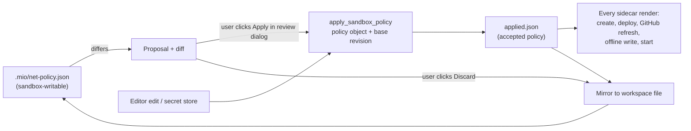

# Net Policy Review: Build Plan

This document is the build plan for closing the self-widening egress hole described in [01_ideas.md](01_ideas.md): no sidecar apply may enforce a policy or binding host list the user has not seen. It continues `01_ideas.md` and supersedes it wherever the two disagree. Status: implemented (Phases A to E). The user settled all ten Resolved Decisions by taking each recommendation, and the phases are written for them.

## The Concrete Model

Written for the settled options (Resolved Decisions 1–10).

### Accepted policy, proposal, mirror

- **Accepted policy**: `AppliedPolicy` in `<app_data_root>/net-policy/<sandbox>/applied.json` (`src-tauri/src/net_policy.rs`), extended with a `revision: u64`. Every apply path renders the accepted policy or a policy object the user just confirmed; none reads the workspace file.
- **Proposal**: the workspace file `.mio/net-policy.json` whenever it parses to something other than the accepted policy. A new `net_policy::diff(accepted, proposed)` lists the changes and marks each one that widens reach.
- **Mirror**: after a successful apply, the app writes the accepted policy to the workspace file, so the file matches what runs. A failed mirror write is logged, never fails the apply. The mirror is skipped while the file holds a proposal the apply did not take in (a differing or unparsable file), so a store-path apply never silently discards a pending proposal.

### Commands

| Command (`src-tauri/src/commands/net_policy.rs`) | Behaviour |
|---|---|
| `net_policy_state(name)` | Returns the accepted policy, its revision, its unstamped bindings, and an optional proposal (proposed policy, `PolicyChange` list, the proposal's unstamped bindings). A workspace file that does not parse is returned as `proposal_error`, never as an apply. The workspace path is resolved from the sandbox record (`Sandbox.workspace_path`, `src-tauri/src/backends/types.rs`), not taken from the frontend. Replaces `get_net_policy`, `net_policy_drift` and `net_policy_unstamped_bindings` |
| `apply_sandbox_policy(name, policy, base_revision, store_secret?, drop_secret_id?)` | Validates `policy`, refuses a `base_revision` other than the accepted revision, stores `store_secret` in the sandbox's own value store, calls `iron::apply_policy()` (`src-tauri/src/proxy/iron.rs`) with `policy`, drops `drop_secret_id` on success, then mirrors. Never reads the workspace file. Replaces the `set_net_policy` → `set_proxy_secret` → `apply_sandbox_policy` → `delete_proxy_secret` sequence of `commitSecretChange()` |
| `discard_net_policy_proposal(name)` | Mirrors the accepted policy over the workspace file |

`set_net_policy`, `set_proxy_secret` and `delete_proxy_secret` are removed, with their entries in `tauri::generate_handler![]` (`src-tauri/src/commands/mod.rs`).

### Secret values per sandbox

Values move from the app-global `<app_data_root>/proxy/secrets.json` to `<app_data_root>/proxy/<sandbox>/values.json`, inside the sidecar state directory that `remove_proxy()` (`src-tauri/src/proxy/mod.rs`) deletes at destroy. `load_secrets()`, `set_secret()` and `delete_secret()` take the sandbox name, so `materialise_secret_files()` (`src-tauri/src/proxy/iron.rs`) can resolve a `secretId` only within the sandbox that owns it.

## Resolved Decisions

1. **Authority model** (Open Question "Authority model") — **Resolved (recommendation taken).** Options: (a) the accepted snapshot is the only apply input and the workspace file is ignored apart from display; (b) the workspace file stays authoritative and every apply first requires a confirmed diff whenever drift exists; (c) hybrid: (a) for every apply, plus (b)'s diff review as the only way a workspace change becomes accepted. **Recommended: (c).** Option (b) needs the same gate on every background path and leaves a re-read window after the confirmation; option (a) alone gives an imported or hand-edited file no way in.
2. **Review experience** (Open Question "Review experience") — **Resolved (recommendation taken).** Options: (a) an amber banner above the editor ("The workspace file has changes that are not applied") with Review and Discard buttons, Review opening a modal (`src/lib/components/ui/dialog`) that lists every change, puts widening changes first in destructive colour, and states for each widened binding "Requests to `<host>` will receive the real value of `$VAR`", with Apply changes, Discard changes and Cancel; (b) the same, plus a typed confirmation for any widened binding; (c) inline per-change accept and reject toggles. **Recommended: (a).** A typed confirmation adds friction for the user's own hand edits; per-change toggles need a merge model the first build does not need.
3. **Editing while a proposal is pending** (Open Question "Editing while a proposal is pending") — **Resolved (recommendation taken).** Options: (a) disable the editor's rule and secret controls until the proposal is applied or discarded; (b) allow edits on the accepted policy and let the mirror overwrite the proposal; (c) allow edits but skip the mirror while a proposal is pending. **Recommended: (a).** Option (b) discards the proposal without the user deciding; option (c) re-diffs the proposal against a moved base, so the proposal appears to undo the user's own edit.
4. **Workspace mirror** (Open Question "Workspace mirror") — **Resolved (recommendation taken).** Options: (a) mirror the accepted policy into the workspace file after every apply; (b) stop writing the file and treat it as an import channel only. **Recommended: (a).** The file stays an honest record of what runs for the user's IDE and git history, and Mutagen's `two-way-resolved` mode makes the laptop's mirror win over a remote edit.
5. **Create from an existing policy file** (Open Question "Create from an existing policy file") — **Resolved (recommendation taken).** Options: (a) show an existing file's rules and bindings in the create dialog (`src/routes/projects/CreateSandboxItem.svelte`) for confirmation; (b) build the accepted policy from the dialog alone (the chosen mode, the starter rules for allowlist), stamp placeholders for the file's binding variables into `guest_env`, leave the file untouched so it shows as a proposal on first open; (c) accept the file as today but strip its secret bindings. **Recommended: (b).** Placeholders are public values, so stamping them is harmless and an accepted binding later needs no manual export; (a) is the better experience but needs a policy preview in the create dialog, recorded in [04_improvements.md](04_improvements.md). The starter policy (`net_policy::starter()`, `src-tauri/src/net_policy.rs`) is app-generated and accepted without review under every option.
6. **Background applies while a proposal is pending** (Open Question "Background applies while a proposal is pending") — **Resolved (recommendation taken).** Options: (a) every background path (GitHub refresh, start, offline write, secret store) keeps rendering the accepted policy and never folds the proposal in; (b) block background applies until the proposal is resolved. **Recommended: (a).** A GitHub credential revocation must reach the sidecar at once (`docs/features/proxy-credential-secrets/02_dev.md`, Resolved Decision 12), and the accepted policy is already safe.
7. **Deployed sandboxes** (Open Question "Deployed sandboxes") — **Resolved (recommendation taken).** A synced-back file is a proposal exactly like a local edit, under every option. Options for deploy itself: (a) deploy applies the accepted policy, and the deploy picker (`src/routes/projects/RemoteManager.svelte`) adds a line "Unreviewed network policy changes will not be deployed" while a proposal is pending; (b) refuse deploy while a proposal is pending; (c) deploy with no notice. **Recommended: (a).** `deploy_secret_count` counts the accepted policy's bindings under every option, so the notice describes what actually leaves the laptop.
8. **Secret value scoping** (Open Question "Secret value scoping") — **Resolved (recommendation taken).** Options: (a) a per-sandbox value store (`<app_data_root>/proxy/<sandbox>/values.json`); (b) validate that every `secretId` starts with `<sandbox>-`; (c) leave the cross-sandbox hole to a later feature. **Recommended: (a).** A prefix rule is bypassable when sandbox names contain hyphens (sandbox `a` could claim `a-b-key` of sandbox `a-b`), and option (c) leaves the review misleading, because the dialog cannot show that a new binding resolves to another sandbox's value.
9. **Migration** (Open Question "Migration") — **Resolved (recommendation taken).** Existing `applied.json` files become accepted policies with `revision` 0 under every option. Options for an iron-proxy sandbox without `applied.json`: (a) treat its accepted policy as an allowlist with no rules and no bindings, so the workspace file appears as a proposal; (b) adopt the workspace file silently once. Options for the legacy `proxy/secrets.json` under Decision 8 (a): (i) copy each value into every sandbox whose accepted policy names its id; (ii) copy a value only when its id starts with `<sandbox>-` or exactly one sandbox's accepted policy names it, dropping the rest so the binding reports a missing value. **Recommended: (a) and (ii).** Option (b) re-opens the hole once; option (i) hands a stolen reference in an already-exploited snapshot its own copy. No forced one-time re-review of existing snapshots is recommended: the editor now shows the accepted policy, which is what runs.
10. **Concurrent editors** (Open Question "Concurrent editors") — **Resolved (recommendation taken).** Options: (a) `apply_sandbox_policy` takes the `base_revision` the editor loaded and fails with a "reload the editor" error when the accepted revision moved; (b) last write wins. **Recommended: (a).** Two windows, or an editor open across a deploy, otherwise drop each other's binding edits silently.
11. **Host-global state and parallel worktrees**: every new path (`values.json`) is under `<app_data_root>` via `crate::paths::app_data_root` (`src-tauri/src/paths.rs`), which honours `MIO_APP_DATA_DIR`. The feature adds no host port, external resource, bundled binary, teardown or harness environment variable, so its light specs run per worktree.

## Implemented: Phase A — Accepted Policy as the Only Apply Input

Backend only; the editor keeps working through the renamed commands once Phase B lands, so A and B ship together.

- `src-tauri/src/net_policy.rs`:
  - `AppliedPolicy` gains `revision: u64` with `#[serde(default)]`; `write_applied()` callers bump it.
  - New `PolicyChange` enum (mode changed, rule added, rule removed, rules reordered, binding added, binding removed, binding host added, binding host removed, binding secret id changed, binding position widened, binding position narrowed) and `diff(accepted, proposed) -> Vec<PolicyChange>`, each change carrying `widens: bool`. Serialisable camelCase for IPC.
  - Unit tests: a binding host added in open mode is a widening change; a `secretId` change is a widening change; an added allow rule widens and an added deny CIDR does not; identical policies give no change.
- `src-tauri/src/commands/net_policy.rs`: `net_policy_state`, the new `apply_sandbox_policy` signature and `discard_net_policy_proposal` as in the Commands table; a private helper resolves the workspace path from `services::sandbox::list_user()` (`src-tauri/src/services/sandbox.rs`). `get_net_policy`, `set_net_policy`, `net_policy_drift` and `net_policy_unstamped_bindings` are deleted.
- `src-tauri/src/commands/mod.rs`: update `tauri::generate_handler![]`.
- `src-tauri/src/proxy/iron.rs`: `finish_apply()` writes `revision + 1`; `deploy_secret_count(app, sandbox)` reads `net_policy::read_applied()` and drops its `workspace_path` parameter.
- `src-tauri/src/commands/proxy.rs`: `deploy_secret_count` drops `workspace_path`.
- `src-tauri/src/services/sandbox.rs`:
  - `apply_policy_and_inject_ca()` applies `read_applied()`'s policy instead of calling `net_policy::load()`.
  - `deploy_to_target()` applies `read_applied()`'s policy instead of loading `deployment.alpha`'s file.
- `src-tauri/src/error.rs` and `src/lib/errors.ts`: a stale `base_revision` surfaces as `BackendError::CommandFailed` with a reload message unless the user wants a typed variant; no new `AppError` kind is planned.

## Implemented: Phase B — Editor and Review Dialog

- `src/routes/projects/NetPolicyEditor.svelte`:
  - `refresh()` calls `net_policy_state`; the editor edits a copy of the accepted policy and keeps `baseRevision`.
  - `save()` and `commitSecretChange()` call the new `apply_sandbox_policy` once, passing `storeSecret` and `dropSecretId`; the editor no longer writes the workspace file.
  - The drift banner (`data-net-policy-drift`) becomes a proposal banner (`data-net-policy-proposal`) with Review (`data-net-policy-review`) and Discard (`data-net-policy-discard`); Save is enabled by unsaved edits only, never by drift.
  - Rule and secret controls are disabled while a proposal is pending (Decision 3).
  - `refresh()` also runs on window focus, because nothing watches the file.
- New `src/routes/projects/NetPolicyProposalDialog.svelte` on `src/lib/components/ui/dialog`: change list with `data-proposal-change` and `data-widens`, the widened-binding sentence, Apply (`data-proposal-apply`) sending the displayed proposal with `baseRevision`, Discard and Cancel. Use the `svelte-code-writer` skill for both components.
- `src/routes/projects/RemoteManager.svelte`: `deploy_secret_count` without `workspacePath`; the pending-proposal line (Decision 7).
- New strings are hard-coded English marked `TODO(i18n)` until the user approves the wording; the Paraglide pass follows approval (`feature-implement` skill).

## Implemented: Phase C — Per-Sandbox Secret Values

- `src-tauri/src/proxy/mod.rs`: `secrets_path(app, sandbox)` returns `<app_data_root>/proxy/<sandbox>/values.json`; `load_secrets()`, `set_secret()` and `delete_secret()` take `sandbox`. The comment naming `set_proxy_secret`/`delete_proxy_secret` as the writers changes to `apply_sandbox_policy`.
- `src-tauri/src/proxy/iron.rs`: `apply_local_locked()`, `apply_remote_locked()`, `refresh_github_binding()`, `github_binding_live()` and `deploy_secret_count()` pass the sandbox name to `load_secrets()`.
- Migration (Decision 9): a new `proxy::migrate_legacy_secrets(app, live)` in `src-tauri/src/proxy/mod.rs`, called from the startup task in `src-tauri/src/bootstrap.rs` with the live sandbox list (so not under `MIO_MOCK_BACKEND`), splits `proxy/secrets.json` per live sandbox by the chosen rule, then deletes the legacy file. The split rule is a pure function with unit tests.
- `src/routes/projects/NetPolicyEditor.svelte`: the `<sandbox>-<envvar>` id scheme stays, and the comment explaining it changes to say values are per sandbox.

## Implemented: Phase D — Create From an Existing Policy File

- `prepare_egress()` in `src-tauri/src/backends/mod.rs` (Decision 5 (b)): the accepted policy is the default policy with the dialog's mode and, for allowlist, the starter rules; `guest_env` holds the variables of the workspace file's bindings; the workspace file is written only when it was absent or empty, otherwise left as the proposal.
- `apply_policy_and_inject_ca()` (`src-tauri/src/services/sandbox.rs`) already applies the accepted policy after Phase A.

## Implemented: Phase E — Tests

- New light spec `e2e/test/specs/light/net-policy-review-ui.spec.ts`, modelled on `e2e/test/specs/light/podman-egress-boundary-ui.spec.ts`:
  - Create a sandbox, add a secret `NPR_KEY` bound to `api.example.com` through the editor.
  - Append `evil.example.net` to the binding's `hosts` and an allow rule in `.mio/net-policy.json` on disk; reopen the network section; assert the proposal banner shows and the accepted binding still lists only `api.example.com`.
  - Add a second secret through the editor (the store path that used to re-read the file); assert `config/config.yaml` under `<APP_DATA_ROOT>/proxy/<name>/` and `<APP_DATA_ROOT>/net-policy/<name>/applied.json` never contain `evil.example.net`.
  - Open Review: assert the widened binding host is flagged (`data-widens`). Discard: assert the workspace file equals the accepted policy. Re-write the widening, Review, Apply: assert `config.yaml` now names `evil.example.net`, proving the review path applies.
  - A binding naming another sandbox's `secretId` applies with that variable in the apply report's missing values and no secret file (Phase C).
  - `invokeCmd("deploy_secret_count", { name })` counts the accepted bindings, not the widened file. The spec must not drive `deploy_sandbox` past `plan_deploy` (`docs/features/proxy-remote-deploy/02_dev.md`, Resolved Decision 20).
- `e2e/test/specs/light/podman-egress-boundary-ui.spec.ts`: the drift test becomes a proposal-review test, and the on-disk `pebui-<stamp>` binding is adopted through Review before its value is edited.
- `e2e/test/pageobjects/workspace-dashboard.page.ts`: replace `netPolicyDrift` with proposal, review, apply and discard helpers.
- `e2e/test/specs/standard/podman-egress-boundary.spec.ts`: "creates a bounded sandbox from a seeded policy" seeds the file and then accepts the proposal through Review before the swap assertions (Decision 5).
- `03_e2e.md` is written by the `feature-e2e` skill after the build.

## Implementation Notes

Choices the plan left open, made conservatively during the build.

- **Revision bump**: `finish_apply()` (`src-tauri/src/proxy/iron.rs`) raises `revision` only when the accepted policy changed, so a GitHub refresh or a create-time re-render never invalidates an open editor. The first apply on a sandbox with no `applied.json` writes revision 1 unless the policy is the implicit empty allowlist, so two editors loaded at revision 0 cannot both apply. `apply_policy()` checks the expected revision under the per-sandbox apply lock.
- **Secret value persistence**: a `store_secret` value is written to `values.json` inside the apply lock, after the revision check, and restored to its previous content if the apply fails; a `drop_secret_id` is deleted only after a successful apply, and a failed delete is logged (never the value) instead of failing the command. The editor reloads after any failed commit, since the apply may have taken effect.
- **Deploy and create apply under the lock**: both call `iron::apply_accepted()`, which reads the accepted policy inside the apply lock, so an editor apply landing in between is never reverted.
- **Review wording names the exposed secret**: `net_policy::diff()` builds each binding change's risk sentence by resolving the proposed `secretId` against the accepted bindings: "the real value of `$VAR`" when the variable keeps its id, "the real value stored for `$OTHER`" when the id belongs to another accepted variable, otherwise the id itself. A `BindingSecretIdChanged` change names the new id and its owning accepted variable and always widens.
- **Reserved variable names**: `RESERVED_ENV` (`src-tauri/src/net_policy.rs`) covers shell, loader, runtime and proxy variables, including every name `proxy::proxy_env()` sets; validation rejects them for edits and proposals (a proposal with one shows as `proposalError`), and `stampable_vars()` skips them at create.
- **Focus refresh** is skipped within five seconds of the previous refresh, because `net_policy_state` lists every sandbox to find the workspace path.
- **No snapshot**: `net_policy::read_accepted()` returns an empty allowlist at revision 0 for a sandbox with no `applied.json`, for the state command, create and deploy alike.
- **Absent or empty workspace file** proposes nothing. A file that does not parse, or parses but fails validation, is reported as `proposalError` and offers only Discard; the editor stays locked until then.
- **Create** writes the accepted policy to the workspace file only when the file is absent or empty; a file that exists, parsable or not, is left alone. Placeholder variables come from the file's bindings, restricted to valid variable names (`net_policy::stampable_vars()`).
- **Legacy secret split** (`proxy::split_legacy_secrets()`): a value goes to the sandbox with the longest name that prefixes its id plus a hyphen (so sandbox `a` never claims `a-b-key`), and, only when no sandbox name prefixes the id, to the one live sandbox whose accepted policy names the id when exactly one does. The candidates are the live sandboxes (a sandbox without a snapshot keeps its prefixed values; a snapshot of a destroyed sandbox receives nothing), so migration runs after the live list is known at startup. Values already in a sandbox's own store win over legacy ones. The legacy file is deleted only after every write succeeded.
- **Bindings in a proposal** show the stored secret id in the change text, and the risk sentence names the secret actually exposed (see above).
- **Light spec scope**: with editing locked under a proposal, the spec drives the editor's store path through `apply_sandbox_policy` directly (`invokeCmd`) rather than the form.

## Lifecycle and Cross-Cutting Concerns

- **Destroy**: `net_policy::remove_applied()` removes the accepted policy and `remove_proxy()` removes `values.json` with the sidecar state directory; a same-name create starts with no values.
- **Deploy and undeploy**: deploy renders the accepted policy on the remote sidecar; undeploy starts the local sidecar from its last written files; neither reads the workspace file.
- **Cross-feature**: `docs/features/mcp-servers/01_ideas.md` plans to add egress hosts with `net_policy::save()`; under this feature an app-side policy change must go through an accepted-policy apply, or it becomes a proposal the user must review.
- **Architecture** (updated by `feature-implement` when the feature ships): `docs/architecture/network.md` gains the accepted-policy and proposal concepts under "Where State Lives" and "Lifecycle", and the invariant "No apply enforces a policy or binding the user has not seen; the workspace file is a proposal".
- **Backlog**: on completion tick T2 in `docs/improvement-backlog.md` and record the resolution against finding 1 of `docs/features/podman-egress-boundary/05_dev_review.md`.

## Common Gotchas

| Gotcha | Cause | Fix |
|---|---|---|
| The sidecar enforces a binding host the user never added | An apply path called `net_policy::load()` on the workspace file, which code inside the sandbox can write | Render only `net_policy::read_applied()` (`src-tauri/src/net_policy.rs`) or the policy object the review dialog sent |
| A widening applied after the user clicked Apply on a different diff | The apply re-read the workspace file after the review, and the sandbox rewrote the file in between | `apply_sandbox_policy` (`src-tauri/src/commands/net_policy.rs`) takes the displayed policy object and never reads the file |
| "reload the editor" error on Save | `base_revision` no longer matches `applied.json`'s `revision`, because another window, a create or a deploy applied in between | Reload the network section and redo the edit (Resolved Decision 10) |
| A dormant binding goes live when a value is stored later | `refresh_github_binding()` (`src-tauri/src/proxy/iron.rs`) re-materialises current values for every binding in `applied.json` | Never let an unreviewed binding into `applied.json`; values resolve from the sandbox's own `values.json` only |
| A secret stored in one sandbox reaches requests from another | Values were looked up in the app-global `proxy/secrets.json` by a guessable `secretId` | Pass the sandbox name to `load_secrets()` (`src-tauri/src/proxy/mod.rs`) and resolve within `<app_data_root>/proxy/<sandbox>/values.json` |
| The proposal banner never clears after Apply | The mirror write to `.mio/net-policy.json` failed, so the file still differs from `applied.json` | Check the warn log for the mirror path; Discard rewrites the file from the accepted policy |
| An imported repository's allowlist is not in force after create | Resolved Decision 5 (b) builds the accepted policy from the create dialog only | Review and apply the proposal in the network section after create |
| The light spec writes `~/.ssh` or runs `ssh` | The spec drove `deploy_sandbox` past `plan_deploy` | Check deploy behaviour through `invokeCmd("deploy_secret_count")` only in `light`; deploy itself belongs to the `standard` remote specs |
