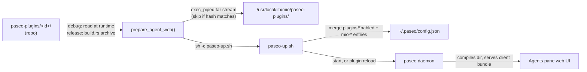

# Paseo Plugins: Ideas

This document scopes a way for Sandbox-mio to ship its own Paseo plugins and have the in-sandbox Paseo daemon load them when it launches. The plugins extend the Agents pane, the Paseo web UI described in `docs/architecture/agents.md` and `docs/architecture/workspace-ui.md`. Today the app launches a pinned Paseo daemon (`npm:@getpaseo/cli@0.16.1`) through `paseo-up.sh` (`src-tauri/resources/agent-web/paseo-up.sh`), driven by `prepare_agent_web()` in `src-tauri/src/runtime/mod.rs`. The daemon loads no plugins, because Paseo's global plugin switch defaults to off. The first build delivers the pipeline plus one probe plugin; real Agents-pane plugins are later features. Plugins written by users are out of scope (`04_improvements.md`).

## Current State

- **Daemon launch.** `MiseRuntime::prepare_agent_web()` in `src-tauri/src/runtime/mod.rs` runs `paseo-up.sh` with `sh -c` in the workspace. On exit code 10 it installs the pinned tools (`PASEO_NODE_TOOL`, `PASEO_CLI_TOOL`). On exit code 11 it retries.
- **Restart rule.** `paseo-up.sh` restarts the daemon only when the hash of `mise.toml`, `launch_rev`, the CLI version and the password changes. The daemon's home is the default `~/.paseo` inside the container, outside the workspace.
- **Callers.** `prepare_agent_web()` is called from `prepare_agent_web_pane()` (Agents tab open) and from `spawn_prewarm_agent_web()` (sandbox start, only after a first open). Both live in `src-tauri/src/services/panes.rs`. The `RuntimeManager` trait in `src-tauri/src/runtime/types.rs` declares the method. `MockRuntime` in `src-tauri/src/runtime/mock.rs` stands in for it under `MIO_MOCK_BACKEND=1`.
- **Precedent for shipping files.** The pi supervisor scripts already travel this way. `src-tauri/src/agent_host/mod.rs` embeds `pi-host.sh` with `include_str!` and streams it into `/usr/local/lib/mio/` over `MachineProvider::exec_piped()` (`src-tauri/src/provider/types.rs`). A `SCRIPT_VERSION` mismatch triggers reinstall. The Podman and microsandbox providers both implement `exec_piped()` (`src-tauri/src/provider/mod.rs`, `src-tauri/src/provider/msb.rs`).
- **Repository packaging.** `src-tauri/build.rs` only calls `tauri_build::build()`. `pnpm-workspace.yaml` lists only `e2e` as a workspace package.
- **Paseo plugin contract.** The contract lives in the user-level `paseo-plugin` skill and at https://paseo.sh/docs/plugins/reference.md. A plugin is a directory holding `paseo-plugin.json` (`id`, `requirements.paseo`), an optional `index.client.tsx` (React Native UI: panels, Command Center items, slash commands, composer pills, timeline renderers) and an optional `index.server.ts` (daemon subprocess: RPCs, lifecycle hooks).

## Plugin Source in the Repository

App-owned plugins live in a new top-level directory, `paseo-plugins/<id>/`, one Paseo plugin project per subdirectory.

- **Ids.** Every app-owned id starts with `mio-`. The prefix is how the registration step tells its own `config.json` entries apart from plugins the user installed through Paseo's Settings.
- **Probe plugin.** The first build ships one plugin, `mio-probe`. It contributes a Command Center item and a small workspace panel that proves client and server code run. The spike version is `docs/features/paseo-plugins/spike/probe-plugin/`.
- **Typechecking.** `paseo-plugins/` holds a `package.json` whose dev dependencies include `@getpaseo/plugin` at the same version as `PASEO_CLI_TOOL`. That package is added to `pnpm-workspace.yaml`. Paseo compiles TypeScript itself, so the typecheck is the only build step.
- **Imports.** Plugins import only the modules Paseo supplies at runtime: the plugin SDK, React, React Native, TanStack Query and Zod. No `node_modules` exists in the sandbox copy (Technology Choices, Plugin dependencies).

## Packaging into the App

A plugin bundle is one tar archive holding every `paseo-plugins/<id>/` directory, minus `node_modules` and dotfiles, together with a content hash.

- **Release builds.** `src-tauri/build.rs` builds the archive at compile time and the binary embeds it, matching the `include_str!` precedent. A `cargo:rerun-if-changed` on `paseo-plugins/` keeps it current.
- **Debug builds.** The user picked this dev loop on 2026-11-18. The app reads `paseo-plugins/` from the repository at runtime and builds the archive on each delivery, so a plugin edit needs no Rust rebuild. The path comes from `CARGO_MANIFEST_DIR` at compile time.
- **Seam.** One function returns `(archive bytes, hash)` for either source. The natural home is a new `src-tauri/src/runtime/paseo_plugins.rs` called from `prepare_agent_web()`.

## Delivery into the Sandbox

`prepare_agent_web()` delivers the bundle before running `paseo-up.sh`.

- **Skip when current.** It first compares the bundle hash with a marker file, `/usr/local/lib/mio/paseo-plugins/.bundle-hash`, and skips delivery when they match.
- **Copy.** Otherwise it streams the archive over `exec_piped()` into a staging directory. It extracts with `tar --no-same-owner` (spike gotcha) and swaps the staging directory into `/usr/local/lib/mio/paseo-plugins/`.
- **Where the files live.** They live in the container filesystem, so a recreated sandbox loses them and the next Agents-tab open re-delivers them. Nothing is written into the workspace.
- **Remote deploys.** `prepare_agent_web()` already resolves the provider for the sandbox's machine, so deployed sandboxes receive plugins through the same path.

## Registration with the Daemon

`paseo-up.sh` gains a registration step that runs while the daemon is stopped, just before its launch branch.

- **Merge.** The step merges into `~/.paseo/config.json`. It sets `pluginsEnabled: true` and writes one `{source: "directory", path}` entry per delivered `mio-*` plugin. It deletes `mio-*` entries whose folder no longer exists and keeps every other key and entry.
- **Tooling.** The base image has no `jq`, so the merge runs as `mise exec -- node -e`. The pinned Node is guaranteed present once `paseo-up.sh` passes its exit-10 check.
- **Content changes.** When the set of plugin ids is unchanged and only contents changed, the step runs `paseo plugin reload <id>` per plugin against the running daemon instead of restarting it. The spike measured 0.8 s with an unchanged daemon pid.
- **Restart trigger.** The set of `mio-*` ids joins the `want` hash in `paseo-up.sh`, so adding or removing a plugin restarts the daemon. That happens only on an app upgrade or while developing plugins.

## Technology Choices with Tradeoffs

### Where plugin files live in the sandbox

- **Chosen: the container filesystem, `/usr/local/lib/mio/paseo-plugins/`,** next to the pi supervisor scripts. The files are invisible to the user's project, re-delivered on demand, and isolated per sandbox.
- **Rejected: the workspace, `.mio/paseo-plugins/`.** App-owned code would land in the user's project and its git history and be synced to remote hosts. A user edit would also be overwritten on every delivery. The workspace stays the right home for future user-written plugins (`04_improvements.md`).
- **Rejected: installing from npm or GitHub with `paseo plugin install npm:...`.** It needs a publishing pipeline. It also needs registry hosts on every sandbox's egress allowlist (`docs/architecture/network.md`), fails offline, and decouples plugin versions from app versions.
- **Rejected: baking plugins into the base image.** Every plugin edit would bump `BASE_IMAGE_VERSION` (`src-tauri/src/backends/mod.rs`) and prompt users to recreate sandboxes.

### How plugins are registered

- **Chosen: merging `~/.paseo/config.json` before launch.** Paseo 0.16.1 accepts a declarative `plugins` record, and a minimal file works on first start (spike).
- **Rejected: `paseo plugin install <dir>` after the daemon is up.** It is not idempotent: a second call fails with `already configured`. It also needs the daemon running, adding an exec round trip to every open.
- **Rejected: environment variables on `paseo daemon run`.** No `PASEO_*` variable exists for `pluginsEnabled` or `plugins` in 0.16.1.

### How plugins are embedded in the binary

- **Chosen: a tar archive built by `src-tauri/build.rs` and embedded with `include_bytes!`.** The build script filters out `node_modules` (present after `pnpm install` for typechecking) and computes the hash once.
- **Rejected: the `include_dir` crate.** It embeds the whole tree including `node_modules`, with no filtering.
- **Rejected: Tauri bundle resources.** Their path resolution differs between `tauri dev`, installed builds and the e2e harness. The repository's existing precedent is embedding in the binary.

### How content changes reach a running daemon

- **Chosen: `paseo plugin reload <id>`.** The spike showed changed source live in under a second with no restart, so running agent sessions are untouched.
- **Rejected: folding the bundle hash into the `want` hash in `paseo-up.sh`.** Every plugin edit would restart the daemon, which is slower and ends whatever agents the daemon is running.

### Plugin dependencies

- **Chosen: host-supplied modules only.** The daemon's esbuild run marks the SDK, React, React Native, TanStack Query and Zod external. The sandbox copy needs no `node_modules`.
- **Rejected: `npm install` inside the sandbox.** It needs network egress to the npm registry and adds minutes to the first open.
- **Rejected: pre-bundling on the host.** It adds an esbuild step to the Rust build and duplicates the compile that Paseo already performs. Revisit if a plugin needs a third-party package.

### Development loop

- **Chosen (user decision, 2026-11-18): debug builds read `paseo-plugins/` from disk; release builds embed it.**
- **Rejected: always embedding.** Every plugin edit would then need a Rust rebuild and app restart.

### Host-global state

The feature adds no host-global dependency. Every artefact is per sandbox (a container folder and the container's Paseo home), so tests stay in the per-worktree tiers. The `light` tier cannot exercise the delivery, because `MockRuntime` stands in for `prepare_agent_web()`. Proof needs a `standard` spec (`e2e/AGENTS.md`).

## Validation

A spike on 2026-11-18 ran Paseo 0.16.1 in a throwaway container from `sandbox-mio/base:10`. The record is `docs/features/paseo-plugins/spike/spike.md`; the driver is `docs/features/paseo-plugins/spike/run-spike.sh`. Cleared risks:

- A minimal pre-written `config.json` with a directory plugin starts the plugin on the daemon's first launch.
- A tar stream over exec stdin delivers the plugin folder (with `--no-same-owner`).
- `paseo plugin reload` applies changed source without restarting the daemon.
- A configured plugin with a missing folder fails alone and the daemon still starts.
- A browser-type client receives the compiled client bundle through `getPluginCatalog()`.

One gap remains: the Command Center item was not observed rendering inside the Agents pane webview.

## Open Questions

1. **Id-set change: restart or runtime install.** Should adding or removing a `mio-*` plugin restart the daemon (folding the id set into `want`)? The alternative is `paseo plugin install`/`remove` against the running daemon, which avoids ending running agents but must handle the non-idempotent install error.
2. **Reload trigger during development.** Is delivery on Agents-tab open (and pre-warm) enough? Or should debug builds add an explicit "reload Paseo plugins" action or a file watcher on `paseo-plugins/`?
3. **Ownership of the global switch.** Forcing `pluginsEnabled: true` also activates any plugin the user installs through Paseo's Settings, and overrides a user who turned the switch off there. Should the app set the switch on every launch, or only when the switch is absent?
4. **Version coupling.** How is the `@getpaseo/plugin` dev dependency and each manifest's `requirements.paseo` kept equal to `PASEO_CLI_TOOL`? Options: a two-ends comment, a `./build` check, or a `cargo test` that parses the manifests.
5. **Repository location.** Should plugins live at top-level `paseo-plugins/` (proposed; plugins are TypeScript projects, not Rust resources) or under `src-tauri/resources/paseo-plugins/` next to `paseo-up.sh`?
6. **Mock-tier visibility.** Should `MockRuntime` record plugin delivery so a `light` spec can assert the bundle hash was sent, or is the `standard` spec the only proof?

## Common Gotchas

| Gotcha | Cause | Fix |
|---|---|---|
| `tar: ./index.client.tsx: Cannot change ownership to uid 197609, gid 197609: Invalid argument` when extracting a plugin archive in a sandbox | A tar archive created on the Windows host records the host uid, which the container cannot assign | Extract with `tar --no-same-owner -xf -` inside the sandbox, or write uid 0 into archive headers when building the archive |
| `Plugin ID "<id>" is already configured; choose another ID with --id` from `paseo plugin install` | `paseo plugin install` refuses an id already present in `~/.paseo/config.json`; the command is not idempotent | Register plugins by merging `~/.paseo/config.json` before daemon launch, and use `paseo plugin reload <id>` for content changes |
| A plugin added to `~/.paseo/config.json` while the daemon runs never starts | Paseo reads plugin source entries from `config.json` only at daemon start; manual edits to a running daemon's entries are not reloaded | Merge `config.json` while the daemon is stopped in `paseo-up.sh`, or restart the daemon after changing the set of plugin ids |
| An external writer's formatting or keys in `~/.paseo/config.json` disappear | The Paseo daemon rewrites `config.json` itself on install, remove and settings changes | Merge into `config.json` by key with `mise exec -- node`; never overwrite the whole file |
| `paseo plugin ls` shows a `mio-*` plugin `failed` with `Plugin manifest is missing: <path>/paseo-plugin.json` | `config.json` still lists a plugin whose folder under `/usr/local/lib/mio/paseo-plugins/` was not delivered or was removed | Deliver the bundle before running `paseo-up.sh`, and prune `mio-*` entries whose folder is absent during the `config.json` merge |
| A plugin compiles on the developer's machine but fails in the sandbox with an unresolved import | The sandbox copy of `paseo-plugins/<id>/` carries no `node_modules`; only the plugin SDK, React, React Native, TanStack Query and Zod are supplied by Paseo | Import only host-supplied modules in `paseo-plugins/`, or resolve the dependency question in `02_dev.md` before adding a third-party package |
| Plugins configured in `config.json` stay `disabled` | Paseo's root `pluginsEnabled` defaults to `false` when absent, and 0.16.1 has no environment variable for it | Set `pluginsEnabled: true` in the `config.json` merge in `paseo-up.sh` |
| A plugin manifest without `requirements.paseo` is rejected | Paseo 0.8 and later treat a missing `requirements.paseo` as `<0.8.0` | Give every `paseo-plugins/<id>/paseo-plugin.json` a `requirements.paseo` range covering the version in `PASEO_CLI_TOOL` (`src-tauri/src/runtime/mod.rs`) |
