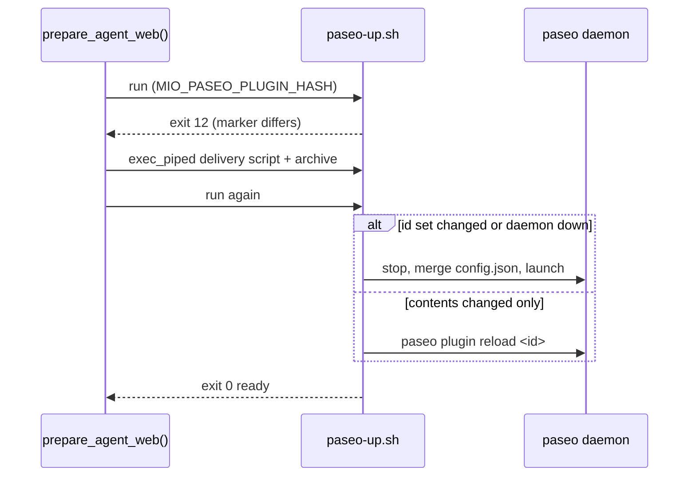

# Paseo Plugins: Build Plan

This document is the build plan for shipping app-owned Paseo plugins to every sandbox's Paseo daemon, continuing `docs/features/paseo-plugins/01_ideas.md` and the spike in `docs/features/paseo-plugins/spike/spike.md`. Scope is the delivery pipeline plus one probe plugin, `mio-probe`; real Agents-pane plugins are later features and user-written plugins are deferred (`04_improvements.md`). Status: all phases implemented. The microsandbox and deployed-sandbox manual checks were skipped (Phase D).

## The Concrete Model

- **Source.** App-owned plugins live in the top-level `paseo-plugins/` directory, one Paseo plugin project per `paseo-plugins/mio-<name>/` subdirectory, typechecked as a pnpm workspace package. Plugins import only the modules Paseo supplies (plugin SDK, React, React Native, TanStack Query, Zod).
- **Bundle.** A deterministic uncompressed tar archive of every `paseo-plugins/mio-*/` directory, without `node_modules` and dotfiles, with uid 0 and mtime 0 in every header. Release builds embed the archive that `src-tauri/build.rs` writes into `OUT_DIR`. Debug builds build the same archive at runtime from the worktree's `paseo-plugins/`, located through `CARGO_MANIFEST_DIR`, so a plugin edit needs no Rust rebuild. The bundle hash is the SHA-256 of the archive bytes.
- **Staleness check without an extra exec.** `prepare_agent_web()` in `src-tauri/src/runtime/mod.rs` passes the expected bundle hash to `paseo-up.sh` (`src-tauri/resources/agent-web/paseo-up.sh`). The script compares it with the marker file `/usr/local/lib/mio/paseo-plugins/.bundle-hash` and exits with a new code, 12, when they differ. This mirrors the existing exit-10 "install the tools" handshake, so an Agents-tab open whose plugins are current costs no additional exec.
- **Delivery.** On exit 12, `prepare_agent_web()` streams the archive over `MachineProvider::exec_piped()` (`src-tauri/src/provider/types.rs`). A delivery script extracts it with `tar --no-same-owner` into a staging directory, writes `.bundle-hash`, and swaps the staging directory into `/usr/local/lib/mio/paseo-plugins/`. Then `prepare_agent_web()` runs `paseo-up.sh` again.
- **Registration.** `paseo-up.sh` adds the plugin on/off state (the sorted list of delivered plugin ids, plus the global switch value the app writes) to its `want` hash. When the on/off state changes, the existing restart branch runs (Resolved Decision 1). Inside that branch, between `paseo daemon stop` and the launch, a `mise exec -- node` step merges `~/.paseo/config.json`. The merge sets `pluginsEnabled: true`, writes one `{source: "directory", path}` entry per delivered id, removes `mio-*` entries without a folder, and preserves every other key.
- **Content reload.** When the daemon is running and the id set is unchanged, `paseo-up.sh` compares `.bundle-hash` with `$HOME/.paseo/mio-plugins-loaded`. When they differ, it runs `paseo plugin reload <id>` for each delivered id, then records the hash once every reload succeeded. A reload failure is printed to stderr and does not fail the script. `prepare_agent_web()` already logs stderr from a successful run as a warning.

## Resolved Decisions

1. **Id-set change: restart or runtime install.** Restart (user decision, 2026-11-18). The rule is that any change to which plugins are on restarts Paseo. That covers a plugin added, removed, enabled or disabled, and a change to the global switch. The rule is simpler and easier for users to understand than applying on/off changes live. The on/off state joins the `want` hash in `paseo-up.sh`, and `config.json` is merged while the daemon is stopped. Restarting on a changed `mise.toml` is existing accepted behaviour. `paseo plugin install` and `paseo plugin remove` against a running daemon are not used; install is not idempotent anyway (spike). Contents-only changes still use `paseo plugin reload` and do not restart.
2. **Reload trigger during development.** Delivery runs only inside `prepare_agent_web()`, so on an Agents-tab open and on the sandbox-start pre-warm. No file watcher or reload action ships in the first build. Opening an Agents pane that already exists only switches to it (`docs/architecture/workspace-ui.md`), so the developer closes and reopens the Agents tab to pick up an edit. A debug-only reload action is recorded in `04_improvements.md`.
3. **Ownership of the global switch.** The app owns the switch, because app-owned plugins are part of the Agents pane's behaviour. The `config.json` merge sets `pluginsEnabled: true`, and it runs only inside the restart branch, so the switch is applied by a Paseo restart like every other on/off change (Resolved Decision 1). A user who turns the switch off in Paseo's Settings keeps that setting until the next daemon restart.
4. **Version coupling.** A `cargo test` in `src-tauri/src/runtime/paseo_plugins.rs` enforces it. The test fails unless the `@getpaseo/plugin` dev dependency in `paseo-plugins/package.json` equals the version in `PASEO_CLI_TOOL` (`src-tauri/src/runtime/mod.rs`). It also requires every `paseo-plugins/mio-*/paseo-plugin.json` to declare `requirements.paseo` as `>=` followed by that version. A two-ends comment on `PASEO_CLI_TOOL` points at `paseo-plugins/package.json`.
5. **Repository location.** Top-level `paseo-plugins/`, with its own `paseo-plugins/AGENTS.md` and a row in the root `AGENTS.md` repo map. Plugins are TypeScript projects with their own toolchain, not Rust resources.
6. **Mock-tier visibility.** `MockRuntime::prepare_agent_web()` (`src-tauri/src/runtime/mock.rs`) is unchanged. Delivery and registration happen only in real sandboxes, so a `light` spec could assert nothing beyond the mock's own bookkeeping. Proof lives in `cargo test` (archive and version coupling) and a `standard` spec planned in `03_e2e.md`.
7. **Staleness check placement (new).** The hash comparison lives in `paseo-up.sh` as exit code 12, not in a separate exec. A Podman exec costs about 1.4 s to set up (`src-tauri/src/agent_host/mod.rs`), and the Agents-tab open path already runs one exec per attempt.
8. **Archive determinism (new).** Headers carry uid 0, gid 0, mtime 0 and mode 0644 for files and 0755 for directories, and entries are sorted. The same sources then always produce the same hash, whichever machine or checkout built them. Extraction still passes `--no-same-owner` as defence against a stray header.

## Implemented: Phase A — Plugin Source Tree and Probe Plugin

- Create `paseo-plugins/package.json`, a private pnpm package. It has a `typecheck` script (`tsc --noEmit`). Its dev dependencies are `@getpaseo/plugin`, `@getpaseo/client` and `@getpaseo/protocol` at the pinned Paseo version, plus `react`, `@types/react`, `react-native`, `zod` and `typescript` within the `@getpaseo/plugin` peer ranges. `@tanstack/react-query` and `@types/node` are added too, for the probe panel's query and the server entry's `node:os` import.
- Create `paseo-plugins/tsconfig.json`. It uses no `DOM` lib, per the `paseo-plugin` skill's mobile rules.
- Add `paseo-plugins` to `packages` in `pnpm-workspace.yaml`.
- Create the probe plugin `paseo-plugins/mio-probe/`, starting from `docs/features/paseo-plugins/spike/probe-plugin/`:
  - `paseo-plugin.json` with `id: "mio-probe"` and `requirements.paseo: ">=0.16.1"`.
  - `index.client.tsx` registering a Command Center item and a workspace panel. The panel calls one plugin RPC and shows the sandbox's workspace name and the RPC answer, coloured from `theme.colors`.
  - `index.server.ts` handling that RPC.
  - `shared/probe.ts` holding the `defineRpc` contract.
- Create `paseo-plugins/AGENTS.md`. It documents the `mio-` id prefix, host-supplied imports only, the `paseo-plugin` skill as the contract reference, the typecheck command, and the debug-build reload loop (close and reopen the Agents tab).
- Root `AGENTS.md`:
  - Add a repo-map row for `paseo-plugins/`.
  - Add `pnpm --filter paseo-plugins typecheck` to Verification Commands, required after any `paseo-plugins/` change.

## Implemented: Phase B — Bundle Builder

- Create `src-tauri/src/runtime/plugin_archive.rs`, a dependency-light module holding `build_plugin_archive(dir) -> io::Result<(Vec<u8>, Vec<String>)>`. It returns the archive bytes and the sorted plugin ids, from `mio-*` subdirectories that contain a `paseo-plugin.json`.
- Include the same file from `src-tauri/build.rs` through a `#[path]` module, so the build-time and runtime archives cannot diverge.
- `src-tauri/build.rs` writes `$OUT_DIR/paseo-plugins.tar` and `$OUT_DIR/paseo-plugin-ids.txt` (the ids, one per line, so the release build need not parse the archive) and emits `cargo:rerun-if-changed=../paseo-plugins` before calling `tauri_build::build()`.
- Add the `tar` crate to both `[dependencies]` and `[build-dependencies]` in `src-tauri/Cargo.toml`. `sha2` is already a dependency.
- Create `src-tauri/src/runtime/paseo_plugins.rs` with `PluginBundle { archive, hash, ids }` and `plugin_bundle() -> Result<Arc<PluginBundle>, RuntimeError>`:
  - Under `cfg(debug_assertions)` it reads `concat!(env!("CARGO_MANIFEST_DIR"), "/../paseo-plugins")` at runtime.
  - Otherwise it uses `include_bytes!(concat!(env!("OUT_DIR"), "/paseo-plugins.tar"))`.
  - The release bundle is computed once in a `OnceLock`. The debug bundle is rebuilt on every call.
- Unit tests in `paseo_plugins.rs`:
  - The archive is byte-identical across two builds of one tree.
  - `node_modules` and dotfiles are excluded.
  - Headers carry uid 0 and mtime 0.
  - The ids are sorted.
  - The version coupling test from Resolved Decision 4, which reads `paseo-plugins/package.json` and the manifests through `CARGO_MANIFEST_DIR`. It also requires each manifest's `id` to equal its directory name.

## Implemented: Phase C — Delivery and Registration

- `src-tauri/src/runtime/mod.rs`:
  - Add the constant `PASEO_PLUGIN_DIR` (`/usr/local/lib/mio/paseo-plugins`) and the exit code `PASEO_UP_PLUGINS_STALE` (12).
  - `paseo_up_env()` gains `MIO_PASEO_PLUGIN_DIR`, `MIO_PASEO_PLUGIN_HASH` and `MIO_PASEO_PLUGIN_IDS` (space-separated). `paseo_up_env()` therefore takes the `PluginBundle`.
  - `prepare_agent_web()` calls `plugin_bundle()` once per call.
  - Its retry loop handles `Some(PASEO_UP_PLUGINS_STALE) if !delivered` by running the delivery script, then loops. A second exit 12 after delivery is an `AgentWebUnavailable` error naming the marker mismatch.
  - `PASEO_UP_ATTEMPTS` rises from 5 to 6, so the delivery run does not shorten the wait for a cold start.
- Create `src-tauri/resources/agent-web/paseo-plugins-deliver.sh`, embedded with `include_str!` and run through `exec_piped()` with `sh -c`. It takes the archive on stdin and the plugin directory and hash as arguments. It extracts with `tar --no-same-owner -xf - -C <staging>`, writes `.bundle-hash` into the staging directory, and swaps the staging directory with the live directory through a rename. It cleans up any staging directory left by an earlier failure. It holds `paseo-up.sh`'s lock (`~/.paseo/mio-up.lock`), because a pre-warm and an Agents-tab open can both deliver at once. `.gitattributes` already pins `src-tauri/resources/**/*.sh` to LF.
- `src-tauri/resources/agent-web/paseo-up.sh`:
  - After the lock and the tool checks, compare `MIO_PASEO_PLUGIN_HASH` with the marker and exit 12 on mismatch.
  - Unset the three new variables along with the existing ones, so the daemon and its agents do not inherit them.
  - Add `MIO_PASEO_PLUGIN_IDS` to the `want` input, and bump `launch_rev`.
  - In the launch branch, after the stop and before the launch, merge `config.json` (The Concrete Model, Registration) and record the bundle hash in `$HOME/.paseo/mio-plugins-loaded`. A failed merge is printed to stderr and the daemon still launches.
  - In the already-running path, after the readiness wait, run `paseo plugin reload <id>` per id when `mio-plugins-loaded` differs from the bundle hash. `mio-plugins-loaded` is updated only when every reload succeeded, so a failed reload is retried on the next open.
  - The header comment lists exit code 12 and the new inputs.
- `MiseRuntime` keeps its `RuntimeManager` signature (`src-tauri/src/runtime/types.rs`). Callers in `src-tauri/src/services/panes.rs` (`prepare_agent_web_pane()`, `prewarm_agent_web()`) are unchanged.

## Implemented: Phase D — Verification and Architecture

- **Manual check (closes the spike gap):**
  - Open the Agents tab of a Podman sandbox, start a conversation, find "probe" in Paseo's Command Center (Ctrl+K) and open the probe panel. Done 2026-11-20: the plugin loaded and the item appeared once a conversation existed, and the panel showed the workspace name plus the `probe.info` RPC answer (daemon host, Node v24.19.0, server start time), so the client-to-server RPC path works inside the sandbox.
  - Edit the probe's panel text, then close and reopen the Agents tab. Confirm the new text appears without a daemon restart: the pid in `~/.paseo/paseo.pid` is unchanged. Done 2026-11-20 on Podman: the panel title changed, `paseo plugin logs mio-probe` showed an in-place stop and load, and the supervisor pid stayed the same. An earlier attempt restarted the daemon because a `jq` install had changed `mise.toml` between the two pid reads, which is the intended restart rule.
  - Repeat the open on a microsandbox sandbox and on a deployed sandbox. Skipped 2026-11-21: microsandbox is due to be dropped, and deployed sandboxes were broken at the time; tracked in `04_improvements.md`.
- **Architecture (done).** Update `docs/architecture/agents.md` under "Agent Web UI (Paseo)". App-owned plugins ship in the app and are registered at daemon launch. Add an invariant: app-owned plugins live outside the workspace.
- **E2E (done).** `e2e/test/specs/standard/agent-web-plugins.spec.ts` covers delivery, registration, reload, redelivery and restart on Podman (`03_e2e.md`); it passed on 2026-11-20.

## Lifecycle and Cross-Cutting Concerns

- **Recreate and base-image upgrade.** The plugin directory and `~/.paseo` both live in the container filesystem, so a recreated sandbox loses both together. The next Agents-tab open re-delivers the plugins (marker missing → exit 12) and the first launch merges a fresh `config.json`.
- **Plugin removed from the repository.** The next bundle lacks the id. The id set changes, the daemon restarts, and the merge prunes the `mio-*` entry whose folder the swap removed.
- **App downgrade to a build without this feature.** The older `paseo-up.sh` ignores the plugin directory, so `config.json` keeps `pluginsEnabled` and the `mio-*` entries, and the delivered plugins keep running. This is harmless, and no cleanup is planned.
- **Remote deploys.** `prepare_agent_web()` already targets the deployed machine's provider, so delivery reaches deployed sandboxes unchanged. Both providers implement `exec_piped()`.
- **Network policy.** Delivery and compilation make no network calls, so the egress allowlist (`docs/architecture/network.md`) is untouched.
- **Parallel worktrees.** The plan adds no host path, host port, host-global resource, bundled binary or harness environment variable. A debug build reads the `paseo-plugins/` of its own worktree through `CARGO_MANIFEST_DIR`. Every in-sandbox path is fixed only inside the container. `standard` specs therefore need no extra serialisation beyond the tier's own.

## Common Gotchas

| Gotcha | Cause | Fix |
|---|---|---|
| A plugin edit does not appear after reopening the app's Agents view | Opening an Agents pane that already exists only switches to it, so `prepare_agent_web()` in `src-tauri/src/runtime/mod.rs` never runs and nothing is delivered | Close the Agents tab and open it again; the debug build then re-reads `paseo-plugins/` and reloads the changed plugins |
| A plugin edit is not picked up by an installed release build | Release builds embed the archive written by `src-tauri/build.rs`; only debug builds read `paseo-plugins/` at runtime | Rebuild the app, or develop plugins against a debug build (`tauri dev`) |
| `tar: Cannot change ownership to uid 197609, gid 197609: Invalid argument` during delivery | An archive header carries the Windows host uid and extraction ran without `--no-same-owner` | Keep `--no-same-owner` in `src-tauri/resources/agent-web/paseo-plugins-deliver.sh` and uid 0 headers in `src-tauri/src/runtime/plugin_archive.rs` |
| `paseo-up.sh` keeps exiting 12 and the Agents tab fails with a marker mismatch | The delivery script did not leave `.bundle-hash` matching `MIO_PASEO_PLUGIN_HASH`, for example after an extraction failure | Read the delivery script's stderr in the app log (`target: "runtime"`) and run the delivery script's commands by hand in the sandbox |
| `cargo test` fails on the version coupling test after bumping Paseo | `PASEO_CLI_TOOL` in `src-tauri/src/runtime/mod.rs` changed without `paseo-plugins/package.json` and every `paseo-plugin.json` `requirements.paseo` | Update the `@getpaseo/plugin` dev dependency and each manifest's `requirements.paseo` to the new version in the same change |
| A `mio-*` plugin shows `failed` in Paseo's Settings → Plugins with an unresolved import | The sandbox copy of `paseo-plugins/<id>/` has no `node_modules`; Paseo supplies only the plugin SDK, React, React Native, TanStack Query and Zod | Remove the third-party import, or plan third-party dependencies first (`docs/features/paseo-plugins/04_improvements.md`) |
| A new plugin directory under `paseo-plugins/` is silently not shipped | `build_plugin_archive()` in `src-tauri/src/runtime/plugin_archive.rs` includes only `mio-*` directories containing a `paseo-plugin.json` | Name the directory `mio-<name>` and give it a `paseo-plugin.json` whose `id` equals the directory name |
| A `mio-*` Command Center item is missing from Ctrl+K although Settings → Plugins shows the plugin enabled | Items registered with `context: "workspace"` appear only inside a workspace, and Paseo creates a workspace only when a conversation starts; search also matches only the title and `keywords` | Start a conversation first, and give every item `keywords` that include the plugin id, as `paseo-plugins/mio-probe/index.client.tsx` does |
| A plugin content edit restarts the daemon (new pid in `~/.paseo/paseo.pid`) instead of reloading in place | Something else changed `mise.toml` since the last open, for example a tool install; `mise.toml` is part of the restart key in `src-tauri/resources/agent-web/paseo-up.sh`, so the restart branch wins | Expected; check `daemon.log` for `supervisor_received_SIGTERM` and the `mise.toml` mtime before suspecting the plugin pipeline |
| Plugins report `disabled` after the user flips Paseo's global switch off | Paseo's `pluginsEnabled` in `~/.paseo/config.json` is only re-set to `true` by the merge in `paseo-up.sh` when the daemon restarts | Turn the switch back on in Paseo's Settings → Plugins, or trigger a daemon restart (an id-set or `mise.toml` change) |
