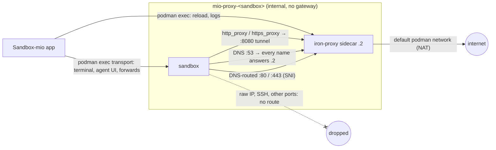

# Podman Egress Boundary: Build Plan

This document is the build plan for giving proxied Podman sandboxes a fail-closed network boundary and replacing the Podman mitmproxy sidecar with iron-proxy. It continues [01_ideas.md](01_ideas.md) and supersedes it wherever the two disagree. Status: Phase A (the gating spikes) ran on 2026-11-13 and the boundary works; the Resolved Decisions below were amended with the spike findings on 2026-11-14 (Spike Results lists each change); Phases B (provider seam), C (policy dialect and config renderer) and D (iron-proxy sidecar lifecycle) were implemented on 2026-11-14 and Phase E is next. The user settled four product decisions on 2026-11-13: `proxy-network-policy` is superseded with interactive approval deferred, the boundary shares the existing proxy toggle, a new bounded sandbox defaults to `open` mode, and the Podman mitmproxy path is removed outright (hard cut). On 2026-11-14, after Phase A found iron-proxy's `inject` mode, the user kept the hard cut with placeholder-swap bindings only (Resolved Decision 8). Relevant code: `src-tauri/src/proxy/` (sidecar lifecycle, flow log), `src-tauri/src/net_policy.rs` (`.mio/net-policy.json`), `src-tauri/src/provider/` (network and sidecar seam), `src-tauri/src/backends/mod.rs` (`CliBackend::create`), `src-tauri/src/services/sandbox.rs` (create ordering), and `src/routes/projects/` (`ProxyPanel.svelte`, `NetPolicyEditor.svelte`, `TrafficPanel.svelte`, `CreateSandboxItem.svelte`).

## The Concrete Model

A Podman sandbox created with the proxy switch on is a **bounded sandbox**. A bounded sandbox has three parts:

- **The internal network** `mio-proxy-<sandbox>`, created by `allocate_network` (`src-tauri/src/proxy/mod.rs`) with `--internal --disable-dns` on the first free `10.90.<index>.0/24`. The internal network has no gateway and no NAT, so a socket the sandbox opens to anything except the sidecar fails with "Network is unreachable".
- **The iron-proxy sidecar** `<sandbox>-proxy`, dual-homed: pinned at `10.90.<index>.2` on the internal network and joined without a pinned address to Podman's default `podman` network, which is the sidecar's only route out. The sidecar runs a pinned `ironsh/iron-proxy` image with `-config` pointing at a config file the app renders. Listeners inside the sidecar: the tunnel listener on `PROXY_PORT` (8080; absolute-form HTTP, CONNECT, SOCKS5), the HTTP and HTTPS listeners on 80 and 443 for DNS-routed traffic, the DNS server on 53, and the token-guarded management listener and the metrics listener on `127.0.0.1` only.
- **The sandbox container**, attached only to the internal network (no `pasta`), with `--dns <sidecar ip>`, the `proxy_env` variables pointing at the tunnel listener, the app-generated CA injected by `inject_ca`, and one placeholder variable per secret binding.

Traffic paths through a bounded sandbox:

**Policy.** The workspace's `.mio/net-policy.json` (`NetPolicy` in `src-tauri/src/net_policy.rs`) stays the single policy format. A new pure renderer, `src-tauri/src/proxy/iron_config.rs`, turns a validated `NetPolicy` into the iron-proxy config: an `allowlist` transform (domains and CIDRs from allow rules; `warn: true` in `open` mode), a `secrets` transform (one entry per binding), and `proxy.upstream_deny_cidrs` (a fixed baseline of private, link-local, loopback and metadata ranges plus the policy's CIDR deny rules). Applying a policy rewrites the config file under the sidecar state directory and calls `POST /v1/reload` on the management listener through `podman exec`; no sandbox recreate is needed.

**Secrets.** A secret binding gives the sandbox a placeholder value in the binding's variable at create. The sidecar swaps the placeholder for the real value only in requests to the binding's hosts, at the header/query/body positions the binding enables. Real values reach the sidecar as one read-only file per binding under the state directory, materialised from `<app_data_root>/proxy/secrets.json` at every apply.

**CA.** The app generates the per-sandbox CA in-process before creating the sidecar, into `<app_data_root>/proxy/<sandbox>/certs/`. iron-proxy loads the CA from a read-only mount; `inject_ca` pipes the same PEM into the sandbox.

**Traffic record.** iron-proxy writes one structured JSON audit record per request to stderr. The backend polls `podman logs` on the sidecar, translates each audit record into the existing `FlowEntry` (`src-tauri/src/proxy/flowlog.rs`), appends the rows to the host-side `flows.ndjson` (the container log is truncated at its size cap, so it is only a transport), and emits `proxy://flows-changed` from that file exactly as today, so `src/lib/proxy/traffic.svelte.ts` keeps its contract. Two new optional fields carry the rejecting transform and the `open`-mode "would block" annotation.

**What stays unchanged.** microsandbox keeps its mitmproxy SOCKS5 sidecar, its own engine-enforced egress, and the file-based flow log. `<app_data_root>/proxy/secrets.json` stays the one secret-value store for both providers. Proxy state stays derived from the sidecar container's presence (`docs/features/network-proxy/02_dev.md`, Resolved Decision 3). Remote deploy of a proxied sandbox stays refused (`BackendError::ProxyDeployUnsupported` in `CliBackend::deploy`, `src-tauri/src/backends/mod.rs`).

## Resolved Decisions

Decisions 1–10 restate the Open Questions of `01_ideas.md`; 11 onward are settled here. Decisions marked **(spike-gated)** carried a named fallback that Phase A could trigger; Phase A triggered none, and the fallbacks are kept only as the recovery path if a later Podman or iron-proxy version breaks the spike result.

1. **Supersede scope** — this feature supersedes `proxy-network-policy` entirely. `docs/features/proxy-network-policy/feature.md` moves to `status: superseded` with `superseded_by: podman-egress-boundary` when this plan is written. The approval channel of `proxy-network-policy` Phases D–F (reverse tunnel, pending-request registry) is not carried forward; a future approval feature starts from [04_improvements.md](04_improvements.md), Reject-then-reload approval.
2. **Interactive approval** — deferred, not in the first build (user decision, 2026-11-13). The reserved `interactive` field of `NetPolicy` stays in the schema, and `net_policy::validate` refuses `interactive: true` for every provider, replacing the current check that refuses it only when `caps.egress_policy` is true.
3. **External network for the sidecar (spike-gated)** — Podman's default `podman` network, joined without a pinned IP. Podman creates the default network itself, so the app allocates nothing, adds no host-global resource, and never removes it. Fallback if spike 1 shows the default network unusable (absent on the rootless machine, or DNS-enabled and therefore failing on the missing `aardvark-dns`): a per-sandbox `mio-egress-<sandbox>` bridge created with `--disable-dns` from a separate `10.91.<index>.0/24` walk, removed by `remove_proxy` beside the internal network. Phase A confirmed the default network: present on the rootless machine with `dns_enabled: false`.
4. **Audit transport (spike-gated)** — polling `podman logs --timestamps --since <cursor>` on the sidecar every `FLOW_LOG_POLL_INTERVAL`, translated in Rust, and **appended to the host-side `flows.ndjson`** under the state directory. The sidecar is created with `--log-driver k8s-file --log-opt max-size=<FLOW_LOG_MAX_BYTES>`, which bounds the container log and avoids `journald` (the podman machine has no user systemd bus). Phase A showed that `k8s-file` truncates the log to zero at `max-size` instead of rotating, so the container log is only a transport: the ingest step keeps the traffic record in `flows.ndjson`, rewritten to the newest `FLOW_LOG_MAX_LINES` rows once past the cap (the same contract `mitm_flowlog_addon.py` keeps), and stores its cursor (the `podman logs` timestamp prefix of the last ingested line, inclusive at nanosecond precision) in `audit.cursor` beside the file. History therefore survives truncation, a stopped sidecar, and an app restart, and the existing file reader in `src-tauri/src/proxy/flowlog.rs` stays the only path to the frontend. `FLOW_LOG_MAX_BYTES` is sized well above 500 rows (about 1 KB per tunnelled row), so a truncation can lose at most the lines written between the last poll and the cut. Fallback if a later version breaks `podman logs`: an `sh -c` wrapper around the iron-proxy entrypoint that redirects stderr into a mounted `audit.ndjson`, ingested the same way.
5. **Opt-in shape and default mode** — one toggle (user decision). The create dialog's existing proxy switch (`CreateSandboxItem.svelte`) turns on the internal network, the iron-proxy sidecar and the policy together; no unbounded proxied Podman sandbox can be created any more. A new bounded sandbox defaults to `open` mode (user decision), rendered as the allowlist transform with `warn: true`, so the traffic panel previews what an allowlist would block. The dialog's egress picker appears for Podman whenever the proxy switch is on, and the `allowlist` choice seeds the starter policy exactly as for microsandbox.
6. **Rule vocabulary gaps** — `net_policy::validate` applies a **sidecar dialect** whenever `ProviderCapabilities.sidecar_egress` is true (Decision 14), refusing what iron-proxy cannot enforce:
   - Accepted: `allow` with `host`; `deny` with `cidr` (rendered into `upstream_deny_cidrs`); `protocol: tcp` (every proxied connection is TCP).
   - Refused: `allow` with `cidr`; `deny` with `host`; any `group` target; `protocol: udp`; any `ports` list; `violationAction` other than the default `block-and-log`. An `allow` CIDR is refused because iron-proxy's allowlist `cidrs` match only a host written as a literal IP, never a hostname resolving into the range, and literal-IP HTTPS fails anyway (the client sends no SNI, so no leaf certificate is minted); accepting the rule would promise access that never works.
   - `strictHostnames` is accepted with either value and has no effect: under the boundary no connection without an inspectable hostname can leave, which is stricter than either setting.
   - `net_policy::starter` takes the capabilities and omits `protocol`/`ports` for the sidecar dialect, so the starter policy validates for Podman.
   - Accepted divergence, confirmed in Phase A: iron-proxy's `*.example.com` also matches `example.com`, while microsandbox's suffix rule does not. The apex of an allowed wildcard is treated as low-risk widening and documented in the editor hint.
   - Accepted divergence, confirmed in Phase A: an allowed host is reachable on every port through the tunnel listener (`http_proxy`/`https_proxy`, CONNECT), for HTTP and TLS alike, while the DNS route reaches only 80 and 443. Non-TLS, non-HTTP protocols (for example SSH through CONNECT) are closed after the CONNECT. The editor hint states that an allow rule covers every port.
7. **Placeholder delivery after create** — create-time only. Placeholders are stamped with `--env` at `podman create`, like `proxy_env`, and reach every `podman exec` process tree (terminal panes, agents). A binding added to a running sandbox takes effect on the sidecar at the next apply, but the guest variable appears only in a sandbox created afterwards; `NetPolicyEditor.svelte` shows the placeholder value beside such a binding so the user can export it by hand. Podman recreate belongs to `proxy-toggle-management`; a guest-side profile script is recorded in [04_improvements.md](04_improvements.md).
8. **Migration of existing proxy rules** — hard cut (user decision). `mitm_addon.py`, `src-tauri/src/proxy/rules.rs`, `.mio/proxy-rules.json` handling, and the `list_proxy_rules`/`set_proxy_rules` commands are deleted. A Podman sidecar created before this feature (a **legacy sidecar**: `meta.json` without `"engine": "iron-proxy"`) keeps running and keeps feeding the traffic panel from its `flows.ndjson`, but its injection rules can no longer be edited, and `ProxyPanel.svelte` tells the user to recreate the sandbox to get the boundary. Existing `.mio/proxy-rules.json` files are left on disk and ignored. No automatic conversion, and secret bindings stay placeholder-swap only (user decision, 2026-11-14). `01_ideas.md` assumed iron-proxy could not add a header the agent never sent; Phase A found a `secrets` `inject` mode that can, and each `ProxyRule` (`src-tauri/src/proxy/rules.rs`) would map onto one `inject` entry. The user kept the hard cut anyway so that `SecretBinding` (`src-tauri/src/net_policy.rs`) stays one format enforced the same way by both providers: microsandbox's `--secret` can only swap a placeholder. The accepted costs are a manual rewrite of each legacy rule as a binding that the agent sends through a variable, plus the limits of Decisions 7 and 16. An `inject` form for the sidecar dialect is recorded in [04_improvements.md](04_improvements.md), Injected bindings.
9. **One proxy image or two** — two. microsandbox keeps the authenticated mitmproxy SOCKS5 sidecar, because iron-proxy's SOCKS5 tunnel has no authentication and the microsandbox chain listens on host loopback ([04_improvements.md](04_improvements.md), microsandbox chained to iron-proxy). `mitm_flowlog_addon.py` and `MITMPROXY_IMAGE_DEFAULT` stay for microsandbox only.
10. **Version pinning and updates** — the image is the constant `IRON_PROXY_IMAGE_DEFAULT` in `src-tauri/src/proxy/iron.rs`, pinned to `docker.io/ironsh/iron-proxy:0.56.0` (the version Phase A ran; never `latest` or an `-rc.N` tag), overridable by the new `MIO_IRON_PROXY_IMAGE` variable. Docker Hub tags are bare semver, so the pinned tag does not parse as an integer, which is required: `is_sidecar` (`src-tauri/src/proxy/mod.rs`) tells sidecars from sandboxes by `parse_image_version` (`src-tauri/src/provider/mod.rs`) failing on the tag. An upgrade is gated on re-running the Phase A spike scripts (`spike/`), re-capturing the audit fixtures, and this feature's `standard` spec; the constant's comment cites this decision.
11. **CA generation** (confirmed in Phase A against git, mise, npm and pip) — in-process with the `rcgen` crate (new dependency in `src-tauri/Cargo.toml`; `ring` is already in the dependency tree), ECDSA P-256, ten-year validity, written as `certs/ca.pem` and `certs/ca-key.pem`. Chosen over a one-shot `iron-proxy generate-ca` container because generation then costs no container run per create, works unchanged on the `light` tier, and needs no validity override. `wait_for_ca` stays for the microsandbox mitmproxy path only.
12. **Config file format** — JSON written with `serde_json` into `config.yaml`, relying on YAML 1.2 being a superset of JSON, so no YAML crate is added. Phase A confirmed iron-proxy loads a JSON-bodied config at boot and on reload; the fallback if a later version stops accepting it is adding `serde_yaml_ng` (or the maintained successor current at the time) to render real YAML.
13. **Applying a policy** — `proxy::iron::apply_policy` writes the new config atomically, keeps the previous file as `config.prev.yaml`, and runs busybox `wget` (the release image is Alpine with no `curl`) inside the sidecar through `MachineProvider::exec`, posting an empty body to `http://127.0.0.1:<IRON_MGMT_PORT>/v1/reload` with an `Authorization: Bearer <token>` header. iron-proxy's management API refuses requests without the token (401) and refuses to boot a `management.listen` unless the variable named by `management.api_key_env` is set, so `create_podman_proxy` generates a random per-sandbox token, passes it to the sidecar as `IRON_MANAGEMENT_API_KEY`, and records it in `meta.json`. The token is not a user secret: the management listener binds the sidecar's loopback, which the sandbox cannot reach. A failed reload restores `config.prev.yaml` and returns the error, so the running pipeline and the file on disk always agree. busybox `wget` hides the 422 response body, so the error's reason is read from the sidecar log line `management reload rejected invalid config` through `MachineProvider::sidecar_logs`. A stopped sidecar is started instead of reloaded. `restart_proxy_container` is never the fallback for a rejected config: a restart against an invalid config takes the sandbox's only exit down. This replaces `docs/features/network-proxy/02_dev.md`, Resolved Decision 11, for Podman.
14. **Capability shape** — `ProviderCapabilities` (`src-tauri/src/provider/types.rs`) gains `sidecar_egress: bool`, meaning "the proxy sidecar enforces `.mio/net-policy.json` when the sandbox has one"; Podman reports `true`, microsandbox `false`. `egress_policy` keeps its meaning (the engine's own network stack enforces `InstanceSpec::egress`) and stays `false` for Podman, so `PodmanProvider::create_instance` keeps refusing `Some(egress)`. `src/lib/providers.ts` mirrors the field.
15. **Secret value delivery** — `apply_policy` materialises one file per binding, `secrets/<ENV_VAR>` under the state directory (the variable name is already validated as `[A-Z0-9_]`, so the file name is safe), mounted read-only into the sidecar, and renders a `file` source per entry. Each file holds the value's exact bytes with no trailing newline, because a `file` source sends the file content verbatim. A binding whose `secretId` has no stored value is left out of the rendered config and reported in the apply result, so the placeholder passes through unswapped and the request fails upstream instead of the whole apply failing. A rendered source whose file is missing or unreadable does not fail a reload either (Phase A): the request passes without the swap, the audit row annotates `secret_unavailable`, and iron-proxy caches the failure for one minute. A rotated value takes effect at the next reload or restart, never mid-pipeline. `set_proxy_secret` (`src-tauri/src/commands/proxy.rs`) keeps writing only the store; the editor follows a value change with an apply.
16. **Placeholder format** — `mio-placeholder-<env_var in lowercase>`, derived from the variable name so it is recomputable from `applied.json` with nothing extra stored. The placeholder is not secret. An SDK that validates key format (for example a required `sk-` prefix) rejects the placeholder; per-binding placeholder prefixes are recorded in [04_improvements.md](04_improvements.md).
17. **Private-range block** — a constant `BASELINE_DENY_CIDRS` in `src-tauri/src/proxy/iron_config.rs` replaces iron-proxy's default deny list in every rendered config: `0.0.0.0/8`, `10.0.0.0/8`, `100.64.0.0/10`, `127.0.0.0/8`, `169.254.0.0/16`, `172.16.0.0/12`, `192.168.0.0/16`, `::1/128`, `fc00::/7`, `fe80::/10`, plus iron-proxy's own metadata addresses. The list covers the sidecar's own internal subnets, the default `podman` network and the podman machine's host gateway, so an allowed hostname resolving to a private address cannot reach a host or LAN service. Phase A confirmed the check runs on the resolved address at dial time (502, with the matched CIDR in the audit `error`).
18. **Fail-closed bootstrap** — `create_podman_proxy` starts the sidecar with a bootstrap config whose allowlist is empty and not in warn mode, so the sidecar denies everything until the first `apply_policy` runs after `store.create`. The bootstrap and every rendered config bind `management.listen` and `metrics.listen` to `127.0.0.1`: iron-proxy cannot disable metrics, and an empty `metrics.listen` defaults to `:9090` on every interface, reachable from the sandbox. The sidecar must exist before the sandbox (`docs/features/network-proxy/02_dev.md`, Concrete Model) while the workspace policy can only be read after `store.create` resolves the workspace.
19. **Superseded network-proxy decisions, Podman only** — `docs/features/network-proxy/02_dev.md` Resolved Decisions 4 (injection rules in `.mio/proxy-rules.json`), 7 (non-HTTP traffic accepted as an uninspected gap), 11 (rule changes restart the sidecar) and 12 (the CA read from mitmproxy's confdir) no longer describe Podman. Decision 1 (the sandbox joins the proxy network instead of `pasta`) and Decision 8 (per-runtime CA variables) still hold. Do not reintroduce rule-based header injection or restart-on-change for Podman.
20. **Neighbouring planned features** — `proxy-credential-secrets` targets the deleted header rules; its `02_dev.md` must be refreshed to source binding values instead. `proxy-non-http-capture` loses its purpose for Podman, since every proxied Podman sandbox is now bounded; whether to abandon it stays open for the user after Phase D ships. `proxy-toggle-management` (Podman recreate) is unchanged and is where re-applying placeholders and toggling the boundary on an existing sandbox belong.
21. **Host-global state and parallel worktrees** — every new file (config, CA, secret files, `meta.json`) lives under `<app_data_root>/proxy/<sandbox>/` through `crate::paths::app_data_root`, which honours `MIO_APP_DATA_DIR`. No new host port: all new listeners are inside the sidecar. No new host-global resource: the internal network is named from the run-scoped sandbox name as today, and the default `podman` network is Podman's own and is never created or removed by the app. The iron-proxy image is a machine-wide image-cache entry, the same pattern as the mitmproxy image. No bundled binary and no new teardown of host-global state. One new environment variable, `MIO_IRON_PROXY_IMAGE`, is documented in the root `AGENTS.md` together with the existing undocumented `MIO_PROXY_IMAGE` (now microsandbox-only). Boundary specs need a real podman machine and therefore run in the `standard` tier, which is already one-per-host.

## Implemented: Phase A — gating spikes

Ran on `podman-machine-default` on 2026-11-13 with throwaway names, scripted under `docs/features/podman-egress-boundary/spike/` ([spike/README.md](spike/README.md) holds the evidence table); results are in Spike Results below. Each item names the decision it gates.

| # | Spike | Gates |
|---|---|---|
| 1 | `podman network create --internal --disable-dns`; a sidecar with `--network <internal>:ip=…2 --network podman`; from the sandbox no route out, from the sidecar a route out; `podman exec` terminal, `mio-sshd`, port forwards and the local-LLM loopback forward still work | The boundary; Decision 3 |
| 2 | Sandbox with `--dns <sidecar ip>`; iron-proxy DNS answers; a non-proxy-aware `curl` reaches an allowed host over 443; a raw-IP client and a resolver override both fail | DNS routing |
| 3 | The real audit line shape (nesting, `rejected_by`, warn annotation, secret-swap trace); `podman logs --timestamps --since` boundary behaviour with `--log-driver k8s-file --log-opt max-size`; logs readable from a stopped container | Decision 4; `FlowEntry` mapping |
| 4 | mise, npm, pip and git over HTTPS through the tunnel listener with an `rcgen` ECDSA P-256 CA and the `proxy_env` CA variables | Decision 11; toolchain compatibility |
| 5 | A JSON-bodied `config.yaml`; `POST /v1/reload` via busybox `wget` through `podman exec`; a changed `file` secret source picked up on reload; an invalid config rejected with the old pipeline kept; open SSE streams across a reload | Decisions 12, 13, 15 |
| 6 | The real config keys for `secrets` (`proxy_value` placement, `match_query` default), `allowlist.warn`, `upstream_deny_cidrs`, management bind; whether `*.example.com` matches the apex; whether the tunnel listener CONNECTs to ports other than 443 | Decisions 6, 16, 17 |
| 7 | Docker Hub tag format for `ironsh/iron-proxy`; whether the image binds 53/80/443 as its default user inside a rootless container | Decision 10 |

If spike 1 fails on the default network, switch to the Decision 3 fallback before Phase B. If spike 1 fails outright (no internal network with a dual-homed sidecar on the rootless machine), stop and return to `01_ideas.md`: every later phase depends on the boundary.

## Spike Results

Run 2026-11-13 against Podman 5.8.6 (rootless, netavark) and `docker.io/ironsh/iron-proxy:0.56.0`; iron-proxy source read at tag `v0.56.0`. Evidence and per-check detail: [spike/README.md](spike/README.md). Captured audit lines: `spike/fixtures/podman-logs-timestamps.txt`.

**Gates cleared.** Spike 1 passed outright: the sandbox on the `--internal --disable-dns` network has no route except its own subnet, raw IP, SSH and resolver overrides fail, the bridge exposes no machine address, and the exec transport, `-L` forwards and the `-R` local-LLM forward all work. The default `podman` network exists with DNS off, so Decision 3 stands without its fallback. Spike 2 passed: tools that ignore proxy variables (Node `fetch`, Python `urllib`, `curl --noproxy`) are captured through the DNS route, which they bypassed under mitmproxy. Spike 4 passed for git over HTTPS, mise, npm and pip with the `rcgen` CA (Decision 11 confirmed). Decision 12 (JSON-bodied `config.yaml`), Decision 17 (deny list enforced on the resolved address, error names the CIDR) and the stream-through invariant (RSS flat at 37 MB over a 100 MB download) are confirmed. Open streams survive a reload.

**Decisions the spikes contradict or refine** — each amendment below was applied to the Resolved Decisions and phases on 2026-11-14:

| Decision | Finding | Amendment |
|---|---|---|
| 8 (hard cut; user decision), 7, 16 | iron-proxy 0.56.0 has a `secrets` `inject` mode that sets a header or query parameter on matching requests without the agent sending anything, with an optional Go-template `formatter`; `01_ideas.md` read it as absent. Each `.mio/proxy-rules.json` rule (`ProxyRule` in `src-tauri/src/proxy/rules.rs`: host, path prefix, header, secret id) maps 1:1 to an `inject` entry | User decision (2026-11-14): keep the hard cut and placeholder-swap bindings only, so `SecretBinding` stays one format across both providers. Decision 8's rationale now cites the finding; Decisions 7 and 16 stand unchanged; an `inject` form is recorded in [04_improvements.md](04_improvements.md) |
| 13 | The management API requires `Authorization: Bearer`, and `management.listen` refuses to boot unless the variable named by `management.api_key_env` is set; busybox `wget` hides a 422 response body | Create the sidecar with a per-sandbox random token in `IRON_MANAGEMENT_API_KEY`, recorded in `meta.json`; `reload` sends it with `--header`; on a failed reload, read the reason from the sidecar log line `management reload rejected invalid config` |
| 4 | `k8s-file` `max-size` truncates the log to zero with no rotation file, so right after a cut zero rows are readable, and rows written between the last poll and the cut are lost; `--since` is inclusive at nanosecond precision; every line is on stderr | The poller appends translated rows to the host-side `flows.ndjson` under the existing `FLOW_LOG_MAX_LINES` cap and keeps its `podman logs` cursor in the state directory, so the traffic panel keeps one file source and history survives truncation; size `max-size` well above 500 rows (about 1 KB per tunnelled row) |
| 6 | `allowlist.cidrs` matches only hosts written as literal IPs, and literal-IP HTTPS fails without SNI; the tunnel listener reaches any port for HTTP and TLS, while the DNS route reaches only 80 and 443 | Refuse `allow` CIDR rules in the sidecar dialect (keep `deny` CIDR rules); document that an allowed host is reachable on every port through `http_proxy`/`https_proxy` |
| 10 | Tags are bare semver (`0.56.0`); `latest` and `-rc.N` tags also exist | Pin `IRON_PROXY_IMAGE_DEFAULT` to `docker.io/ironsh/iron-proxy:0.56.0` |
| 15 | A missing or empty secret file does not fail a reload; the request passes without the secret and the audit annotates `secret_unavailable` (failure cached one minute). A `file` source returns exact bytes, trailing newline included | Writing every binding's file is safe; the apply report can come from `secret_unavailable` rows. Write values with no trailing newline |
| Phase C renderer | Unknown keys inside a transform's `config` are silently ignored (only top-level keys are strict, returning 422). `metrics.listen` cannot be disabled and defaults to `:9090` on every interface | Unit-test every rendered key name against a config captured from a real run; render `metrics.listen` and `management.listen` on `127.0.0.1` in the bootstrap and every config |
| Phase E translator | See [spike/README.md](spike/README.md), Audit Record Shape. A tunnelled request yields a CONNECT row plus an inner row; a rejected CONNECT yields only the CONNECT row; an SSH attempt through CONNECT is logged as an allowed CONNECT and then closed. No byte counts exist | Drop allowed CONNECT rows, keep rejected ones (path empty); `rejected_by` and `error` are top-level; `would_block` comes from the allowlist trace's `annotations.action = "warn"`; `secret_injected` from `swapped`. Use the `podman logs` timestamp prefix, not the record's `time`, as the cursor; `reqBytes`/`respBytes` stay empty |

## Implemented: Phase B — provider seam

Implemented on 2026-11-14 with no behaviour change for existing sandboxes: every current caller passes `internal: false`, empty `extra_networks`, no `log_max_size` and no `dns`. The Podman argv changes are unit-tested in `src-tauri/src/provider/mod.rs`'s test module through the `ScriptedPodmanRunner` call journal, the pattern of the `create_sidecar` tests in `src-tauri/src/provider/msb.rs` (the Podman module had no `create_sidecar` tests before this phase).

- **`MachineProvider::create_network`** (`src-tauri/src/provider/types.rs`) gains an `internal: bool` parameter. `PodmanProvider::create_network` (`src-tauri/src/provider/mod.rs`) adds `--internal` when true and keeps `--disable-dns` unconditionally. `MsbProvider::create_network` (`src-tauri/src/provider/msb.rs`) ignores the flag and still refuses. `allocate_network` (`src-tauri/src/proxy/mod.rs`) passes `false` until Phase D.
- **`SidecarSpec`** gains `extra_networks: Vec<String>` (networks joined without a pinned IP, after the pinned `network`) and `log_max_size: Option<String>`. `PodmanProvider::create_sidecar` renders one extra `--network` per entry and `--log-driver k8s-file --log-opt max-size=<v>` when set. `MsbProvider::create_sidecar` ignores both; `create_podman_proxy` and `create_msb_proxy` pass empty values.
- **`InstanceNetwork`** gains `dns: Option<String>`; `PodmanProvider::create_instance` renders `--dns <ip>` after the `--network` it belongs to when set. `CliBackend::create` (`src-tauri/src/backends/mod.rs`) passes `None` until Phase D.
- **`MachineProvider::sidecar_logs(name, since: Option<&str>, tail: Option<usize>) -> Vec<String>`**: Podman runs `podman logs --timestamps [--since <v>] [--tail <n>] <name>` and returns the lines of both streams merged oldest first, sorted stably by the fixed-width timestamp prefix (Podman replays the container's stdout and stderr on its own two streams; iron-proxy writes to stderr, a scripted mock to stdout). Empty lines are dropped. A non-zero exit is `ProviderError::CommandFailed` with the stderr. microsandbox returns `ProviderError::CommandFailed` (its sidecar keeps the file-based flow log).
- **`ProviderCapabilities.sidecar_egress`** (Decision 14): Podman `true`, microsandbox `false`; the `MSB` test constant in `src-tauri/src/net_policy.rs` gains the field, and `ProviderCapabilities` in `src/lib/providers.ts` mirrors it as `sidecarEgress`.
- **Mock backend** (`src-tauri/src/mockctl/mod.rs`): `podman.logs` and `podman.exec` are in `KNOWN_CALLS`, so light specs can script audit lines and reload failures. No new dispatch arm was needed: `derive_podman_key` already derives both keys, both calls were already journalled (only `mock_configure` refused them), and an unscripted key falls through to `default_output`'s empty stdout, which `sidecar_logs` reads as no lines.

## Implemented: Phase C — policy dialect and config renderer

Implemented on 2026-11-14. Nothing calls the renderer yet: Phase D writes its output. The only behaviour change for existing sandboxes is that `interactive: true` is now refused for Podman too, and Podman policies are not yet validated anywhere, since `prepare_egress` runs only for microsandbox until Phase D.

- **`net_policy::validate`** (`src-tauri/src/net_policy.rs`): refuses `interactive: true` for every provider (Decision 2), and applies the sidecar dialect of Decision 6 in `validate_sidecar_dialect` when `caps.sidecar_egress`. Every `ports` list is refused, an empty one included. The unit test `podman_dialect_rejects_what_the_sidecar_cannot_enforce` checks each refused shape against both providers.
- **`net_policy::starter(caps, extra_hosts)`**: rules carry TCP 443 for microsandbox and no `protocol`/`ports` in the sidecar dialect. `CliBackend::prepare_egress` (`src-tauri/src/backends/mod.rs`) passes the provider's capabilities it already receives.
- **`net_policy::placeholder(env_var)`** returns `mio-placeholder-<env_var in lowercase>` (Decision 16).
- **`src-tauri/src/proxy/iron_config.rs`**: `render(policy, &IronListen, &[SecretFile])`, `bootstrap(&IronListen)` and `BASELINE_DENY_CIDRS` (the Decision 17 list, ending with iron-proxy's IPv6 metadata address `fd00:ec2::254/128`). `IronListen` carries the sidecar's internal address (`dns.proxy_ip`), the tunnel port and the management port; Phase D fills it from `PROXY_PORT` and `IRON_MGMT_PORT`. The module also owns the container-side paths Phase D mounts at (`CONTAINER_CERTS_DIR`, `CONTAINER_SECRETS_DIR`) and `MGMT_API_KEY_ENV`. `SecretFile::new(env_var)` names `<CONTAINER_SECRETS_DIR>/<ENV_VAR>`; the caller passes one per binding whose value it materialised.
- **Rendering details settled during the build:**
  - The `secrets` transform is omitted when no binding has a value, and the bootstrap holds only the allowlist transform, because an empty `secrets` transform never ran in Phase A.
  - `match_headers` uses Go's canonical header form (`authorization` → `Authorization`), the form Phase A ran with.
  - `match_body` mirrors the binding's `body` flag; Phase A read the key from the 0.56.0 source (spike check 6a) but never ran it.
  - Domains and deny CIDRs are deduplicated, and a deny CIDR already in the baseline is not repeated.
- **Key pinning**: the config captured from the Phase A run is checked in at `src-tauri/src/proxy/fixtures/iron-config-0.56.0.yaml` (evidence copy: `spike/fixtures/config.yaml`). `every_rendered_key_was_run_against_iron_proxy` fails on any rendered key path absent from it, apart from the two listed in `UNCAPTURED_KEYS` with their spike evidence (`management.api_key_env`, `replace.match_body`). A misspelled key fails that test.
- **Confirmed live in Phase D**: iron-proxy 0.56.0 boots with the bootstrap config (empty `domains`, explicit `management.api_key_env`) and denies everything, and accepts a reload of a rendered config.

## Implemented: Phase D — iron-proxy sidecar lifecycle

Implemented on 2026-11-14. A Podman sandbox created with the proxy switch on is now a bounded sandbox. The frontend does not call `apply_sandbox_policy` yet (Phase F), and the traffic panel shows no Podman rows until the Phase E ingest exists.

- **`src-tauri/src/proxy/iron.rs`** (new): `IRON_PROXY_IMAGE_DEFAULT`, `iron_proxy_image()` (reads `MIO_IRON_PROXY_IMAGE`), `IRON_MGMT_PORT`, `SIDECAR_LOG_MAX_SIZE` (`4mb`, about 4,000 audit rows), `CONTAINER_CONFIG_DIR`, `generate_ca` (Decision 11), `materialise_secret_files` (exact bytes, no trailing newline), `write_bootstrap`, `apply_policy` and the private `reload`.
  - `reload(provider, sidecar)` takes no token: the `wget` runs under `sh -c` and reads the bearer token from the sidecar's own `IRON_MANAGEMENT_API_KEY`, which `podman exec` inherits, so the token never enters a command line or `mio.log`. The token is still recorded in `meta.json` as `mgmtToken`. On failure the reason comes from the newest `management reload rejected invalid config` line through `MachineProvider::sidecar_logs` (Decision 13).
  - `apply_policy(app, registry, sandbox, workspace_path) -> ApplyReport` refuses a sidecar whose `meta.json` lacks `"engine": "iron-proxy"`. It loads and validates the workspace file, materialises secret files, copies `config.yaml` to `config.prev.yaml`, writes the rendered config, and reloads (or starts a stopped sidecar). A failure renames `config.prev.yaml` back. Only after success does it delete secret files no binding names any more and rewrite `applied.json`, so `applied.json` always describes the pipeline the sidecar runs. `ApplyReport.missingSecrets` lists the `envVar` of each binding without a stored value.
- **`create_podman_proxy`** (`src-tauri/src/proxy/mod.rs`): `allocate_network` creates the network with `internal: true`; then `generate_ca`, the bootstrap config, an empty `secrets/` directory, a create-if-absent `flows.ndjson`, and a `uuid` management token. The sidecar is pinned on the internal network, joins `podman` through `extra_networks`, logs through `k8s-file` capped at `SIDECAR_LOG_MAX_SIZE`, and mounts `certs/`, `config/` and `secrets/` read-only at `CONTAINER_CERTS_DIR`, `CONTAINER_CONFIG_DIR` and `CONTAINER_SECRETS_DIR`. `meta.json` records `engine`, `network`, `proxyIp` and `mgmtToken`. `ProxyAttachment::PodmanBridge` (`src-tauri/src/proxy/types.rs`) carries `dns` (the sidecar address). No mitmproxy addon, `rules.json` or flow-log addon is written for Podman; the unused `ADDON_SCRIPT` constant was removed, while `mitm_addon.py`, `apply_rules` and `rules.rs` wait for Phase F.
- **`proxy_image(provider_id)`** picks the sidecar image; `ensure_proxy_image` takes the provider id at both call sites in `src-tauri/src/services/sandbox.rs`. **`ca_pem_path`** and **`read_ca_pem`** take the provider id; `wait_for_ca`, `create_msb_proxy` and `msb_attachment` pass `ProviderId::Microsandbox`.
- **`CliBackend::create`** (`src-tauri/src/backends/mod.rs`): the capability guard accepts an egress request when `caps.egress_policy`, or when `caps.sidecar_egress` and a `PodmanBridge` attachment is present. For such a Podman sandbox `prepare_egress` always runs, its `EgressPolicy` stays out of `InstanceSpec::egress`, one `(envVar, placeholder)` pair per binding joins `proxy_env`, and `InstanceNetwork.dns` is the attachment's `dns`.
- **`services::sandbox::create`**: the Podman proxied branch runs `apply_policy_and_inject_ca` (apply, then CA injection). Either failure rolls back by destroying the sandbox, `cleanup_host_state`, `net_policy::remove_applied` and `remove_proxy`.
- **`apply_sandbox_policy`** (`src-tauri/src/commands/net_policy.rs`, registered in `src-tauri/src/commands/mod.rs`): Podman-only; validates, saves the workspace file, and calls `apply_policy`, which rewrites `applied.json` on success. Returns the `ApplyReport`.
- **`is_sidecar`**'s doc comment names both sidecar images and Decision 10's integer-tag constraint. The root `AGENTS.md` documents `MIO_IRON_PROXY_IMAGE` and `MIO_PROXY_IMAGE` (Decision 21).
- **Unit test**: `secret_files_hold_exact_bytes_and_skip_missing_values` in `src-tauri/src/proxy/iron.rs`.
- **Live check** on `podman-machine-default` (Podman 5.8.6, iron-proxy 0.56.0), using the CA, bootstrap and rendered configs and secret file emitted by this phase's code, with throwaway `peb-phased-*` resources since removed:
  - The bootstrap config boots (explicit `management.api_key_env` accepted, management and metrics on `127.0.0.1`) and denies `example.com`.
  - The `podman exec` reload using the sidecar's own token variable returns `{"status":"ok"}`. After it, `example.com` returns 200, an unlisted host is refused, and a query-position binding is swapped for the real value upstream.
  - A config with an unknown top-level key is rejected with 422. The reason is read from the log line, and the previous pipeline keeps serving.

## Remaining: Phase E — traffic record from the audit stream

- **`src-tauri/src/proxy/audit.rs`** (new, pure): `translate(line: &str, next_id: &mut u64) -> Option<FlowEntry>`, unit-tested against `docs/features/podman-egress-boundary/spike/fixtures/podman-logs-timestamps.txt` (copied into the test fixtures; never the README example, whose flat fields are wrong for 0.56.0). Rules, from [spike/README.md](spike/README.md), Audit Record Shape:
  - Only lines with `msg: "request"` are traffic; reload, secret-fetch and other lines return `None`.
  - Fields come from the nested `audit` object; `rejected_by` and `error` sit at the top level beside it.
  - An allowed CONNECT row (empty path) returns `None`, because the inner request row that follows carries the method, path and status; a rejected CONNECT row is kept, since no inner row follows.
  - `would_block` is true when the allowlist entry of `request_transforms` has `annotations.action = "warn"`; `secret_injected` is true when the secrets entry annotates `swapped`.
  - `reqBytes`/`respBytes` stay `None`: iron-proxy 0.56.0 logs no byte counts.
- **`FlowEntry`** (`src-tauri/src/proxy/flowlog.rs`) gains `rejected_by: Option<String>` and `would_block: bool`, both `#[serde(default)]`, so microsandbox and legacy rows parse unchanged.
- **Audit ingest** (`src-tauri/src/proxy/audit.rs`, Decision 4): for an iron-proxy sidecar (`"engine"` in `meta.json`), each poll reads `MachineProvider::sidecar_logs` from the cursor in `audit.cursor`, drops lines stamped at the cursor that were already ingested (`--since` is inclusive), translates the rest with monotonic ids continuing from the last row in `flows.ndjson`, appends them to `flows.ndjson`, rewrites the file to the newest `FLOW_LOG_MAX_LINES` rows once past the cap, and then advances the cursor. The cursor is the `podman logs` timestamp prefix, not the record's `time`. The ingest runs inside `watch_flows` before the existing file read, so the file reader, its rewind handling and the `proxy://flows-changed` contract stay unchanged for both engines. The loop ends when the state directory disappears (`remove_proxy` deletes it).
- **Frontend**: `src/lib/proxy/traffic.svelte.ts` mirrors the two fields; `TrafficPanel.svelte` marks rejected rows with the transform name, marks `would_block` rows in `open` mode, and hides the byte column when a row has no sizes.

## Remaining: Phase F — hard cut and frontend

- **Delete** `src-tauri/resources/mitm_addon.py`, `ADDON_SCRIPT`, `write_materialised_rules` and `apply_rules` in `src-tauri/src/proxy/mod.rs`, the whole `src-tauri/src/proxy/rules.rs`, and the `list_proxy_rules`/`set_proxy_rules` commands in `src-tauri/src/commands/proxy.rs` (plus their `generate_handler!` entries). `restart_proxy` stays: `TrafficPanel.svelte` and `e2e/test/specs/light/microsandbox-network-policy-ui.spec.ts` call it.
- **`ProxyStatus`** (`src-tauri/src/proxy/types.rs`) gains `engine: String` (`"iron-proxy"`, `"mitmproxy"`), read from `meta.json`; `src/lib/proxy/status.svelte.ts` mirrors it.
- **`ProxyPanel.svelte`**: the Podman injection-rule editor is removed. A running iron-proxy sidecar shows the network name and renders `NetPolicyEditor.svelte`; a legacy sidecar shows a recreate notice; the "non-HTTP traffic is unmonitored" line is replaced by a "non-HTTP traffic is blocked" line for iron-proxy sidecars.
- **`NetPolicyEditor.svelte`** takes the provider's capabilities. In the sidecar dialect it hides the ports input, the violation-action buttons, the violation list and the re-apply/viewer block; its save button calls `apply_sandbox_policy` and shows the apply report (secrets without a value); a binding absent from the sandbox's creation snapshot shows its placeholder with a manual-export hint (Decision 7). The allow-rule hint states that a wildcard also covers its apex and that an allowed host is reachable on every port (Decision 6).
- **`CreateSandboxItem.svelte`**: the egress picker shows when `caps.egressPolicy`, or when `caps.sidecarEgress` and the proxy switch is on; the proxy switch's Podman hint says non-HTTP traffic is blocked.
- **Paraglide**: new and removed `messages/*.json` keys follow the `feature-implement` skill, which defers i18n until the user has approved the working feature.
- **Docs**: `docs/architecture/network.md` (Capability Matrix, Lifecycle, Invariants) and `docs/architecture/providers.md` (internal networks, the sidecar egress capability) are updated when Phase F ships.

## Lifecycle and Cross-Cutting Concerns

- **Create order (Podman, proxied)**: `ensure_proxy_image` → `create_podman_proxy` (internal network, CA, bootstrap config, dual-homed sidecar, `meta.json`) → `store.create` (`prepare_egress` writes `applied.json`; the sandbox gets `proxy_env`, placeholders and `--dns`) → `apply_policy` (secret files, rendered config, reload) → `inject_proxy_ca` → `runtime.init`. Any failure after the sidecar exists ends in `remove_proxy`.
- **Policy change**: `apply_sandbox_policy` → validate → save workspace file → `applied.json` → `apply_policy`. No container is recreated or restarted. Drift (`net_policy_drift`) reports a workspace file edited outside the editor until the next apply.
- **Sidecar restart** (`restart_proxy_container`, the traffic panel's restart button): iron-proxy reads `config.yaml` and the secret files at boot, so a restart applies the last written state.
- **Destroy**: unchanged order in `services::sandbox::destroy` — sandbox, then `remove_proxy` (sidecar container, `mio-proxy-<sandbox>`, state directory with the CA key and secret files). `remove_proxy` never touches the default `podman` network.
- **Startup sweep**: `proxy::sweep` is unchanged; an iron-proxy sidecar is recognised by `is_sidecar` like a mitmproxy one.
- **Fail-closed**: a stopped sidecar leaves the sandbox with no route anywhere; a sidecar between create and first apply denies everything (Decision 18); a rejected reload keeps the previous pipeline (Decision 13).
- **Secret handling invariants**: secret values exist only in `secrets.json` and the per-sandbox `secrets/` files under the app data root; never in argv, container environment, `podman inspect`, logs, IPC results or the workspace. The audit stream carries the source file path of a swapped secret, never its value (no value appeared in the Phase A log). The management token is the one credential in the sidecar's environment; it guards only the sidecar-loopback management listener and is never a user secret.
- **Testing split**: Phases B, C and E's pure parts are unit tests. The `light` tier covers the Podman create dialog, the editor's dialect, apply-report rendering and audit translation through scripted `podman.logs`. Only the `standard` tier proves the boundary itself; this feature's `03_e2e.md`, written next by the `feature-e2e` skill, owns the specs.

## Common Gotchas

| Gotcha | Cause | Fix |
|---|---|---|
| A tool in a bounded sandbox fails with "Network is unreachable" | The sandbox sits on the internal `mio-proxy-<sandbox>` network with no gateway, and the tool opened a raw socket (git over SSH, a database client, a hard-coded IP) | Expected under the boundary; use HTTPS remotes or route the tool through `http_proxy`/`https_proxy` |
| A request from a new bounded sandbox is refused (403, or a failed CONNECT through the tunnel listener) | `apply_policy` never ran after `store.create`, so the sidecar still runs the deny-all bootstrap config (Resolved Decision 18) | Check the `create_sandbox` log for the apply stage in `src-tauri/src/services/sandbox.rs`; call `apply_sandbox_policy` to render and reload |
| An iron-proxy sidecar is listed as a user sandbox | The pinned iron-proxy image tag parses as an integer, so `parse_image_version` (`src-tauri/src/provider/mod.rs`) gives it an `image_version` and `is_sidecar` returns false | Pin a tag containing a non-digit in `IRON_PROXY_IMAGE_DEFAULT` (`src-tauri/src/proxy/iron.rs`) |
| Destroying a sandbox breaks every other container's networking | `remove_proxy` removed the default `podman` network that the sidecar's external leg joins | `remove_proxy` (`src-tauri/src/proxy/mod.rs`) removes only `mio-proxy-<sandbox>` (and `mio-egress-<sandbox>` under the Resolved Decision 3 fallback) |
| Sidecar create fails with "aardvark-dns failed to start" | A network was created without `--disable-dns`, and the podman machine has no user systemd bus | Keep `--disable-dns` unconditional in `PodmanProvider::create_network` (`src-tauri/src/provider/mod.rs`) |
| `podman logs` on the sidecar returns nothing or fails with a journal error | The sidecar was created with the default log driver, which can be `journald` on the podman machine | Create the sidecar with `log_max_size` set so `create_sidecar` renders `--log-driver k8s-file` |
| The traffic panel shows no Podman rows although requests succeed | `src-tauri/src/proxy/audit.rs` parses the flat README example instead of the nested `audit` group iron-proxy actually emits | Parse against the audit fixtures captured in Phase A |
| A policy save succeeds but traffic still follows the old policy | The reload was rejected and `apply_policy` restored `config.prev.yaml`, or the error was swallowed | Surface the `apply_sandbox_policy` error in `NetPolicyEditor.svelte`; compare `config.yaml` under `<app_data_root>/proxy/<sandbox>/` with the policy |
| The sidecar is down after a policy change | `restart_proxy_container` was used as a fallback for a rejected config, and iron-proxy refused to boot with it | Never restart on a reload rejection; `apply_policy` restores the previous file instead (Resolved Decision 13) |
| An allowed hostname resolving to a private address reaches a LAN or host service | The rendered config lacks `upstream_deny_cidrs`, so iron-proxy's default list (metadata and loopback only) applies | Render `BASELINE_DENY_CIDRS` (`src-tauri/src/proxy/iron_config.rs`) into every config, including the bootstrap |
| The sandbox can rebuild the proxy pipeline | The management listener was rendered on `0.0.0.0` | Render the management listener on `127.0.0.1` and reach it only through `podman exec` |
| An agent's API key is rejected as malformed before any request is sent | The client SDK validates key format, and the placeholder `mio-placeholder-<var>` does not match the provider's prefix | Expected limitation of Resolved Decision 16; see [04_improvements.md](04_improvements.md), Placeholder prefixes |
| The upstream API receives the literal placeholder | The request went to a host outside the binding, the position (`query`, `body`) is not enabled, or the secret has no stored value and was left out of the config | Check the apply report in `NetPolicyEditor.svelte`; add the host or position to the binding in `.mio/net-policy.json`; store the value with `set_proxy_secret` and apply |
| A newly added secret binding's variable is empty in the sandbox | Placeholders are stamped with `--env` at `podman create`, and Podman has no recreate path yet | Export the placeholder shown in `NetPolicyEditor.svelte`, or destroy and create the sandbox (Resolved Decision 7) |
| `net_policy::validate` refuses a microsandbox-style policy for a Podman sandbox | The sidecar dialect refuses ports, groups, host denies, `allow` CIDRs and UDP (Resolved Decision 6) | Remove the refused fields; the Podman starter policy from `net_policy::starter` already omits them |
| Interactive mode is refused for a Podman sandbox | Interactive approval is deferred, and `net_policy::validate` refuses `interactive: true` for every provider (Resolved Decision 2) | Leave `interactive` unset; see [04_improvements.md](04_improvements.md), Reject-then-reload approval |
| `mock_configure` rejects `podman.logs` or `podman.exec` | The key is missing from `KNOWN_CALLS` in `src-tauri/src/mockctl/mod.rs` | Keep both keys in `KNOWN_CALLS` (added in Phase B) |
| HTTPS from the sandbox fails "unable to get local issuer certificate" | `inject_ca` piped a different PEM than the CA mounted into the sidecar, because `ca_pem_path` resolved the microsandbox file name | Pass `ProviderId::Podman` to `ca_pem_path` so both sides use `certs/ca.pem` |
| The sidecar exits at boot with "management.api_key_env \"IRON_MANAGEMENT_API_KEY\" is not set in the environment" | iron-proxy refuses a `management.listen` without its bearer-token variable | Create the sidecar with `IRON_MANAGEMENT_API_KEY` set to the token recorded in `meta.json` (Resolved Decision 13) |
| `apply_policy` gets "server returned error: HTTP/1.1 401 Unauthorized" from `wget` | The reload request lacks `Authorization: Bearer <token>` | Send the sidecar's management token with busybox `wget --header` |
| A renamed or misspelled key inside a transform's `config` has no effect and no error | iron-proxy decodes transform configs leniently; only top-level keys return 422 | Pin rendered key names with unit tests in `src-tauri/src/proxy/iron_config.rs` against a config captured from a real run |
| The traffic panel shows no history after the app restarts, although the sandbox made requests | The `k8s-file` log was truncated to zero at `max-size` | Run the audit ingest that appends translated rows to `flows.ndjson` and keeps `audit.cursor` in the state directory (Resolved Decision 4) |
| The sandbox's port 9090 answers with Prometheus metrics | `metrics.listen` was left empty and defaulted to `:9090` on every interface | Render `metrics.listen` on `127.0.0.1` in every config |
| A swapped secret arrives upstream with a trailing newline | A `file` secret source returns the file's exact bytes | Write each secret file with no trailing newline |
| A legacy `.mio/proxy-rules.json` header rule stopped authenticating after the switch to iron-proxy | The hard cut ignores `.mio/proxy-rules.json` and converts nothing; bindings are placeholder-swap only, so the agent must send the placeholder (Resolved Decision 8) | Add a secret binding in `.mio/net-policy.json` with the rule's host and secret, and point the agent's API-key variable at the binding's `env_var` |
| An allow CIDR rule from a microsandbox policy is refused for a Podman sandbox | iron-proxy's allowlist `cidrs` match only literal-IP hosts, so the sidecar dialect refuses `allow` CIDRs (Resolved Decision 6) | Replace the CIDR with the hostnames the tool uses |
| Every command in the sandbox hangs instead of failing while the sidecar is stopped | The sidecar's address stops answering, so connections and DNS time out rather than being refused | Expected fail-closed behaviour; restart the sidecar from the traffic panel |
