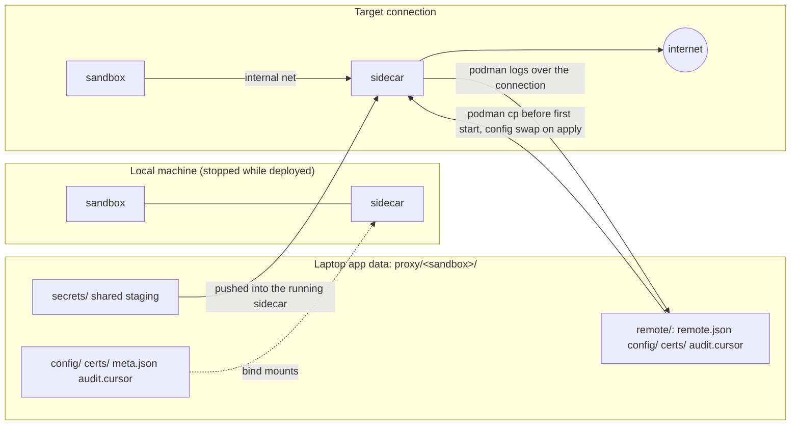

# Proxy Remote Deploy: Build Plan

This document is the build plan for deploying a bounded sandbox (internal network, dual-homed iron-proxy sidecar, secret files, live policy reload, audit polling) to a remote Podman host. It continues [01_ideas.md](01_ideas.md) and supersedes it wherever the two disagree; it replaces an earlier plan written for the removed mitmproxy sidecar, which git history keeps. Status: implemented. Resolved Decisions 1–7 are settled by the user (the recommended option in each case) and the phases below were built for them; the `standard` remote specs pass on `mio-tests-remote`, and a real Linux host run was not done ([04_improvements.md](04_improvements.md)). Phase A (the gating spike) blocked Phases C–G; Phase B changed no behaviour. Phase A (the gating spike) blocks Phases C–G; Phase B changes no behaviour and can start at once. Relevant code: `src-tauri/src/backends/mod.rs` (`CliBackend::deploy`), `src-tauri/src/services/sandbox.rs` (create, undeploy, destroy), `src-tauri/src/services/routing.rs` (`SandboxRouter`), `src-tauri/src/proxy/` (sidecar lifecycle, apply, audit), `src-tauri/src/provider/` (`SidecarSpec`), `src-tauri/src/commands/{deploy,proxy,net_policy,sandbox}.rs`, `src/routes/projects/RemoteManager.svelte`, and the skipped specs under `e2e/test/specs/standard/`.

## The Concrete Model

A deployed bounded sandbox has two sites. The **local site** keeps the stopped sandbox container, the stopped local sidecar and the local `mio-proxy-<sandbox>` network, exactly as created. The **remote site** on the target connection gets its own internal network, its own dual-homed sidecar and the sandbox container. The laptop is the single source of truth for both sites' sidecar files; the remote sidecar only ever holds copies.

**Site resolution.** `SidecarSite { machine: MachineRef, provider: Arc<dyn MachineProvider>, local: bool }` (new, `src-tauri/src/proxy/types.rs`) names where a sandbox's active sidecar runs. Callers resolve it with a new `services::proxy::locate_sidecar` (`src-tauri/src/services/proxy.rs`) from `SandboxRouter::locate` (`src-tauri/src/services/routing.rs`) and `ProviderRegistry::provider_for`; `proxy/` never touches `SyncEngine` (`src-tauri/AGENTS.md`, subsystem independence). Deployed-ness stays defined only by the Mutagen session ([remote.md](../../architecture/remote.md), Invariants); `remote/remote.json` is a cache of the remote sidecar's connection, network and address, read the same way `meta.json` is for the local one.

**Remote sidecar files.** The remote sidecar has no host bind mounts. Its `config/config.yaml` (rendered with the remote sidecar address) and `certs/` (a fresh CA) are staged under `<app_data_root>/proxy/<sandbox>/remote/` and copied into the created, unstarted container at `/etc/iron-proxy/` with `MachineProvider::copy_in` (the paths `CONTAINER_CONFIG_DIR`, `CONTAINER_CERTS_DIR` and `CONTAINER_SECRETS_DIR` in `src-tauri/src/proxy/iron.rs` and `src-tauri/src/proxy/iron_config.rs` stay unchanged). Secret files live in a tmpfs mounted at `CONTAINER_SECRETS_DIR` (Resolved Decision 1) and are pushed from the laptop's shared `secrets/` staging directory after every remote sidecar start and on every apply.

**Apply while deployed.** One apply stages the secret files on the laptop, writes the local sidecar's `config.yaml` offline (the local sidecar stays stopped), renders the remote config, pushes changed secret files, copies the remote config in as `config.next.yaml`, swaps it in, reloads the remote sidecar, and only then rewrites `applied.json` and deletes stale secret files on both sites. A failure restores the laptop files, swaps the remote config back, re-pushes the restored secret files, and returns the error, so `applied.json` always describes what the active sidecar runs (`docs/features/podman-egress-boundary/02_dev.md`, Resolved Decision 13).

**Audit.** `audit::ingest` takes the cursor path, so the local site keeps `audit.cursor` and the remote site uses `remote/audit.cursor`; both append to the one laptop `flows.ndjson`. A running watch is retargeted by deploy and undeploy through `FlowWatchRegistry::retarget` (`src-tauri/src/proxy/flowlog.rs`).

**Deploy order** (`services::sandbox::deploy`, new): plan without mutation (`SandboxBackend::plan_deploy`, includes the target preflight) → pull the iron-proxy image on the target → create the remote network and sidecar (fresh CA, bootstrap config copied in, deny-all) and start it → `SandboxBackend::deploy` with the remote `ProxyAttachment` and the `guestEnv` placeholders (stops the local sandbox, creates the remote workspace, alias, base image, remote container, key) → apply the policy to the remote sidecar → inject the remote CA into the remote sandbox → stop the local sidecar → retarget the flow watch → `RuntimeManager::reproduce_remote` → create the Mutagen session. Any failure before the session exists runs the rollback (Lifecycle).

## Resolved Decisions

Decisions 1–7 restate the Open Questions of [01_ideas.md](01_ideas.md) and were settled by the user in favour of the recommended option. Decisions 8 onward are settled by this plan.

1. **Where remote secret values live** — **Settled.** Options: (a) files in the remote sidecar's container layer, on the remote disk until the sidecar is removed, pushed with `podman cp` of the laptop's staged files; (b) a tmpfs at `CONTAINER_SECRETS_DIR`, RAM only, pushed again after every remote sidecar start; (c) no secret values on the remote, so bindings pass through unswapped there; (d) refuse deploy while any binding has a stored value or the GitHub binding is live. **Chosen: (b).** A stopped or rebooted remote sidecar then holds no credential at rest, and a missing secret file fails safe (iron-proxy sends the placeholder unswapped and annotates `secret_unavailable`; `docs/features/podman-egress-boundary/02_dev.md`, Resolved Decision 15). The cost is a push after every remote start, which Decision 5 already routes through the app. Under (a) Phase C drops `SidecarSpec.tmpfs` and pushes with `copy_in`; under (c) or (d) Phase C drops the secret push and Phase D adds the refusal or the stripped render.
2. **Whether the user is told before secrets leave the laptop** — **Settled.** Options: no notice; a one-line notice in the deploy picker naming the host and the number of secrets that will be sent; a blocking confirmation dialog. **Chosen: the one-line notice** (Phase G), computed by a new `deploy_secret_count` command from the workspace bindings with a stored value plus the live GitHub binding, so no value or secret id crosses IPC.
3. **Sidecar-less sandboxes** — **Settled by the user.** Every sandbox is assumed to have a proxy sidecar. Options considered: (a) keep a sidecar-less sandbox deployable unbounded, flagged in `RemoteManager.svelte`; (b) refuse its deploy. **Chosen: (b).** `services::sandbox::deploy` calls `proxy::require_sidecar` first and fails with "recreate the sandbox" when the `<name>-proxy` sidecar is missing or the lookup fails, so a sandbox never deploys without its boundary and the deploy has one bounded path only. The local start path stays lenient: `ensure_sidecar_running` skips a missing sidecar, because the mock backend scripts `podman ps` without sidecars. A deployment made before this feature has no remote sidecar; undeploy and destroy still work, a policy apply on it is refused, and nothing flags it.
4. **How a policy change reaches the remote sidecar** — **Settled.** Options: push and reload live on every apply; apply only at deploy and require a redeploy. For an unreachable target: fail the apply, or queue it. **Chosen: live push, and fail the apply when the target is unreachable**, leaving the laptop files restored, `applied.json` unchanged and the drift banner (`net_policy_drift`, `src-tauri/src/commands/net_policy.rs`) showing until the next successful apply. A queue would let `applied.json` and the running remote pipeline disagree.
5. **Whether starting a sandbox also starts its sidecar** — **Settled.** Today `start_sandbox` (`src-tauri/src/commands/sandbox.rs`) starts only the sandbox, locally and for a deployed sandbox alike. **Chosen: yes, for both sites, in this feature** (Phase E): a new `proxy::ensure_sidecar_running(site)` starts a stopped sidecar, pushes the secret files on the remote site, and confirms with a reload before the sandbox starts. Without it, a remote host reboot leaves a deployed sandbox with no network, and under Decision 1 (b) with no secrets either. The local half fixes the same pre-existing gap after a Podman machine restart.
6. **The minimum target the deploy preflight accepts** — **Settled by the user as 4.0+ with netavark; Phase A confirms.** Proposed: Podman 4.0 or newer (multiple `--network` flags with `name:ip=` need it) with the netavark backend, read from `podman --connection <target> info --format json` by `SandboxBackend::plan_deploy`. Phase A check 4 fixes the final floor and whether CNI is refused. A target below the floor fails with `BackendError::RemoteHostUnsupported` (Decision 18) before anything is mutated.
7. **What the remote e2e must prove before the feature counts as done** — **Settled.** Options: (a) the un-skipped `standard` specs against `mio-tests-remote` (a second rootless WSL Podman machine, provisioned by `onPrepare` in `e2e/wdio.conf.ts`) plus the new boundary assertions; (b) (a) plus a manual Phase A run against a real non-WSL Linux host. **Chosen: (a) gates `implemented`; (b) runs once if the user can provide a host, else stays recorded in [04_improvements.md](04_improvements.md).** `mio-tests-remote` shares the local machine's WSL image, so it proves the flow, not SELinux, firewalld or older-Podman behaviour.
8. **Remote sidecar state transport** — in-container files over the Podman connection: `MachineProvider::copy_in` of one staged tree (`config/` and `certs/`, removed afterwards) onto `/etc/iron-proxy` before the first start (Phase A) and of `config.next.yaml` on every apply, `MachineProvider::exec` for the swap, reload and stale-file removal, and the Decision 1 push for secrets. No raw SSH and no remote directory; `podman rm` is the whole remote teardown. Rejected options are in [01_ideas.md](01_ideas.md), Technology Choices.
9. **Remote CA** — fresh per deploy, generated by `iron::generate_ca` into `remote/certs/` and removed with `remote/` at undeploy and destroy. The local sandbox's trust store is never touched, so undeploy needs no re-injection.
10. **Remote placeholders** — the remote sandbox is created with the placeholders of `applied.json`'s `guestEnv` (`AppliedPolicy`, `src-tauri/src/net_policy.rs`), so one snapshot stays valid for both containers. A snapshot without `guestEnv` stamps none.
11. **Image on the target** — `proxy::ensure_proxy_image` with the target-pinned provider, reported through `activity::TaskRegistry` as at create. Air-gapped targets are deferred ([04_improvements.md](04_improvements.md)).
12. **Local site during a deploy** — the local sidecar and network are stopped, never removed, because the stopped local sandbox's `--network mio-proxy-<sandbox>` is fixed at create. Undeploy starts the local sidecar with `ensure_sidecar_running` before `store.start`. While deployed, applies and GitHub refreshes write the local sidecar's files offline and never start it.
13. **Subnet on the target** — `allocate_network` (`src-tauri/src/proxy/mod.rs`) walks `10.90.<index>.0/24` on the target independently; the result is recorded in `remote/remote.json` and rendered into the remote config only.
14. **Remote config swap** — the new config is copied in as `config.next.yaml`; one `podman exec … sh -c` renames `config.yaml` to `config.prev.yaml` and `config.next.yaml` to `config.yaml`; the Rust `reload` (`src-tauri/src/proxy/iron.rs`) runs next; on failure a second exec renames `config.prev.yaml` back. The remote sidecar is never restarted as a fallback for a rejected config (`docs/features/podman-egress-boundary/02_dev.md`, Resolved Decision 13).
15. **Audit across sites** — one laptop `flows.ndjson`; one cursor per site; the remote cursor starts empty for each new remote sidecar and is removed with `remote/`. The local cursor survives a deploy because the stopped local sidecar keeps its `k8s-file` log.
16. **Deploy orchestration and rollback** — `services::sandbox::deploy` owns the sequence and `deploy_sandbox` (`src-tauri/src/commands/deploy.rs`) delegates to it. The remote sidecar is created before the local sandbox is stopped. A failure before the Mutagen session exists removes the remote sandbox, the remote sidecar, the remote network and `remote/`, starts the local sidecar, and starts the local sandbox. Today's deploy has no rollback at all; this covers the old `reproduce_remote` failure path too.
17. **Destroy of a deployed sandbox** — after the existing session terminate and `remove_remote`, remove the remote sidecar and network, then `store.destroy`, `net_policy::remove_applied`, `cleanup_host_state` and `proxy::remove_proxy` for the local site. The order relative to the session terminate stays as `docs/features/lib-decomposition/02_dev.md`, Resolved Decision 2, defines it.
18. **Error shape** — `BackendError::ProxyDeployUnsupported` and `AppError::ProxyDeployUnsupported` (`src-tauri/src/backends/types.rs`, `src-tauri/src/error.rs`, `src/lib/errors.ts`) are replaced by `RemoteHostUnsupported { connection, reason }` for a failed preflight, with its `kind()` arm, its arm in the hand-written `From<BackendError> for AppError`, and its `AppErrorKind` entry.
19. **Startup sweep** — `proxy::sweep` stays local-only. A remote sidecar orphaned by a crash mid-deploy is recorded in [04_improvements.md](04_improvements.md), "Cross-connection sweep".
20. **Host-global state and parallel worktrees** — every new laptop path is under `<app_data_root>/proxy/<sandbox>/remote/` through `crate::paths::app_data_root`, which honours `MIO_APP_DATA_DIR`. No new host port, bundled binary, environment variable or teardown of host-global state. The deploy flow already uses host-global resources (`mio-tests-remote`, the `~/.ssh` alias writes in `ssh::write_alias`), so its specs stay in the host-locked `standard` tier, one run per host. No `light` spec may invoke `deploy_sandbox` past `plan_deploy`: `remote_mkdir` runs raw `ssh` and `ssh::write_alias` writes the real `~/.ssh`, neither gated by `MIO_MOCK_BACKEND`.

## Implemented: Phase A — Gating spike

Run before Phases C–G, on `mio-tests-remote` (Decision 7) and, if available, a real Linux host. Adapt the scripts in `docs/features/podman-egress-boundary/spike/` (`lib.sh` already reads `SPIKE_CONNECTION`) to in-container state, and keep the adapted scripts and evidence in `docs/features/proxy-remote-deploy/spike/` with a `type: spike` `README.md`.

| # | Check | Gates |
|---|---|---|
| 1 | Internal network and dual-homed sidecar over `--connection`; `podman cp <dir>/. <sidecar>:/etc/iron-proxy/config` into the created container before its first start (the parent `/etc/iron-proxy` may not exist in the image); iron-proxy's user can read the copied files; bootstrap denies; a swapped `config.next.yaml` reloads | Decisions 8, 14 |
| 2 | `--tmpfs` at `CONTAINER_SECRETS_DIR` with a mode iron-proxy's user can read; a file pushed into it by `podman exec -i … sh -c 'cat > …'` is swapped on the next request; whether `podman cp` can write into the tmpfs of a running container | Decision 1 |
| 3 | A sandbox on the internal network over `--connection`: no route out, the exec transport (`podman --connection <target> exec -i <name> mio-sshd`) works, `mise install` succeeds through the sidecar, `podman logs --timestamps --since` reads the audit stream | Model; Decision 15 |
| 4 | Checks 1–3 on a real Linux host (SELinux enforcing, firewalld, the distribution's Podman); record `podman info` network backend and version | Decision 6 |

**Result (2026-11-24, `mio-tests-remote`, Podman 5.8.6, netavark; evidence in [spike/README.md](spike/README.md)):** checks 1–3 pass; check 4 was not run (no real Linux host available). Two corrections to the plan: `podman cp <dir> <sidecar>:/etc/iron-proxy/config` fails on a created container because `/etc/iron-proxy` does not exist, but copying one staged tree holding `config/` and `certs/` onto `<sidecar>:/etc/iron-proxy` creates the path and works, so no volume fallback was needed; and `podman cp` also writes into the tmpfs of a running container, though the push uses `exec` anyway. The Decision 6 floor (Podman 4.0, netavark) rests on upstream documentation of multiple `--network` flags, not on a measured old Podman. Decision 1 stays (b).

## Implemented: Phase B — Sidecar site seam (no behaviour change)

- **`SidecarSite`** (`src-tauri/src/proxy/types.rs`): `machine`, `provider`, `local`. A constructor for the local site from `ProviderRegistry::local_ref`.
- **`services::proxy::locate_sidecar(router, registry, name)`** (new `src-tauri/src/services/proxy.rs`, registered in `src-tauri/src/services/mod.rs`): `SandboxRouter::locate`, then `registry.provider_for(&route.machine)`, `local` from `SandboxRouter::is_local`.
- **`proxy::status`, `proxy::restart_proxy_container`** (`src-tauri/src/proxy/mod.rs`), **`iron::apply_policy`, `iron::refresh_github_binding`** (`src-tauri/src/proxy/iron.rs`) take a `&SidecarSite` instead of resolving `registry.local`. `sidecar_provider` remains only for the local-only callers (`proxy::exists`, `services::sandbox::destroy`'s non-deployed branch).
- **Commands** `proxy_status`, `restart_proxy`, `watch_proxy_flows` (`src-tauri/src/commands/proxy.rs`) and `apply_sandbox_policy` (`src-tauri/src/commands/net_policy.rs`) take `State<SandboxRouter>` and resolve the site; per the state-narrowing rule (`src-tauri/AGENTS.md`) a command needing the router plus the registry calls the service.
- **`services::github_access`** (`src-tauri/src/services/github_access.rs`): `reconcile_locked` and `spawn_reconcile_all` resolve the site before `refresh_github_binding`.
- **Audit and watch** (`src-tauri/src/proxy/audit.rs`, `src-tauri/src/proxy/flowlog.rs`): `ingest(provider, sidecar, state_dir, cursor_file)`; `start_watch` takes the site; `FlowWatchRegistry::retarget(app, sandbox, site)` aborts and respawns the task keeping its watcher count.
- **Verification**: `cargo check`, `cargo test`, `./build e2e light` (the egress-boundary and traffic light specs must still pass unchanged).

## Implemented: Phase C — Remote sidecar primitives

- **`SidecarSpec.tmpfs: Vec<String>`** (`src-tauri/src/provider/types.rs`) rendered by `PodmanProvider::create_sidecar` (`src-tauri/src/provider/mod.rs`) as `--tmpfs <path>:<options from Phase A>`; argv unit test beside `create_sidecar_renders_networks_and_log_flags_before_the_image`. Existing callers pass an empty list.
- **`podman.cp`** joins `KNOWN_CALLS` in `src-tauri/src/mockctl/mod.rs`, so light specs can script a failed copy.
- **Remote state paths** (`src-tauri/src/proxy/mod.rs`): `remote_dir`, `read_remote_meta`/`write_remote_meta` (`remote/remote.json`: `connection`, `network`, `proxyIp`), `remove_remote_state`.
- **`proxy::create_remote_proxy(app, site, sandbox) -> ProxyAttachment`**: `allocate_network` on `site.provider`; `iron::generate_ca` into `remote/certs/`; `iron::write_bootstrap` into `remote/`; `create_sidecar` with no mounts, the tmpfs, the same networks, log flags and management token as `create_podman_proxy`; `copy_in` of `config/` and `certs/`; start; `write_remote_meta`. Returns `PodmanBridge` with `proxy_env(<remote ip>)` and the remote `dns`.
- **`proxy::remove_remote_proxy(site, sandbox)`**: removes the sidecar (guarded by `is_sidecar` as `remove_proxy` is) and the network on `site.provider`, best-effort. It never touches the laptop state directory; the caller removes `remote/`.
- **`iron::push_secrets(site, sandbox, files)`**: for each staged file, `exec_piped` of `sh -c 'cat > <dir>/.<name>.tmp && mv …'`, then `exec` of `rm` for files no longer staged. `exec_piped` stages stdin in a temp file until `docs/improvement-backlog.md` T5a lands; the same exposure the GitHub token and CA injection have today.
- **`iron::apply_remote(site, sandbox, policy)`**: the Model's "Apply while deployed" sequence, under the same per-sandbox `apply_lock`, with the Decision 14 swap. Reuses `stage_files`, `snapshot_secret_files`, `restore_secret_files`, `write_offline` and `rendered`.
- **`proxy::ensure_sidecar_running(site, sandbox)`**: start if stopped, `push_secrets` on the remote site, then the existing `start_and_confirm` reload.
- **Unit tests**: remote meta round trip; the swap and push argv; render with two addresses yields configs differing only in `dns.proxy_ip`.

## Implemented: Phase D — Deploy service and rollback

- **`SandboxBackend::plan_deploy(name, target) -> DeployPlan`** (`src-tauri/src/backends/types.rs`, `src-tauri/src/backends/mod.rs`): the existing validation of `CliBackend::deploy` (name, `remote_targets`, self-deploy, `resolve_workspace`, `NoSshEndpoint`) plus the Decision 6 preflight through `podman.info`. Mutates nothing.
- **`SandboxBackend::deploy(name, plan, proxy: Option<&ProxyAttachment>, extra_env)`**: the existing mutation steps, with the remote `InstanceSpec` taking `network` (internal network and `dns`) and `env` (`proxy_env` plus the `guestEnv` placeholders). The `proxy::exists` refusal moves into the service until Phase G removes it.
- **`services::sandbox::deploy`** (`src-tauri/src/services/sandbox.rs`): the Model's deploy order, the sidecar precondition of Decision 3, the rollback of Decision 16, and `inject_ca` with `remote/certs/ca.pem`. Wrapped in an `activity::scope` task `sandbox-deploy:<name>` with step progress, mirroring `create`; a new `TaskKind` variant in `src-tauri/src/activity/types.rs`.
- **`deploy_sandbox`** (`src-tauri/src/commands/deploy.rs`) delegates to the service, which takes the backend, runtime, sync engine, registry and flow-watch registry.
- **`BackendError::RemoteHostUnsupported`** replaces `ProxyDeployUnsupported` (Decision 18) in `src-tauri/src/backends/types.rs`, `src-tauri/src/error.rs` and `src/lib/errors.ts`.

## Implemented: Phase E — Operations while deployed

- **Apply**: `apply_policy` dispatches on `site.local`; the remote branch is `iron::apply_remote`. The local branch is unchanged.
- **GitHub binding**: `refresh_github_binding` on a remote site writes the local files offline, pushes, swaps and reloads the remote sidecar when it runs. `github_binding_live` keeps reading the laptop's staged files, which are the source for both sites.
- **Status**: `ProxyStatus` (`src-tauri/src/proxy/types.rs`) gains `host: Option<String>`, the connection when remote; `proxy_ip` and `network` come from `remote.json` there. `src/lib/proxy/status.svelte.ts` mirrors it and `ProxyPanel.svelte` (`src/routes/projects/`) names the host.
- **Restart**: `restart_proxy` on a remote site stops the sidecar and calls `ensure_sidecar_running`, because the tmpfs is empty after a restart.
- **Start** (Decision 5): `start_sandbox` (`src-tauri/src/commands/sandbox.rs`) calls `ensure_sidecar_running` for the resolved site before `store.start`, moving into a `services::sandbox::start` because it now spans the router, registry and backend. A sandbox without a sidecar (Decision 3) skips the step.

## Implemented: Phase F — Undeploy and destroy

- **`services::sandbox::undeploy`**: close panes and forwards → flush → `remove_remote` → `remove_remote_proxy` → terminate the session → `FlowWatchRegistry::retarget` to the local site → `ensure_sidecar_running` on the local site → `store.start` → `remove_remote_state`. The remote removals stay before the terminate, for the reason the existing comment gives.
- **`services::sandbox::destroy`** (deployed branch): Decision 17.
- Both tolerate a deployment without a remote sidecar (made before this feature) by treating "no such container" and "no such network" as success.

## Implemented: Phase G — Lift the refusal, frontend, e2e and docs

- **Remove the refusal** from `services::sandbox::deploy`.
- **`RemoteManager.svelte`**: restore the host picker, `deploy()` and the `projects_no_hosts`/`projects_deploy_confirm` keys in `messages/en.json`, `messages/de.json` and `messages/ru.json` from the parent of commit `bd8f92a`; drop `data-remote-deploy-unavailable` and its `TODO(i18n)` text. Add the Decision 2 notice; new strings stay hard-coded English marked `TODO(i18n)` until the user approves wording (the `feature-implement` skill's Paraglide rule).
- **Specs**: remove `describe.skip`/`it.skip` from `e2e/test/specs/standard/deploy-remote.spec.ts`, `base-image-remote.spec.ts` and `runtime-management.spec.ts`; extend their `after` hooks to remove `<name>-proxy` and `mio-proxy-<name>` on `REMOTE_CONNECTION`. The new boundary assertions (remote sidecar running, raw IP refused from the remote sandbox, an allowed host reachable, a policy apply reaching the remote sidecar, undeploy removing the remote sidecar and network and restarting the local one) are planned in `03_e2e.md` by the `feature-e2e` skill.
- **Docs**: [remote.md](../../architecture/remote.md) (drop "Deploy is temporarily blocked", add the remote sidecar to Deploy, Undeploy and Destroy) and [network.md](../../architecture/network.md) (the "Remote deploy" row, Where State Lives, Lifecycle), via the `write-docs` skill; remove `ProxyDeployUnsupported` from `docs/features/proxy-remote-deploy/feature.md`'s status note.
- **Verification**: `cargo check` and `cargo test` in `src-tauri/`; `pnpm check`; `./build docs`; `./build e2e light`; `./build e2e` (the `standard` tier, which provisions `mio-tests` and `mio-tests-remote` and runs the un-skipped specs; host-locked, one run per host).

## Implementation Notes

What the code does where the phases above were underspecified or the implementation differs from their wording.

- **Site resolution.** `services::proxy::locate_sidecar(router, name)` takes only the router (it already holds the provider registry). A routing failure is never read as "local": a Mutagen error would otherwise start or rewrite the stopped local sidecar of a deployed sandbox.
- **Apply dispatch.** `iron::apply_policy` takes the site and chooses between the unchanged local path and `apply_remote_locked` (remote sidecar known from `remote/remote.json`); a deployed sandbox without `remote/remote.json` is refused. `apply_remote_locked` first calls `ensure_sidecar_running`, so a stopped remote sidecar is restarted with its last-applied files before anything on the laptop changes.
- **`ensure_sidecar_running`** (re-exported as `proxy::ensure_sidecar_running`) is a no-op when the sidecar does not exist on the site, which the mock backend relies on (Decision 3). On a remote site it pushes every file in the laptop's `secrets/` directory on every call, running sidecar or not, so a sidecar left with an empty tmpfs by a failed push is repaired by the next call; a fresh start also runs the confirming reload.
- **Deploy picker count.** `deploy_secret_count` (`src-tauri/src/commands/proxy.rs`) counts the workspace bindings with a stored value plus the live GitHub binding; the picker shows it as a non-blocking line and hides it at zero.
- **Remote host in the status.** `ProxyStatus.host` is set only for a remote sidecar; `ProxyPanel.svelte` shows it.
- **Deploy preconditions.** `deploy` refuses a sandbox that already has a Mutagen session, and one whose local sidecar is missing or whose lookup fails (`proxy::require_sidecar`). `deploy_to_target` refuses a target that already holds a container named `<name>` or `<name>-proxy`. `SandboxBackend::deploy` takes the remote `ProxyAttachment` as required.
- **Rollback.** `DeployUndo` records one flag per resource this run created or stopped (remote sidecar with network and staging, remote sandbox, flow-watch retarget, local sidecar stop, local sandbox stop), and rollback undoes exactly those, remote first. `create_remote_proxy` removes its own partial work when it fails.
- **Start of a deployed sandbox.** `services::sandbox::start` ensures the remote sidecar, then starts the container on the resolved site; the local container of a deployed sandbox stays stopped.
- **Revocation.** `refresh_github_binding` unstages the laptop's GitHub token file when a revocation cannot reach the sidecar, so a later start never re-pushes it.
- **Not covered by unit tests.** The remote-state round trip and `copy_state_in` need an `AppHandle`; they are proven by the `standard` deploy spec. `podman.cp` is a known mock call, but no `light` spec scripts it (Decision 20 keeps `light` out of `deploy_sandbox` past `plan_deploy`).

## Lifecycle and Cross-Cutting Concerns

- **Deploy**: plan → target image → remote sidecar → `store.deploy` → remote apply → remote CA → stop local sidecar → retarget watch → `reproduce_remote` → Mutagen session. The remote sidecar denies everything until the remote apply (`docs/features/podman-egress-boundary/02_dev.md`, Resolved Decision 18), so `reproduce_remote` must run after it.
- **Rollback** (Decision 16): in reverse of what this run created — remote sandbox, remote sidecar and network, `remote/`, then local sidecar start and local sandbox start. Best-effort and warn-logged; the original error is returned.
- **Policy change while deployed**: `apply_sandbox_policy` (the accepted policy plus its revision) → site resolved → `apply_remote`. The workspace file reaches the laptop through Mutagen like any other workspace file and is only ever a proposal the user reviews ([net-policy-review](../net-policy-review/02_dev.md)).
- **Secret value change while deployed**: `apply_sandbox_policy` carries the value edit, persists it after the revision check and pushes the new file.
- **App restart while deployed**: nothing is cached across runs; `locate_sidecar` re-resolves from the session, and the remote sidecar keeps running with its tmpfs intact.
- **Remote host reboot**: both remote containers stop and the tmpfs is gone. `start_sandbox` (Decision 5) restarts the sidecar, re-pushes secrets and reloads before starting the remote sandbox container.
- **Crash mid-deploy**: may leave a remote sidecar, network or container with no session; [04_improvements.md](04_improvements.md), "Cross-connection sweep".
- **Secret invariants** ([network.md](../../architecture/network.md), Invariants): values reach the remote only through `exec_piped` stdin, never argv, the container environment, logs or IPC. The remote management token is generated per remote sidecar and passed as `IRON_MANAGEMENT_API_KEY`, as locally.
- **Testing split**: pure argv and path functions get unit tests; the `light` tier covers the restored picker, a scripted `plan_deploy` failure (`podman.system-connection-list` or `podman.info`) and the status `host` rendering, never a deploy past planning (Decision 20); the `standard` tier is the proof.

## Common Gotchas

| Gotcha | Cause | Fix |
|---|---|---|
| `podman create` of the remote sidecar fails with "no such file or directory" for a `C:/Users/...` path | The remote sidecar spec carried the local `SidecarMount`s, whose sources exist only on the laptop | Build the remote `SidecarSpec` in `proxy::create_remote_proxy` with no mounts; copy files in with `MachineProvider::copy_in` |
| The remote sidecar exits at boot with a config-not-found error | The sidecar was started before `config/` and `certs/` were copied into it | Copy both into the created container, then start it (`proxy::create_remote_proxy`, `src-tauri/src/proxy/mod.rs`) |
| Every request from the remote sandbox is refused right after deploy, and `mise install` fails in `reproduce_remote` | The remote sidecar still runs the deny-all bootstrap because the remote apply had not run | Keep the remote apply before `reproduce_remote` in `services::sandbox::deploy` (`src-tauri/src/services/sandbox.rs`) |
| A remote request reaches upstream with the literal placeholder after a sidecar restart or host reboot | The tmpfs at `CONTAINER_SECRETS_DIR` is empty after any start, and nothing pushed the secret files | Start remote sidecars only through `proxy::ensure_sidecar_running`, which pushes the files before its reload |
| A policy apply while deployed starts the local sidecar | `apply_policy`'s local branch calls `start_and_confirm` for a stopped sidecar | Resolve the site first; the remote branch writes the local files offline and never starts the local sidecar (Resolved Decision 12) |
| `undeploy` starts the local sandbox with no network | The local sidecar was not started first, or was removed by deploy | Call `proxy::ensure_sidecar_running` on the local site before `store.start` in `services::sandbox::undeploy` |
| The remote sidecar keeps serving the old policy although the apply reported success | `config.next.yaml` was copied in but the swap exec did not run before the reload | Swap with one `sh -c` exec before calling `reload` (Resolved Decision 14) |
| The traffic panel shows no rows after deploy | The flow watch still polls the stopped local sidecar | Call `FlowWatchRegistry::retarget` in deploy and undeploy (`src-tauri/src/proxy/flowlog.rs`) |
| Traffic rows from before a deploy reappear after it | The remote ingest read the local `audit.cursor` | Pass `remote/audit.cursor` to `audit::ingest` for the remote site (Resolved Decision 15) |
| HTTPS from the remote sandbox fails with "unable to get local issuer certificate" | The local `certs/ca.pem` was injected into the remote sandbox | Inject `remote/certs/ca.pem` (Resolved Decision 9) |
| A `light` spec writes the developer's real `~/.ssh/config` or runs `ssh` | The spec drove `deploy_sandbox` past `plan_deploy`, and `remote_mkdir` and `ssh::write_alias` are not gated by `MIO_MOCK_BACKEND` | Script the failure at `podman.system-connection-list` or `podman.info` so the deploy stops in `plan_deploy` (Resolved Decision 20) |
| A deployed sandbox's destroy leaves `<name>-proxy` and `mio-proxy-<name>` on the target | The deployed branch of `services::sandbox::destroy` removed only the sandbox containers | Call `proxy::remove_remote_proxy` right after `remove_remote` (Resolved Decision 17) |
| Deploy to a host fails with `RemoteHostUnsupported` | The target's Podman is below the Resolved Decision 6 floor or uses a refused network backend | Upgrade Podman on the target; `podman --connection <target> info` shows the version and backend |
| A spec run leaves a `<name>-proxy` container on `mio-tests-remote` that breaks the next run's create | The spec's `after` hook removed only the remote sandbox | Remove `<name>-proxy` and `mio-proxy-<name>` on `REMOTE_CONNECTION` in the `after` hooks of the remote specs |
