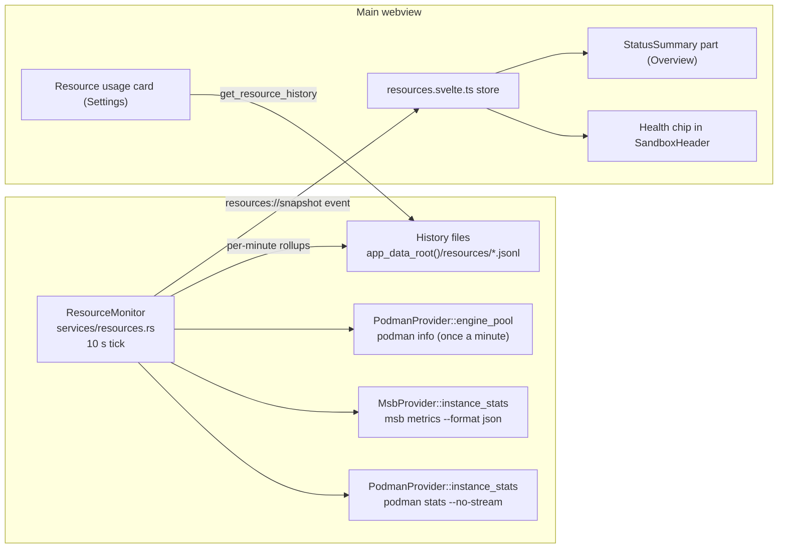

# Sandbox Resource Monitor Build Plan

This document is the build plan for sampling the CPU and memory of every local sandbox, showing a discrete health indicator (with a restart hint) in the sandbox header and the Manage Overview, and keeping a local per-sandbox usage history that answers the maintainer's sizing question: should sandboxes get more memory by default? Planning started here without an `01_ideas.md`; the questions such a document would have left open are restated and resolved under Resolved Decisions. Status: Phases A to E are implemented, except the Health pool rule, which waits on a decision (Phase D); Phase F remains.

## The Concrete Model

### What is measured

- **Per sandbox:** CPU use as a fraction of the CPUs the sandbox may use, memory in use in bytes, and the memory limit in bytes. Only the sandbox's main instance is reported; proxy sidecars and other app-owned instances are dropped by intersecting engine output with the sandbox name set (see Resolved Decision 6).
- **Per engine pool:** for Podman, the Podman machine's total and available memory. Every Podman sandbox runs without a per-container limit, so all Podman sandboxes share the one WSL VM, and the pool, not the container, is what runs out. microsandbox has no pool: each microVM has its own fixed memory size.
- **Not measured:** disk, network and GPU use; deployed (remote) sandboxes; stopped sandboxes. Deferred items are listed in [04_improvements.md](04_improvements.md).

### Sampling (Rust)

- `MachineProvider` (`src-tauri/src/provider/types.rs`) gains `instance_stats()`, returning one `InstanceStats` per running instance from a single engine call, and `engine_pool()`, returning an optional `EnginePool`. `PodmanProvider` (`src-tauri/src/provider/mod.rs`) runs `podman stats --no-stream` for every running container and `podman info` for the pool. `MsbProvider` (`src-tauri/src/provider/msb.rs`) runs `msb metrics --format json` with no name, which reports every running sandbox, and returns no pool.
- `ResourceMonitor` (`src-tauri/src/services/resources.rs`, new) owns one background task started from `src-tauri/src/bootstrap.rs` through `tauri::async_runtime::spawn`, as the flow-log poller in `src-tauri/src/proxy/flowlog.rs` does. Every tick (10 s) it asks each engine that has at least one running sandbox for `instance_stats()`, derives CPU fractions, folds the result into a ring of the last six samples per sandbox, and emits one `resources://snapshot` event. Once a minute it also calls `engine_pool()` and appends one rollup line per sandbox to the history files.
- The monitor holds the latest `ResourceSnapshot` in memory; the `get_resource_snapshot` command returns it so a reloaded frontend hydrates without waiting for a tick.

### Health (frontend)

- `src/lib/sandbox/health.ts` (new) holds the pure classification and its thresholds. A sandbox is **strained** when memory use is at or above 90 % of its limit in every one of the last three samples, or when its Podman machine pool has under 10 % memory available (not implemented: `podman info` reports no available figure, see Phase D); **busy** when memory use is at or above 75 % of its limit or CPU use is at or above 90 % of its allotted CPUs across the last three samples; otherwise **ok**. A sandbox with fewer than two samples is **unknown**, and the indicator stays hidden.
- `src/lib/sandbox/resources.svelte.ts` (new) is the module-scoped rune store that owns the single `resources://snapshot` subscription and the `get_resource_snapshot` hydration, following the pattern of `src/lib/registry.svelte.ts`. Components read `resourcesFor(name)` and `healthFor(name)` accessors and never call `listen()` themselves.
- `src/lib/sandbox/HealthChip.svelte` (new) renders inside `src/lib/workspace/SandboxHeader.svelte`, beside the status dot, only while the sandbox is running. The chip is a small coloured gauge icon with no text when ok, and adds a short label when busy or strained. Clicking it opens a popover with plain-language copy ("Running smoothly", "Working hard", "Running low on memory — restarting may help"), memory as "1.2 GB of 4 GB", CPU as a percentage, and, when strained, a Restart button.
- Restart is a frontend sequence of the existing `stop_sandbox` and `start_sandbox` commands (`src-tauri/src/commands/sandbox.rs`), reusing the stop and start handlers `SandboxHeader.svelte` already has, so pane teardown and activity reporting stay identical to pressing Stop then Start.
- `src/lib/workspace/StatusSummary.svelte` gains a `resources` part ("Memory 1.2 / 4 GB · CPU 12 %"), shown only while the sandbox is running.

### Usage history and the sizing report

- History lives under `paths::app_data_root()` (`src-tauri/src/paths.rs`) in a `resources/` directory, one JSON-lines file per sandbox named after the sandbox, plus `_podman-machine.jsonl` for the Podman pool. A leading underscore cannot collide with a sandbox name, because `validate_name()` in `src-tauri/src/backends/mod.rs` requires an ASCII-alphanumeric first character.
- Each line is a one-minute rollup: timestamp, provider, CPU mean and max, memory mean and max, memory limit, and the count of samples in the minute that were at or above 90 % of the limit. Lines older than 14 days are dropped when the monitor starts and when a file passes 512 KiB.
- `get_resource_history` (new command) returns the rollups for one sandbox, or for every sandbox and the pool, over a window of 24 hours or 7 days.
- `src/lib/settings/ResourceUsageCard.svelte` (new), mounted on `src/routes/settings/+page.svelte`, shows one row per sandbox and one for the Podman machine: provider, memory limit, 7-day peak memory, 95th-percentile memory, minutes spent at or above 90 % of the limit, and mean CPU. A "Copy report" button copies the same table as plain text, so other users can send their numbers to the maintainer. Nothing leaves the machine unless a user pastes the report somewhere.

## Resolved Decisions

1. **How are CPU and memory read from each engine?** Through each engine's own CLI in one call for all running instances: `podman stats --no-stream` for Podman and `msb metrics --format json` for microsandbox (present in the bundled `msb` 0.7.12). An exec into each sandbox reading `/proc` or cgroup files was rejected because it costs one process spawn per sandbox per tick instead of one per engine.
2. **What is a Podman sandbox's memory limit?** No Podman sandbox container is created with a memory limit (`create_instance` in `src-tauri/src/provider/mod.rs` renders no memory flag), so a container's reported limit is the whole Podman machine. The machine is a WSL VM, and WSL sizes the VM from the user's `.wslconfig` (by default half of the host's RAM), not from the `--memory` value `podman machine init` records; `podman machine list` reporting 2048 MiB therefore does not describe the real VM. The monitor takes the limit and the pool totals from `podman info`, which reports what the VM actually has.
3. **What is a microsandbox sandbox's memory limit?** The microVM's own memory size. `MsbProvider::create_instance` passes no `--memory` or `--cpus` flag, so every microsandbox sandbox runs on `msb`'s defaults today. The default values are confirmed in Phase A from `msb inspect` and recorded in `spike/engine-output.md`.
4. **How is CPU expressed?** As a fraction of the CPUs the sandbox may use: the Podman machine's CPU count for a Podman sandbox, and the microVM's vCPU count for a microsandbox sandbox. When an engine reports cumulative CPU time, the monitor computes the fraction from the difference between consecutive samples; when it reports only a percentage, the percentage is divided by the allotted CPU count. Phase A records which field each engine provides. A single-shot `podman stats --no-stream` percentage is averaged since container start on a remote client, so it is never used as a live reading when cumulative time is available.
5. **What counts as memory in use?** The engine's working set excluding reclaimable file cache wherever the engine separates the two; Phase A records whether each engine's figure includes cache. A figure that includes cache overstates pressure, which would bias the sizing decision upward, so the history records which definition each provider used.
6. **How are sidecars excluded?** The monitor keeps the set of sandbox names from `SandboxBackend::list` (`src-tauri/src/backends/types.rs`), refreshed every 60 s and whenever a sample contains a name the set does not hold, and drops every stats entry whose name is outside the set. Neither `podman stats` nor `msb metrics` can filter by the `sandbox-mio.workspace` label.
7. **Does polling flood `mio.log`?** No. The process layer (`src-tauri/src/process/mod.rs`) treats `stats`, `info` and `metrics` calls issued by the monitor as quiet call shapes: a successful call logs at `debug` instead of `info`; non-zero exits and failures still log at `warn` and `error`.
8. **Can a slow stats call block the user?** No. A timed-out monitor call neither trips nor closes the Podman breaker (`PODMAN_UNRESPONSIVE` in `src-tauri/src/process/mod.rs`), and the monitor skips Podman while the breaker is open or the machine is not running. A struggling sandbox is exactly when stats are slowest, and a breaker tripped by the monitor would fail-fast the user's Stop or Restart. Monitor calls use a 10 s timeout, shorter than the 30 s default.
9. **Poll or push to the frontend?** Push: one backend task samples for every consumer and emits `resources://snapshot`, because the history must be recorded whether or not any view is open. Frontend polling, as `src/lib/proxy/status.svelte.ts` does, was rejected for that reason.
10. **How often to sample?** Every 10 s for live samples and once a minute for rollups and the pool. An engine with no running sandbox is not called at all. Slowing down while the window is hidden is deferred to [04_improvements.md](04_improvements.md).
11. **Where is the indicator shown?** In the sandbox header (always visible while a sandbox is open) and the Overview status summary. The Home page sandbox cards do not show it in this feature; the cards are deferred to [04_improvements.md](04_improvements.md) to keep the first version discrete.
12. **What does Restart do?** Stop then start through the existing commands, never a new backend command, so every pane and session cleanup a stop performs still runs.
13. **How does the maintainer get data from other users?** Through the Settings card's "Copy report" button, which copies plain text. Automatic telemetry was rejected: the app has none today, and adding a network upload needs its own consent design.
14. **Does this feature change default memory?** No. This feature measures; choosing new defaults (an `msb create --memory` value, a Podman `--memory` per container, or guidance on `.wslconfig`) is the follow-on recorded in [04_improvements.md](04_improvements.md), to be decided from the history this feature collects.
15. **How is the feature exercised in the `light` tier?** Through the scriptable mock: `podman.stats` and `msb.metrics` join `KNOWN_CALLS` in `src-tauri/src/mockctl/mod.rs` (`podman.info` is already listed). An unscripted call returns an empty list, so the indicator stays hidden in every existing spec.
16. **Parallel-worktree impact.** The only new path is the `resources/` directory under `app_data_root()`, which honours the per-worktree `MIO_APP_DATA_DIR` override. The feature adds no host port, no host-global resource, no bundled binary, no harness environment variable and no host-global teardown.
17. **Engine field names and `msb` defaults.** Settled by Phase A ([spike/engine-output.md](spike/engine-output.md)): Podman is sampled with `podman stats --no-stream --format '{{json .}}'` and `podman info --format '{{json .Host}}'`, microsandbox with `msb metrics --format json`; `msb`'s defaults are 512 MiB and 1 vCPU. The parsers in Phase B are written against those captures.

## Implemented: Phase A — Engine output spike

- Ran one throwaway Podman container and one throwaway microsandbox sandbox from the base image, loaded each with CPU, anonymous memory and page cache, and captured `podman stats --no-stream` in both JSON shapes, `podman info` (full and `{{json .Host}}`), `msb metrics --format json` and `msb inspect --format json`.
- Captures, the field mapping and the host's `.wslconfig` state are in [spike/engine-output.md](spike/engine-output.md); trimmed copies are the parser fixtures under `src-tauri/src/provider/fixtures/`.
- Findings: Podman's raw-struct template (`{{json .}}`) gives cumulative `CPUNano` and wall-clock `SystemNano`; `msb metrics` gives cumulative `vcpu_time_ns` and a `timestamp`. Both engines' memory-in-use figures exclude reclaimable cache. `podman info` reports the WSL VM's real size (8 CPUs, 15.4 GiB here, against 4 CPUs and 2 GiB in `podman machine list`). `msb`'s defaults are 512 MiB and 1 vCPU.
- **Plan problem found:** `podman info`'s `memFree` is the kernel's `MemFree`, which counts reclaimable page cache as used, and `podman info` has no available-memory figure. The Health pool rule ("under 10 % available") cannot be fed from it without false strained states; see Phase B and Phase D.

## Implemented: Phase B — Provider seam and process layer

- `src-tauri/src/provider/types.rs`: `InstanceStats` (name, cumulative CPU time in nanoseconds with the engine's sampling clock, allotted CPUs where the engine reports them per instance, memory used, memory limit, whether memory includes cache) and `EnginePool` (CPU count, total memory, free memory); `instance_stats()` and `engine_pool()` on `MachineProvider`. No percentage variant exists, because both engines report cumulative CPU time (Phase A).
- `EnginePool` carries **free**, not available, memory: `podman info` reports only the kernel's `MemFree`, which counts page cache as used (Phase A). The pool rule in Health therefore has no trustworthy input; see Phase D.
- `src-tauri/src/provider/mod.rs`: `PodmanProvider` parses `podman stats --no-stream --format '{{json .}}'` (`parse_podman_stats`) and `podman info --format '{{json .Host}}'` (`parse_podman_pool`), with unit tests over the fixtures. A Podman `InstanceStats` has no allotted CPUs; the monitor takes them from the pool.
- `src-tauri/src/provider/msb.rs`: `MsbProvider` parses `msb metrics --format json` (`parse_msb_metrics`), converting the RFC 3339 `timestamp` to nanoseconds; `engine_pool()` returns none. `MsbProvider`'s own call logging also drops to `debug` for the monitor shape.
- `src-tauri/src/process/mod.rs`: the three monitor argv shapes are constants (`PODMAN_STATS_ARGV`, `PODMAN_POOL_ARGV`, `MSB_METRICS_ARGV`) recognised by `is_monitor_call`. A monitor call logs its start and success at `debug`, gets the 10 s bound in `call_timeout` and `msb_call_timeout`, never trips or closes the breaker, never takes the half-open probe slot, and fails fast while the breaker is open. `podman_breaker_open()` exposes the breaker state. The pool call uses a `{{json .Host}}` template so the existing `info --format json` readiness probe keeps its loud, breaker-tripping shape.
- `src-tauri/src/mockctl/mod.rs`: `podman.stats` and `msb.metrics` are in `KNOWN_CALLS`. An unscripted `podman.stats` returns empty output and an unscripted `msb.metrics` returns `[]`, both parsed as no running instances.

## Implemented: Phase C — Monitor service, commands and history

- `src-tauri/src/services/resources.rs` (new): `ResourceMonitor`, `ResourceSnapshot`, `SandboxResources`, `ResourceSample`, the history line shapes `Rollup` and `PoolRollup`, the tick loop, the name-set refresh, CPU fraction derivation (`cpu_fraction`), the six-sample ring, minute rollups (`MinuteAcc`) and history file writes and pruning. Pure parts have unit tests.
- The name set is built by asking each provider's `list_instances` separately and dropping sidecars and auth containers (the same filter as `services::sandbox::list_user`), rather than through `SandboxBackend::list`, whose Podman failure would also hide every microsandbox sandbox while the Podman machine is stopped.
- A sandbox missing from a successful engine reading leaves the snapshot at once; one whose engine call failed keeps its last samples for up to three ticks; a Podman sandbox's CPU fraction is relative to the pool's CPU count and stays empty until the first pool reading. Each sample's CPU is `None` for the first reading after start.
- A Podman rollup carries the pool only while a Podman sandbox ran in that minute. Each rollup records `memIncludesCache` (false for both engines today).
- Pruning runs at monitor start and whenever a file has grown by 512 KiB since its last prune. A sandbox running around the clock writes more than 512 KiB in about two days, so a file-size trigger alone would rewrite the file every minute once past it.
- `src-tauri/src/paths.rs`: `resource_history_dir()` derives `resources/` from `app_data_root()`.
- `src-tauri/src/bootstrap.rs`: constructs, starts and manages the monitor after the provider registry; the exit handler stops it first.
- `src-tauri/src/commands/sandbox.rs`: `get_resource_snapshot` and `get_resource_history` (`window` is `"day"` or `"week"`), registered in `src-tauri/src/commands/mod.rs`.
- `src-tauri/src/services/sandbox.rs`: `cleanup_host_state`, which every destroy path runs after the instance is removed, calls `ResourceMonitor::forget`, deleting the history file and dropping the sandbox from the snapshot.

## Implemented: Phase D — Health indicator

- `src/lib/sandbox/health.ts` (new): thresholds and `classify`. Strained needs all of the last three samples at or above 90 % of the limit. Busy reads "across the last three samples" as the mean of the recent window (up to three samples): mean memory at or above 75 % of the limit, or mean CPU at or above 90 % over the samples that have a CPU reading.
- **Remaining, pending a decision:** the pool rule ("strained when the Podman machine has under 10 % memory available") is not implemented. `podman info` reports only `MemFree`, which counts page cache as used (Phase A), so the rule would mark every Podman sandbox strained whenever the VM's cache fills. The snapshot carries the pool (`podmanPool`) for a later rule once a trustworthy available figure is chosen; until then a Podman sandbox is strained only when it alone uses 90 % of the VM.
- `src/lib/sandbox/resources.svelte.ts` (new): the store, `ensureResources()` (called once from `src/routes/+layout.svelte`'s mount, beside the other store starts), and the `resourcesFor`, `healthFor` and `latestSampleFor` accessors.
- `src/lib/sandbox/HealthChip.svelte` (new), mounted in `src/lib/workspace/SandboxHeader.svelte` right of the name block while the sandbox is running. The repository has no `popover` component, so the details open in the existing `dropdown-menu` primitive, with Restart as its item (Resolved Decision 12); adding a `popover` needs the user's approval under the root `AGENTS.md`. Like every DOM overlay, the menu falls under the agent web UI pane's native webview while that pane is shown.
- Restart is `restart()` in `SandboxHeader.svelte`: the header's own `stop()`, then `start()` only when the stop succeeded.
- DOM contract for `03_e2e.md`: `[data-health-chip]` with `data-health` (`ok`, `busy`, `strained`), `[data-health-popover]`, `[data-health-memory]`, `[data-health-cpu]`, `[data-health-restart]`, and `[data-summary-part="resources"]` in the status summary.
- `src/lib/workspace/StatusSummary.svelte`: the `resources` part ("Memory 1.2 GB / 4 GB · CPU 12 %"), shown while the sandbox has a sample, which only a running sandbox has.
- `src/lib/sandbox.ts`: `formatBytes` and `formatCpu`, shared by the chip, the summary and the Settings card.
- User-facing strings are hard-coded English marked `TODO(i18n)` until the user approves the wording; `messages/` is untouched (the `feature-implement` skill's i18n rule, which supersedes this phase's original "added to `messages/en.json`").

## Implemented: Phase E — Usage report in Settings

- `src/lib/settings/usage.ts` (new): the report arithmetic, kept out of the component: per sandbox, the latest memory limit, the 7-day peak and nearest-rank 95th percentile of the per-minute memory peaks, the minutes with any sample at or above 90 % of the limit, the mean of the per-minute CPU means, and the minutes sampled. The Podman machine row derives "used" as total minus free, which counts page cache as used; the card and the copied report say so.
- `src/lib/settings/ResourceUsageCard.svelte` (new): calls `get_resource_history` for the `week` window and renders the table and the "Copy report" button, which copies an aligned plain-text table and confirms with a toast. DOM contract: `[data-resource-usage]`, `[data-usage-row]` (the sandbox name, or `podman-machine`), `[data-copy-report]`, `[data-resource-usage-empty]`.
- `src/routes/settings/+page.svelte`: mounts the card in its own section above the runtime explainer.

## Remaining: Phase F — Translations and architecture

- Mirror the new keys into `messages/de.json` and `messages/ru.json` once the user approves the working feature, as the `feature-implement` skill requires.
- `docs/architecture/providers.md`: add resource sampling to the provider seam and the rule that monitor calls never trip the Podman breaker.
- `docs/architecture/workspace-ui.md`: mention the health indicator in the sandbox header.
- Write `03_e2e.md` with the `feature-e2e` skill: `light` specs scripting `podman.stats` and `msb.metrics` for each health state, the Restart flow, and the Settings report.

## Lifecycle and Cross-Cutting Concerns

- **State derivation.** The live snapshot is in-memory only and rebuilt from the engines after every start; the history files are the only persisted state and are append-only rollups. Which provider runs a sandbox is still derived per lookup, never read from history.
- **Sandbox lifecycle.** A stopped sandbox drops out of the next snapshot, so the chip disappears; a destroyed sandbox loses its history file. A sandbox renamed by destroy-and-recreate under the same name inherits nothing, because destroy deletes the file.
- **Machine lifecycle.** While the Podman machine is stopped or the breaker is open, Podman sandboxes get no samples, the chip hides, and no rollup is written; a gap in history means no data, never zero use.
- **App exit.** The monitor task stops in the exit handler before the process layer is torn down, so no stats call is in flight at exit.

## Common Gotchas

| Gotcha | Cause | Fix |
|---|---|---|
| Every Podman sandbox shows the same large memory limit | Podman sandbox containers carry no memory limit, so `podman stats` reports the whole Podman machine as each container's limit | Classify Podman health from the pool as well as the container (Resolved Decision 2); never treat the container limit as a per-sandbox allocation |
| The Podman limit disagrees with `podman machine list` | WSL sizes the VM from `.wslconfig`, ignoring the memory value recorded by `podman machine init` | Read memory from `podman info`, never from `podman machine list` |
| CPU reads as a steady low percentage that never moves | A single-shot `podman stats --no-stream` percentage over the remote client is averaged since container start | Derive CPU from cumulative CPU time across consecutive samples (Resolved Decision 4) |
| Memory looks near the limit while the sandbox is idle | The engine's memory figure includes reclaimable file cache | Use the cache-excluding figure where the engine separates it, and record the definition in history (Resolved Decision 5) |
| A proxy sidecar appears as an extra sandbox | `podman stats` and `msb metrics` report every running instance and cannot filter by label | Intersect with the sandbox name set from `SandboxBackend::list` (Resolved Decision 6) |
| `mio.log` grows by thousands of lines a day | Each podman and msb call logs a start and an outcome line at `info` | Route monitor calls through the quiet call shapes in `src-tauri/src/process/mod.rs` (Resolved Decision 7) |
| Stop or Restart fails fast with "podman breaker open" while a sandbox is struggling | A slow monitor stats call timed out and tripped the process-wide breaker | Exempt monitor calls from tripping the breaker and skip Podman while it is open (Resolved Decision 8) |
| The indicator appears in unrelated `light` specs | An unscripted `podman.stats` or `msb.metrics` returned synthetic data | The scripted runners return an empty list for an unscripted stats call (Resolved Decision 15) |
| History from one worktree's e2e run appears in another's | The history directory was built from a fixed path instead of `app_data_root()` | Derive it through `resource_history_dir()` in `src-tauri/src/paths.rs` (Resolved Decision 16) |
| Every Podman sandbox would read strained after a build | `podman info`'s `memFree` is the kernel's `MemFree`, which counts reclaimable page cache as used | Never treat `memFree` as available memory; the pool rule stays off until a cache-aware figure exists (Phase D) |
| The chip flickers between states | Classification read only the latest sample | Classify across the last three samples, and hide the chip with fewer than two (see Health) |
